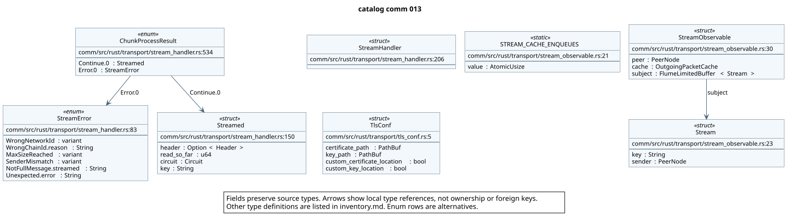

# catalog comm 013

[Inventory](inventory.md) | [PlantUML](catalog-comm-013.puml)

## Cross-Page References

- `Stream: sender -> PeerNode [catalog-comm-003.svg]`
- `StreamObservable: cache -> OutgoingPacketCache [catalog-comm-012.svg]`
- `StreamObservable: peer -> PeerNode [catalog-comm-003.svg]`
- `StreamObservable: subject -> FlumeLimitedBuffer [catalog-comm-011.svg]`
- `Streamed: circuit -> Circuit [catalog-comm-012.svg]`
- `Streamed: header -> Header [catalog-comm-012.svg]`
