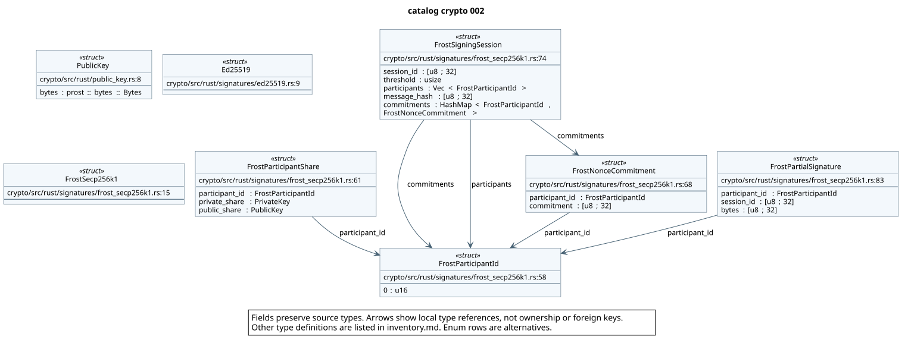

# catalog crypto 002

[Inventory](inventory.md) | [PlantUML](catalog-crypto-002.puml)

## Cardinality and Size

[Method, units, limits, and runtime evidence](sizing.md). These are declaration-level assessments, not measured live counts.

### PublicKey

Cardinality: 0..n live values. Current count and owner-level limits are not derivable from this declaration.

Size: Sum of field inline layouts plus compiler padding, then uniquely owned allocations. repr and custom implementations can change layout.

| Field or variant | Cardinality | Inline bytes or layout | Additional storage or wire encoding |
| --- | --- | --- | --- |
| `bytes` | 1 value | Compiler layout required | Follow the referenced declaration or external implementation. No allocation bound established. |

### Ed25519

Cardinality: 0..n live values. Current count and owner-level limits are not derivable from this declaration.

Size: Sum of field inline layouts plus compiler padding, then uniquely owned allocations. repr and custom implementations can change layout.

| Field or variant | Cardinality | Inline bytes or layout | Additional storage or wire encoding |
| --- | --- | --- | --- |
| No declared fields | 0 field payloads | Compiler layout required | No field-owned allocations |

### FrostSecp256k1

Cardinality: 0..n live values. Current count and owner-level limits are not derivable from this declaration.

Size: Sum of field inline layouts plus compiler padding, then uniquely owned allocations. repr and custom implementations can change layout.

| Field or variant | Cardinality | Inline bytes or layout | Additional storage or wire encoding |
| --- | --- | --- | --- |
| No declared fields | 0 field payloads | Compiler layout required | No field-owned allocations |

### FrostParticipantId

Cardinality: 0..n live values. Current count and owner-level limits are not derivable from this declaration.

Size: Sum of field inline layouts plus compiler padding, then uniquely owned allocations. repr and custom implementations can change layout.

| Field or variant | Cardinality | Inline bytes or layout | Additional storage or wire encoding |
| --- | --- | --- | --- |
| `0` | 1 scalar | 2 B | None |

### FrostParticipantShare

Cardinality: 0..n live values. Current count and owner-level limits are not derivable from this declaration.

Size: Sum of field inline layouts plus compiler padding, then uniquely owned allocations. repr and custom implementations can change layout.

| Field or variant | Cardinality | Inline bytes or layout | Additional storage or wire encoding |
| --- | --- | --- | --- |
| `participant_id` | 1 value | Compiler layout required | Follow the referenced declaration or external implementation. No allocation bound established. |
| `private_share` | 1 value | Compiler layout required | Follow the referenced declaration or external implementation. No allocation bound established. |
| `public_share` | 1 value | Compiler layout required | Follow the referenced declaration or external implementation. No allocation bound established. |

### FrostNonceCommitment

Cardinality: 0..n live values. Current count and owner-level limits are not derivable from this declaration.

Size: Sum of field inline layouts plus compiler padding, then uniquely owned allocations. repr and custom implementations can change layout.

| Field or variant | Cardinality | Inline bytes or layout | Additional storage or wire encoding |
| --- | --- | --- | --- |
| `participant_id` | 1 value | Compiler layout required | Follow the referenced declaration or external implementation. No allocation bound established. |
| `commitment` | 32 elements | 32 B. 32 * I(element), inline array | Sum of element-owned allocations. Element: None |

### FrostSigningSession

Cardinality: 0..n live values. Current count and owner-level limits are not derivable from this declaration.

Size: Sum of field inline layouts plus compiler padding, then uniquely owned allocations. repr and custom implementations can change layout.

| Field or variant | Cardinality | Inline bytes or layout | Additional storage or wire encoding |
| --- | --- | --- | --- |
| `session_id` | 32 elements | 32 B. 32 * I(element), inline array | Sum of element-owned allocations. Element: None |
| `threshold` | 1 scalar | 8 B | None |
| `participants` | 0..n elements | 24 B. Vec header on the generator target | capacity * I(element), plus live element-owned allocations. Zero-sized elements need no backing allocation. Element: Follow the referenced declaration or external implementation. No allocation bound established. |
| `message_hash` | 32 elements | 32 B. 32 * I(element), inline array | Sum of element-owned allocations. Element: None |
| `commitments` | 0..n key/value pairs | Container and hasher implementation required | n keys and n values, their owned allocations, spare capacity, buckets or tree nodes, and control bytes. No type-level count cap |

### FrostPartialSignature

Cardinality: 0..n live values. Current count and owner-level limits are not derivable from this declaration.

Size: Sum of field inline layouts plus compiler padding, then uniquely owned allocations. repr and custom implementations can change layout.

| Field or variant | Cardinality | Inline bytes or layout | Additional storage or wire encoding |
| --- | --- | --- | --- |
| `participant_id` | 1 value | Compiler layout required | Follow the referenced declaration or external implementation. No allocation bound established. |
| `session_id` | 32 elements | 32 B. 32 * I(element), inline array | Sum of element-owned allocations. Element: None |
| `bytes` | 32 elements | 32 B. 32 * I(element), inline array | Sum of element-owned allocations. Element: None |

## Cross-Page References

- `FrostParticipantShare: private_share -> PrivateKey [catalog-crypto-001.svg]`
