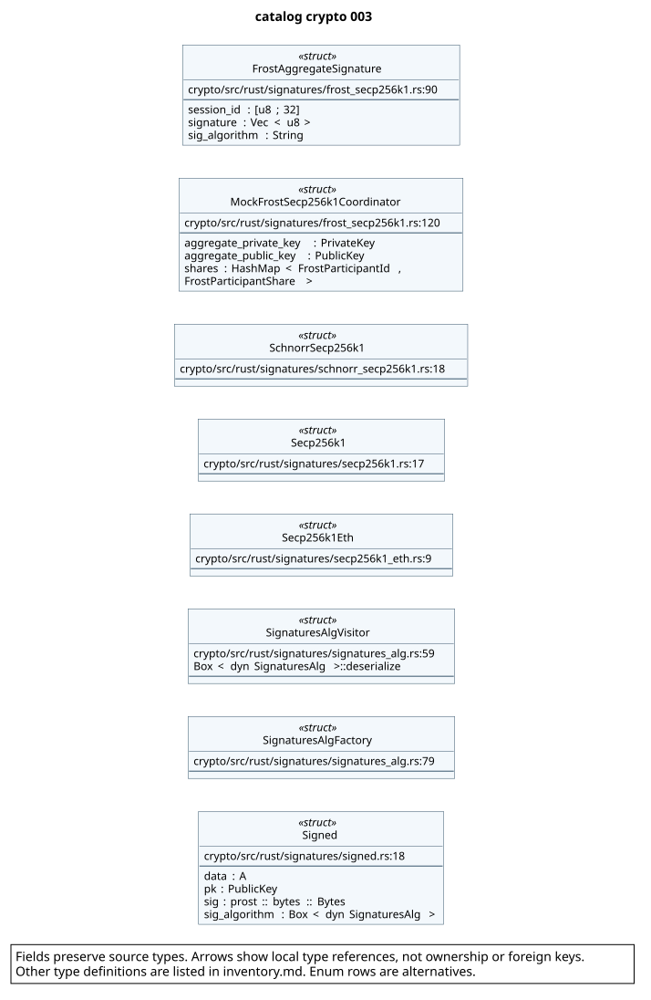

# catalog crypto 003

[Inventory](inventory.md) | [PlantUML](catalog-crypto-003.puml)

## Cross-Page References

- `MockFrostSecp256k1Coordinator: aggregate_private_key -> PrivateKey [catalog-crypto-001.svg]`
- `MockFrostSecp256k1Coordinator: shares -> FrostParticipantId [catalog-crypto-002.svg]`
- `MockFrostSecp256k1Coordinator: shares -> FrostParticipantShare [catalog-crypto-002.svg]`
