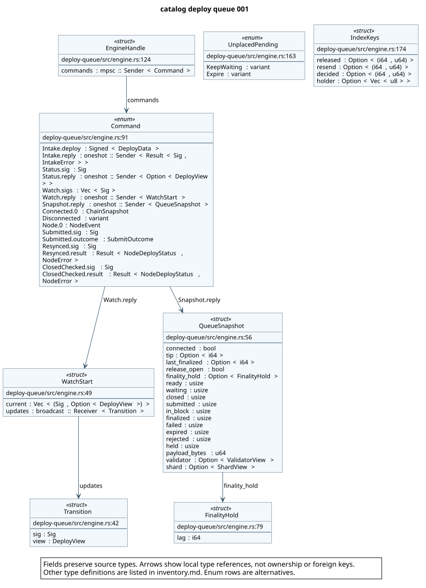

# catalog deploy queue 001

[Inventory](inventory.md) | [PlantUML](catalog-deploy-queue-001.puml)

## Cardinality and Size

[Method, units, limits, and runtime evidence](sizing.md). These are declaration-level assessments, not measured live counts.

### Transition

Cardinality: 0..n live values. Current count and owner-level limits are not derivable from this declaration.

Size: Sum of field inline layouts plus compiler padding, then uniquely owned allocations. repr and custom implementations can change layout.

| Field or variant | Cardinality | Inline bytes or layout | Additional storage or wire encoding |
| --- | --- | --- | --- |
| `sig` | 1 value | Compiler layout required | Follow the referenced declaration or external implementation. No allocation bound established. |
| `view` | 1 value | Compiler layout required | Follow the referenced declaration or external implementation. No allocation bound established. |

### WatchStart

Cardinality: 0..n live values. Current count and owner-level limits are not derivable from this declaration.

Size: Sum of field inline layouts plus compiler padding, then uniquely owned allocations. repr and custom implementations can change layout.

| Field or variant | Cardinality | Inline bytes or layout | Additional storage or wire encoding |
| --- | --- | --- | --- |
| `current` | 0..n elements | 24 B. Vec header on the generator target | capacity * I(element), plus live element-owned allocations. Zero-sized elements need no backing allocation. Element: Sum of component-owned allocations |
| `updates` | 1 value | Compiler layout required | Follow the referenced declaration or external implementation. No allocation bound established. |

### QueueSnapshot

Cardinality: 0..n live values. Current count and owner-level limits are not derivable from this declaration.

Size: Sum of field inline layouts plus compiler padding, then uniquely owned allocations. repr and custom implementations can change layout.

| Field or variant | Cardinality | Inline bytes or layout | Additional storage or wire encoding |
| --- | --- | --- | --- |
| `connected` | 1 scalar | 1 B | None |
| `tip` | 0..1 present payload | Option layout includes any tag or niche optimization. Do not assume I(T) + 1 | None when absent. Present payload: 1 scalar. None |
| `last_finalized` | 0..1 present payload | Option layout includes any tag or niche optimization. Do not assume I(T) + 1 | None when absent. Present payload: 1 scalar. None |
| `release_open` | 1 scalar | 1 B | None |
| `finality_hold` | 0..1 present payload | Option layout includes any tag or niche optimization. Do not assume I(T) + 1 | None when absent. Present payload: 1 value. Follow the referenced declaration or external implementation. No allocation bound established. |
| `ready` | 1 scalar | 8 B | None |
| `waiting` | 1 scalar | 8 B | None |
| `closed` | 1 scalar | 8 B | None |
| `submitted` | 1 scalar | 8 B | None |
| `in_block` | 1 scalar | 8 B | None |
| `finalized` | 1 scalar | 8 B | None |
| `failed` | 1 scalar | 8 B | None |
| `expired` | 1 scalar | 8 B | None |
| `rejected` | 1 scalar | 8 B | None |
| `held` | 1 scalar | 8 B | None |
| `payload_bytes` | 1 scalar | 8 B | None |
| `validator` | 0..1 present payload | Option layout includes any tag or niche optimization. Do not assume I(T) + 1 | None when absent. Present payload: 1 value. Follow the referenced declaration or external implementation. No allocation bound established. |
| `shard` | 0..1 present payload | Option layout includes any tag or niche optimization. Do not assume I(T) + 1 | None when absent. Present payload: 1 value. Follow the referenced declaration or external implementation. No allocation bound established. |

### FinalityHold

Cardinality: 0..n live values. Current count and owner-level limits are not derivable from this declaration.

Size: Sum of field inline layouts plus compiler padding, then uniquely owned allocations. repr and custom implementations can change layout.

| Field or variant | Cardinality | Inline bytes or layout | Additional storage or wire encoding |
| --- | --- | --- | --- |
| `lag` | 1 scalar | 8 B | None |

### Command

Cardinality: 0..n live values. Current count and owner-level limits are not derivable from this declaration.

Size: Compiler enum layout plus allocations of the active variant only. Do not sum alternative variants.

| Field or variant | Cardinality | Inline bytes or layout | Additional storage or wire encoding |
| --- | --- | --- | --- |
| `Intake.deploy` | 1 value when this variant is active | Compiler layout required | Follow the referenced declaration or external implementation. No allocation bound established. |
| `Intake.reply` | 1 value when this variant is active | Compiler layout required | Follow the referenced declaration or external implementation. No allocation bound established. |
| `Status.sig` | 1 value when this variant is active | Compiler layout required | Follow the referenced declaration or external implementation. No allocation bound established. |
| `Status.reply` | 1 value when this variant is active | Compiler layout required | Follow the referenced declaration or external implementation. No allocation bound established. |
| `Watch.sigs` | 0..n elements when this variant is active | 24 B. Vec header on the generator target | capacity * I(element), plus live element-owned allocations. Zero-sized elements need no backing allocation. Element: Follow the referenced declaration or external implementation. No allocation bound established. |
| `Watch.reply` | 1 value when this variant is active | Compiler layout required | Follow the referenced declaration or external implementation. No allocation bound established. |
| `Snapshot.reply` | 1 value when this variant is active | Compiler layout required | Follow the referenced declaration or external implementation. No allocation bound established. |
| `Connected.0` | 1 value when this variant is active | Compiler layout required | Follow the referenced declaration or external implementation. No allocation bound established. |
| `Disconnected` | 1 mutually exclusive alternative | No payload. Enum discriminant layout required | None for this unit variant |
| `Node.0` | 1 value when this variant is active | Compiler layout required | Follow the referenced declaration or external implementation. No allocation bound established. |
| `Submitted.sig` | 1 value when this variant is active | Compiler layout required | Follow the referenced declaration or external implementation. No allocation bound established. |
| `Submitted.outcome` | 1 value when this variant is active | Compiler layout required | Follow the referenced declaration or external implementation. No allocation bound established. |
| `Resynced.sig` | 1 value when this variant is active | Compiler layout required | Follow the referenced declaration or external implementation. No allocation bound established. |
| `Resynced.result` | 1 of 2 alternatives when this variant is active | Maximum variant layout plus compiler tag and padding | Only the active Ok or Err payload contributes owned allocations |
| `ClosedChecked.sig` | 1 value when this variant is active | Compiler layout required | Follow the referenced declaration or external implementation. No allocation bound established. |
| `ClosedChecked.result` | 1 of 2 alternatives when this variant is active | Maximum variant layout plus compiler tag and padding | Only the active Ok or Err payload contributes owned allocations |

### EngineHandle

Cardinality: 0..n live values. Current count and owner-level limits are not derivable from this declaration.

Size: Sum of field inline layouts plus compiler padding, then uniquely owned allocations. repr and custom implementations can change layout.

| Field or variant | Cardinality | Inline bytes or layout | Additional storage or wire encoding |
| --- | --- | --- | --- |
| `commands` | 1 value | Compiler layout required | Follow the referenced declaration or external implementation. No allocation bound established. |

### UnplacedPending

Cardinality: 0..n live values. Current count and owner-level limits are not derivable from this declaration.

Size: Compiler enum layout plus allocations of the active variant only. Do not sum alternative variants.

| Field or variant | Cardinality | Inline bytes or layout | Additional storage or wire encoding |
| --- | --- | --- | --- |
| `KeepWaiting` | 1 mutually exclusive alternative | No payload. Enum discriminant layout required | None for this unit variant |
| `Expire` | 1 mutually exclusive alternative | No payload. Enum discriminant layout required | None for this unit variant |

### IndexKeys

Cardinality: 0..n live values. Current count and owner-level limits are not derivable from this declaration.

Size: Sum of field inline layouts plus compiler padding, then uniquely owned allocations. repr and custom implementations can change layout.

| Field or variant | Cardinality | Inline bytes or layout | Additional storage or wire encoding |
| --- | --- | --- | --- |
| `released` | 0..1 present payload | Option layout includes any tag or niche optimization. Do not assume I(T) + 1 | None when absent. Present payload: 2 component values. Sum of component-owned allocations |
| `resend` | 0..1 present payload | Option layout includes any tag or niche optimization. Do not assume I(T) + 1 | None when absent. Present payload: 2 component values. Sum of component-owned allocations |
| `decided` | 0..1 present payload | Option layout includes any tag or niche optimization. Do not assume I(T) + 1 | None when absent. Present payload: 2 component values. Sum of component-owned allocations |
| `holder` | 0..1 present payload | Option layout includes any tag or niche optimization. Do not assume I(T) + 1 | None when absent. Present payload: 0..n elements. capacity * I(element), plus live element-owned allocations. Zero-sized elements need no backing allocation. Element: None |

## Cross-Page References

- `Command: ClosedChecked.result -> NodeDeployStatus [catalog-deploy-queue-006.svg]`
- `Command: ClosedChecked.result -> NodeError [catalog-deploy-queue-005.svg]`
- `Command: ClosedChecked.sig -> Sig [catalog-deploy-queue-006.svg]`
- `Command: Connected.0 -> ChainSnapshot [catalog-deploy-queue-006.svg]`
- `Command: Intake.deploy -> Signed [catalog-crypto-003.svg]`
- `Command: Intake.reply -> IntakeError [catalog-deploy-queue-002.svg]`
- `Command: Intake.reply -> Sig [catalog-deploy-queue-006.svg]`
- `Command: Node.0 -> NodeEvent [catalog-deploy-queue-003.svg]`
- `Command: Resynced.result -> NodeDeployStatus [catalog-deploy-queue-006.svg]`
- `Command: Resynced.result -> NodeError [catalog-deploy-queue-005.svg]`
- `Command: Resynced.sig -> Sig [catalog-deploy-queue-006.svg]`
- `Command: Status.reply -> DeployView [catalog-deploy-queue-007.svg]`
- `Command: Status.sig -> Sig [catalog-deploy-queue-006.svg]`
- `Command: Submitted.outcome -> SubmitOutcome [catalog-deploy-queue-006.svg]`
- `Command: Submitted.sig -> Sig [catalog-deploy-queue-006.svg]`
- `Command: Watch.sigs -> Sig [catalog-deploy-queue-006.svg]`
- `QueueSnapshot: shard -> ShardView [catalog-deploy-queue-005.svg]`
- `QueueSnapshot: validator -> ValidatorView [catalog-deploy-queue-005.svg]`
- `Transition: sig -> Sig [catalog-deploy-queue-006.svg]`
- `Transition: view -> DeployView [catalog-deploy-queue-007.svg]`
- `WatchStart: current -> DeployView [catalog-deploy-queue-007.svg]`
- `WatchStart: current -> Sig [catalog-deploy-queue-006.svg]`
