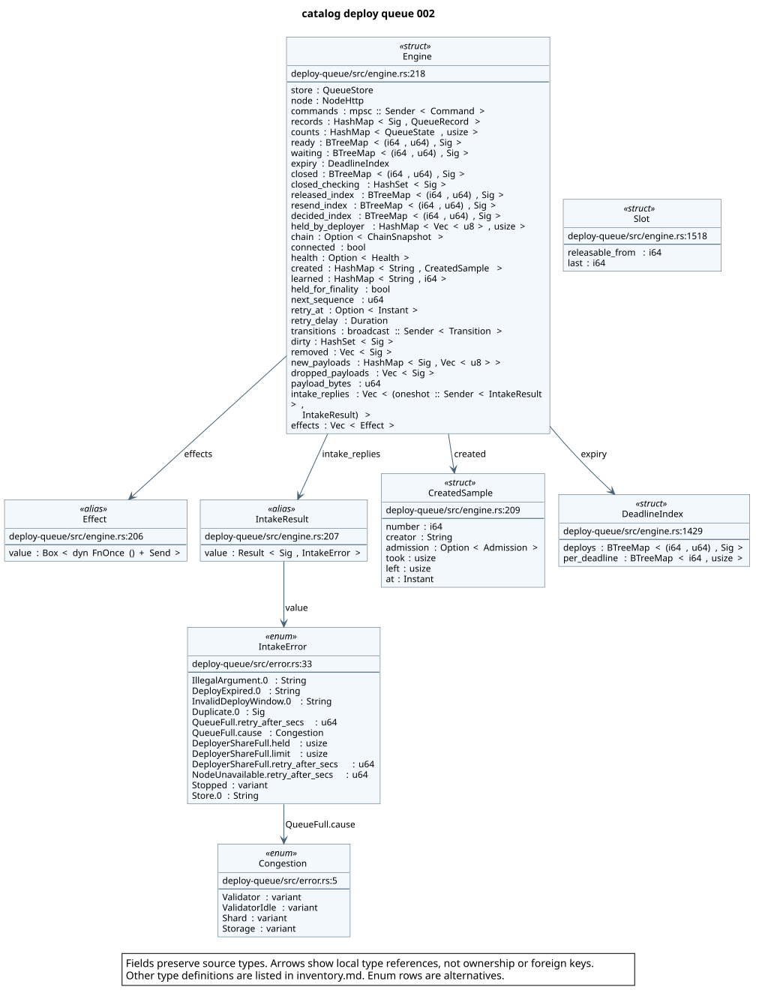

# catalog deploy queue 002

[Inventory](inventory.md) | [PlantUML](catalog-deploy-queue-002.puml)

## Cross-Page References

- `CreatedSample: admission -> Admission [catalog-deploy-queue-003.svg]`
- `DeadlineIndex: deploys -> Sig [catalog-deploy-queue-006.svg]`
- `Engine: chain -> ChainSnapshot [catalog-deploy-queue-006.svg]`
- `Engine: closed -> Sig [catalog-deploy-queue-006.svg]`
- `Engine: closed_checking -> Sig [catalog-deploy-queue-006.svg]`
- `Engine: commands -> Command [catalog-deploy-queue-001.svg]`
- `Engine: counts -> QueueState [catalog-deploy-queue-007.svg]`
- `Engine: decided_index -> Sig [catalog-deploy-queue-006.svg]`
- `Engine: dirty -> Sig [catalog-deploy-queue-006.svg]`
- `Engine: dropped_payloads -> Sig [catalog-deploy-queue-006.svg]`
- `Engine: health -> Health [catalog-deploy-queue-005.svg]`
- `Engine: new_payloads -> Sig [catalog-deploy-queue-006.svg]`
- `Engine: node -> NodeHttp [catalog-deploy-queue-006.svg]`
- `Engine: ready -> Sig [catalog-deploy-queue-006.svg]`
- `Engine: records -> QueueRecord [catalog-deploy-queue-007.svg]`
- `Engine: records -> Sig [catalog-deploy-queue-006.svg]`
- `Engine: released_index -> Sig [catalog-deploy-queue-006.svg]`
- `Engine: removed -> Sig [catalog-deploy-queue-006.svg]`
- `Engine: resend_index -> Sig [catalog-deploy-queue-006.svg]`
- `Engine: store -> QueueStore [catalog-deploy-queue-007.svg]`
- `Engine: transitions -> Transition [catalog-deploy-queue-001.svg]`
- `Engine: waiting -> Sig [catalog-deploy-queue-006.svg]`
- `IntakeError: Duplicate.0 -> Sig [catalog-deploy-queue-006.svg]`
- `IntakeResult: value -> Sig [catalog-deploy-queue-006.svg]`
