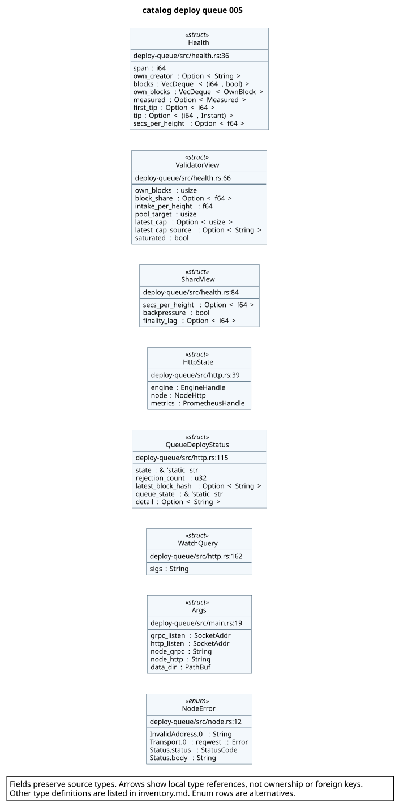

# catalog deploy queue 005

[Inventory](inventory.md) | [PlantUML](catalog-deploy-queue-005.puml)

## Cross-Page References

- `Health: measured -> Measured [catalog-deploy-queue-004.svg]`
- `Health: own_blocks -> OwnBlock [catalog-deploy-queue-004.svg]`
- `HttpState: engine -> EngineHandle [catalog-deploy-queue-001.svg]`
- `HttpState: node -> NodeHttp [catalog-deploy-queue-006.svg]`
