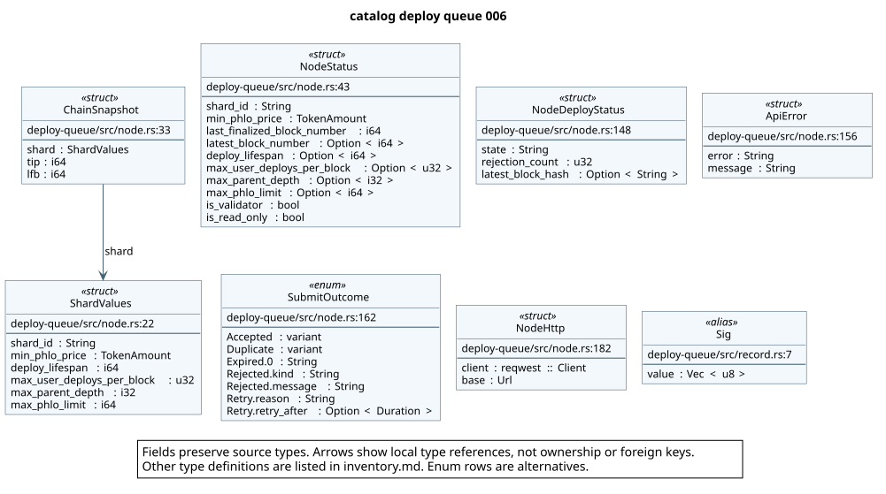

# catalog deploy queue 006

[Inventory](inventory.md) | [PlantUML](catalog-deploy-queue-006.puml)

## Cross-Page References

- `NodeStatus: min_phlo_price -> TokenAmount [catalog-shared-009.svg]`
- `ShardValues: min_phlo_price -> TokenAmount [catalog-shared-009.svg]`
