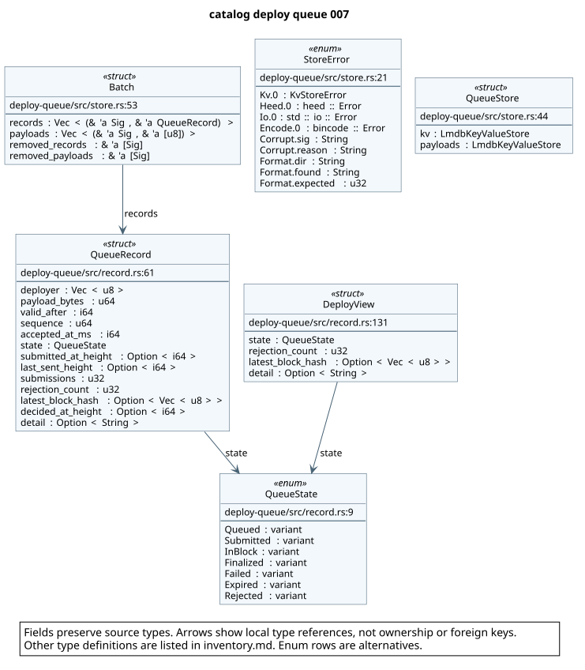

# catalog deploy queue 007

[Inventory](inventory.md) | [PlantUML](catalog-deploy-queue-007.puml)

## Cardinality and Size

[Method, units, limits, and runtime evidence](sizing.md). These are declaration-level assessments, not measured live counts.

### QueueState

Cardinality: 0..n live values. Current count and owner-level limits are not derivable from this declaration.

Size: Compiler enum layout plus allocations of the active variant only. Do not sum alternative variants.

| Field or variant | Cardinality | Inline bytes or layout | Additional storage or wire encoding |
| --- | --- | --- | --- |
| `Queued` | 1 mutually exclusive alternative | No payload. Enum discriminant layout required | None for this unit variant |
| `Submitted` | 1 mutually exclusive alternative | No payload. Enum discriminant layout required | None for this unit variant |
| `InBlock` | 1 mutually exclusive alternative | No payload. Enum discriminant layout required | None for this unit variant |
| `Finalized` | 1 mutually exclusive alternative | No payload. Enum discriminant layout required | None for this unit variant |
| `Failed` | 1 mutually exclusive alternative | No payload. Enum discriminant layout required | None for this unit variant |
| `Expired` | 1 mutually exclusive alternative | No payload. Enum discriminant layout required | None for this unit variant |
| `Rejected` | 1 mutually exclusive alternative | No payload. Enum discriminant layout required | None for this unit variant |

### QueueRecord

Cardinality: 0..n live values. Current count and owner-level limits are not derivable from this declaration.

Size: Sum of field inline layouts plus compiler padding, then uniquely owned allocations. repr and custom implementations can change layout.

| Field or variant | Cardinality | Inline bytes or layout | Additional storage or wire encoding |
| --- | --- | --- | --- |
| `deployer` | 0..n elements | 24 B. Vec header on the generator target | capacity * I(element), plus live element-owned allocations. Zero-sized elements need no backing allocation. Element: None |
| `payload_bytes` | 1 scalar | 8 B | None |
| `valid_after` | 1 scalar | 8 B | None |
| `sequence` | 1 scalar | 8 B | None |
| `accepted_at_ms` | 1 scalar | 8 B | None |
| `state` | 1 value | Compiler layout required | Follow the referenced declaration or external implementation. No allocation bound established. |
| `submitted_at_height` | 0..1 present payload | Option layout includes any tag or niche optimization. Do not assume I(T) + 1 | None when absent. Present payload: 1 scalar. None |
| `last_sent_height` | 0..1 present payload | Option layout includes any tag or niche optimization. Do not assume I(T) + 1 | None when absent. Present payload: 1 scalar. None |
| `submissions` | 1 scalar | 4 B | None |
| `rejection_count` | 1 scalar | 4 B | None |
| `latest_block_hash` | 0..1 present payload | Option layout includes any tag or niche optimization. Do not assume I(T) + 1 | None when absent. Present payload: 0..n elements. capacity * I(element), plus live element-owned allocations. Zero-sized elements need no backing allocation. Element: None |
| `decided_at_height` | 0..1 present payload | Option layout includes any tag or niche optimization. Do not assume I(T) + 1 | None when absent. Present payload: 1 scalar. None |
| `detail` | 0..1 present payload | Option layout includes any tag or niche optimization. Do not assume I(T) + 1 | None when absent. Present payload: 0..n UTF-8 bytes. capacity() bytes, excluding allocator overhead. UTF-8 byte length is not character count |

### DeployView

Cardinality: 0..n live values. Current count and owner-level limits are not derivable from this declaration.

Size: Sum of field inline layouts plus compiler padding, then uniquely owned allocations. repr and custom implementations can change layout.

| Field or variant | Cardinality | Inline bytes or layout | Additional storage or wire encoding |
| --- | --- | --- | --- |
| `state` | 1 value | Compiler layout required | Follow the referenced declaration or external implementation. No allocation bound established. |
| `rejection_count` | 1 scalar | 4 B | None |
| `latest_block_hash` | 0..1 present payload | Option layout includes any tag or niche optimization. Do not assume I(T) + 1 | None when absent. Present payload: 0..n elements. capacity * I(element), plus live element-owned allocations. Zero-sized elements need no backing allocation. Element: None |
| `detail` | 0..1 present payload | Option layout includes any tag or niche optimization. Do not assume I(T) + 1 | None when absent. Present payload: 0..n UTF-8 bytes. capacity() bytes, excluding allocator overhead. UTF-8 byte length is not character count |

### StoreError

Cardinality: 0..n live values. Current count and owner-level limits are not derivable from this declaration.

Size: Compiler enum layout plus allocations of the active variant only. Do not sum alternative variants.

| Field or variant | Cardinality | Inline bytes or layout | Additional storage or wire encoding |
| --- | --- | --- | --- |
| `Kv.0` | 1 value when this variant is active | Compiler layout required | Follow the referenced declaration or external implementation. No allocation bound established. |
| `Heed.0` | 1 value when this variant is active | Compiler layout required | Follow the referenced declaration or external implementation. No allocation bound established. |
| `Io.0` | 1 value when this variant is active | Compiler layout required | Follow the referenced declaration or external implementation. No allocation bound established. |
| `Encode.0` | 1 value when this variant is active | Compiler layout required | Follow the referenced declaration or external implementation. No allocation bound established. |
| `Corrupt.sig` | 0..n UTF-8 bytes when this variant is active | 24 B. String header on the generator target | capacity() bytes, excluding allocator overhead. UTF-8 byte length is not character count |
| `Corrupt.reason` | 0..n UTF-8 bytes when this variant is active | 24 B. String header on the generator target | capacity() bytes, excluding allocator overhead. UTF-8 byte length is not character count |
| `Format.dir` | 0..n UTF-8 bytes when this variant is active | 24 B. String header on the generator target | capacity() bytes, excluding allocator overhead. UTF-8 byte length is not character count |
| `Format.found` | 0..n UTF-8 bytes when this variant is active | 24 B. String header on the generator target | capacity() bytes, excluding allocator overhead. UTF-8 byte length is not character count |
| `Format.expected` | 1 scalar when this variant is active | 4 B | None |

### QueueStore

Cardinality: 0..n live values. Current count and owner-level limits are not derivable from this declaration.

Size: Sum of field inline layouts plus compiler padding, then uniquely owned allocations. repr and custom implementations can change layout.

| Field or variant | Cardinality | Inline bytes or layout | Additional storage or wire encoding |
| --- | --- | --- | --- |
| `kv` | 1 value | Compiler layout required | Follow the referenced declaration or external implementation. No allocation bound established. |
| `payloads` | 1 value | Compiler layout required | Follow the referenced declaration or external implementation. No allocation bound established. |

### Batch

Cardinality: 0..n live values. Current count and owner-level limits are not derivable from this declaration.

Size: Sum of field inline layouts plus compiler padding, then uniquely owned allocations. repr and custom implementations can change layout.

| Field or variant | Cardinality | Inline bytes or layout | Additional storage or wire encoding |
| --- | --- | --- | --- |
| `records` | 0..n elements | 24 B. Vec header on the generator target | capacity * I(element), plus live element-owned allocations. Zero-sized elements need no backing allocation. Element: Sum of component-owned allocations |
| `payloads` | 0..n elements | 24 B. Vec header on the generator target | capacity * I(element), plus live element-owned allocations. Zero-sized elements need no backing allocation. Element: Sum of component-owned allocations |
| `removed_records` | 1 borrowed reference | Pointer or fat pointer. Referent layout required | No owned allocation. Referent: 0..n elements |
| `removed_payloads` | 1 borrowed reference | Pointer or fat pointer. Referent layout required | No owned allocation. Referent: 0..n elements |

## Cross-Page References

- `Batch: payloads -> Sig [catalog-deploy-queue-006.svg]`
- `Batch: records -> Sig [catalog-deploy-queue-006.svg]`
- `Batch: removed_payloads -> Sig [catalog-deploy-queue-006.svg]`
- `Batch: removed_records -> Sig [catalog-deploy-queue-006.svg]`
- `QueueStore: kv -> LmdbKeyValueStore [catalog-shared-007.svg]`
- `QueueStore: payloads -> LmdbKeyValueStore [catalog-shared-007.svg]`
- `StoreError: Kv.0 -> KvStoreError [catalog-shared-007.svg]`
