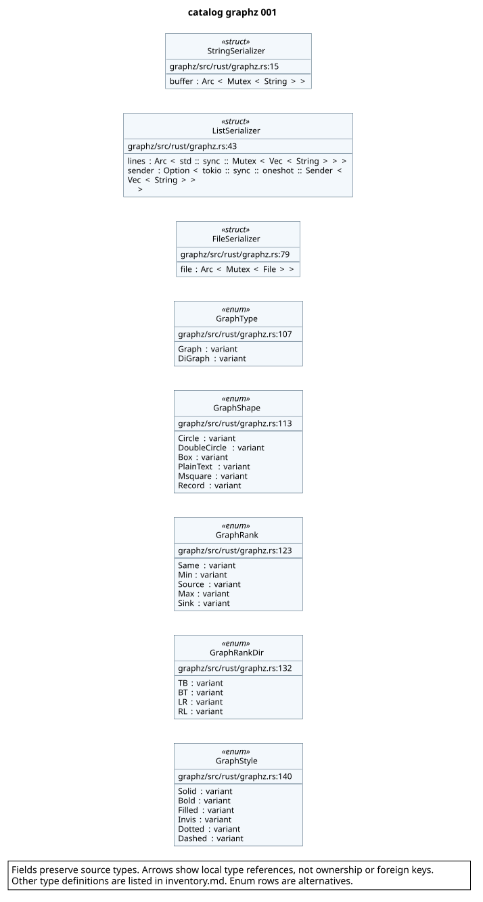

# catalog graphz 001

[Inventory](inventory.md) | [PlantUML](catalog-graphz-001.puml)

## Cardinality and Size

[Method, units, limits, and runtime evidence](sizing.md). These are declaration-level assessments, not measured live counts.

### StringSerializer

Cardinality: 0..n live values. Current count and owner-level limits are not derivable from this declaration.

Size: Sum of field inline layouts plus compiler padding, then uniquely owned allocations. repr and custom implementations can change layout.

| Field or variant | Cardinality | Inline bytes or layout | Additional storage or wire encoding |
| --- | --- | --- | --- |
| `buffer` | 1 shared strong reference | Pointer or fat pointer, depending on target type | One shared allocation holds the target, counters and alignment. Count it once across all handles |

### ListSerializer

Cardinality: 0..n live values. Current count and owner-level limits are not derivable from this declaration.

Size: Sum of field inline layouts plus compiler padding, then uniquely owned allocations. repr and custom implementations can change layout.

| Field or variant | Cardinality | Inline bytes or layout | Additional storage or wire encoding |
| --- | --- | --- | --- |
| `lines` | 1 shared strong reference | Pointer or fat pointer, depending on target type | One shared allocation holds the target, counters and alignment. Count it once across all handles |
| `sender` | 0..1 present payload | Option layout includes any tag or niche optimization. Do not assume I(T) + 1 | None when absent. Present payload: 1 value. Follow the referenced declaration or external implementation. No allocation bound established. |

### FileSerializer

Cardinality: 0..n live values. Current count and owner-level limits are not derivable from this declaration.

Size: Sum of field inline layouts plus compiler padding, then uniquely owned allocations. repr and custom implementations can change layout.

| Field or variant | Cardinality | Inline bytes or layout | Additional storage or wire encoding |
| --- | --- | --- | --- |
| `file` | 1 shared strong reference | Pointer or fat pointer, depending on target type | One shared allocation holds the target, counters and alignment. Count it once across all handles |

### GraphType

Cardinality: 0..n live values. Current count and owner-level limits are not derivable from this declaration.

Size: Compiler enum layout plus allocations of the active variant only. Do not sum alternative variants.

| Field or variant | Cardinality | Inline bytes or layout | Additional storage or wire encoding |
| --- | --- | --- | --- |
| `Graph` | 1 mutually exclusive alternative | No payload. Enum discriminant layout required | None for this unit variant |
| `DiGraph` | 1 mutually exclusive alternative | No payload. Enum discriminant layout required | None for this unit variant |

### GraphShape

Cardinality: 0..n live values. Current count and owner-level limits are not derivable from this declaration.

Size: Compiler enum layout plus allocations of the active variant only. Do not sum alternative variants.

| Field or variant | Cardinality | Inline bytes or layout | Additional storage or wire encoding |
| --- | --- | --- | --- |
| `Circle` | 1 mutually exclusive alternative | No payload. Enum discriminant layout required | None for this unit variant |
| `DoubleCircle` | 1 mutually exclusive alternative | No payload. Enum discriminant layout required | None for this unit variant |
| `Box` | 1 mutually exclusive alternative | No payload. Enum discriminant layout required | None for this unit variant |
| `PlainText` | 1 mutually exclusive alternative | No payload. Enum discriminant layout required | None for this unit variant |
| `Msquare` | 1 mutually exclusive alternative | No payload. Enum discriminant layout required | None for this unit variant |
| `Record` | 1 mutually exclusive alternative | No payload. Enum discriminant layout required | None for this unit variant |

### GraphRank

Cardinality: 0..n live values. Current count and owner-level limits are not derivable from this declaration.

Size: Compiler enum layout plus allocations of the active variant only. Do not sum alternative variants.

| Field or variant | Cardinality | Inline bytes or layout | Additional storage or wire encoding |
| --- | --- | --- | --- |
| `Same` | 1 mutually exclusive alternative | No payload. Enum discriminant layout required | None for this unit variant |
| `Min` | 1 mutually exclusive alternative | No payload. Enum discriminant layout required | None for this unit variant |
| `Source` | 1 mutually exclusive alternative | No payload. Enum discriminant layout required | None for this unit variant |
| `Max` | 1 mutually exclusive alternative | No payload. Enum discriminant layout required | None for this unit variant |
| `Sink` | 1 mutually exclusive alternative | No payload. Enum discriminant layout required | None for this unit variant |

### GraphRankDir

Cardinality: 0..n live values. Current count and owner-level limits are not derivable from this declaration.

Size: Compiler enum layout plus allocations of the active variant only. Do not sum alternative variants.

| Field or variant | Cardinality | Inline bytes or layout | Additional storage or wire encoding |
| --- | --- | --- | --- |
| `TB` | 1 mutually exclusive alternative | No payload. Enum discriminant layout required | None for this unit variant |
| `BT` | 1 mutually exclusive alternative | No payload. Enum discriminant layout required | None for this unit variant |
| `LR` | 1 mutually exclusive alternative | No payload. Enum discriminant layout required | None for this unit variant |
| `RL` | 1 mutually exclusive alternative | No payload. Enum discriminant layout required | None for this unit variant |

### GraphStyle

Cardinality: 0..n live values. Current count and owner-level limits are not derivable from this declaration.

Size: Compiler enum layout plus allocations of the active variant only. Do not sum alternative variants.

| Field or variant | Cardinality | Inline bytes or layout | Additional storage or wire encoding |
| --- | --- | --- | --- |
| `Solid` | 1 mutually exclusive alternative | No payload. Enum discriminant layout required | None for this unit variant |
| `Bold` | 1 mutually exclusive alternative | No payload. Enum discriminant layout required | None for this unit variant |
| `Filled` | 1 mutually exclusive alternative | No payload. Enum discriminant layout required | None for this unit variant |
| `Invis` | 1 mutually exclusive alternative | No payload. Enum discriminant layout required | None for this unit variant |
| `Dotted` | 1 mutually exclusive alternative | No payload. Enum discriminant layout required | None for this unit variant |
| `Dashed` | 1 mutually exclusive alternative | No payload. Enum discriminant layout required | None for this unit variant |

## Cross-Page References

No resolved cross-page references.
