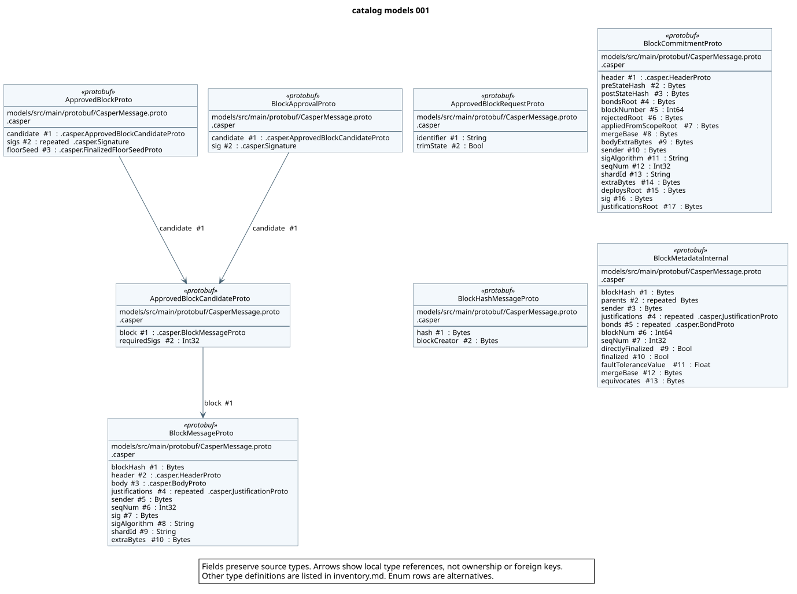

# catalog models 001

[Inventory](inventory.md) | [PlantUML](catalog-models-001.puml)

## Cross-Page References

- `ApprovedBlockProto: floorSeed #3 -> FinalizedFloorSeedProto [catalog-models-003.svg]`
- `ApprovedBlockProto: sigs #2 -> Signature [catalog-models-006.svg]`
- `BlockApprovalProto: sig #2 -> Signature [catalog-models-006.svg]`
- `BlockCommitmentProto: header #1 -> HeaderProto [catalog-models-004.svg]`
- `BlockMessageProto: body #3 -> BodyProto [catalog-models-002.svg]`
- `BlockMessageProto: header #2 -> HeaderProto [catalog-models-004.svg]`
- `BlockMessageProto: justifications #4 -> JustificationProto [catalog-models-005.svg]`
- `BlockMetadataInternal: bonds #5 -> BondProto [catalog-models-002.svg]`
- `BlockMetadataInternal: justifications #4 -> JustificationProto [catalog-models-005.svg]`
