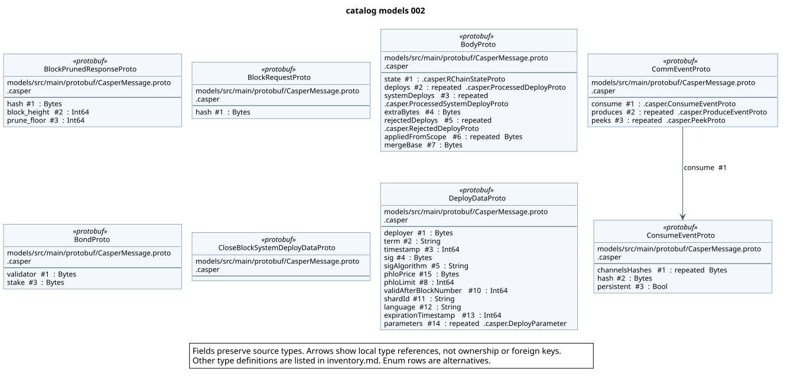

# catalog models 002

[Inventory](inventory.md) | [PlantUML](catalog-models-002.puml)

## Cardinality and Size

[Method, units, limits, and runtime evidence](sizing.md). These are declaration-level assessments, not measured live counts.

### BlockPrunedResponseProto

Cardinality: 0..n live values. Current count and owner-level limits are not derivable from this declaration.

Size: Generated Rust layout plus owned allocations. Encoded size is the sum of present field encodings.

| Field or variant | Cardinality | Inline bytes or layout | Additional storage or wire encoding |
| --- | --- | --- | --- |
| `hash #1` | 0..1 encoded value for these proto3 schemas | Generated Rust field layout required. Wire size is not heap size | Wire when present: tag + v(L) + L bytes, where L is the byte length. Defaults can be omitted. tag = v((field_number << 3) &#124; wire_type) |
| `block_height #2` | 0..1 encoded value for these proto3 schemas | Generated Rust field layout required. Wire size is not heap size | Wire when present: tag + 1..10 B varint. Defaults can be omitted. tag = v((field_number << 3) &#124; wire_type) |
| `prune_floor #3` | 0..1 encoded value for these proto3 schemas | Generated Rust field layout required. Wire size is not heap size | Wire when present: tag + 1..10 B varint. Defaults can be omitted. tag = v((field_number << 3) &#124; wire_type) |

### BlockRequestProto

Cardinality: 0..n live values. Current count and owner-level limits are not derivable from this declaration.

Size: Generated Rust layout plus owned allocations. Encoded size is the sum of present field encodings.

| Field or variant | Cardinality | Inline bytes or layout | Additional storage or wire encoding |
| --- | --- | --- | --- |
| `hash #1` | 0..1 encoded value for these proto3 schemas | Generated Rust field layout required. Wire size is not heap size | Wire when present: tag + v(L) + L bytes, where L is the byte length. Defaults can be omitted. tag = v((field_number << 3) &#124; wire_type) |

### BodyProto

Cardinality: 0..n live values. Current count and owner-level limits are not derivable from this declaration.

Size: Generated Rust layout plus owned allocations. Encoded size is the sum of present field encodings.

| Field or variant | Cardinality | Inline bytes or layout | Additional storage or wire encoding |
| --- | --- | --- | --- |
| `state #1` | 0..1 encoded value for these proto3 schemas | Generated Rust field layout required. Wire size is not heap size | Wire when present: tag + Nested message: v(P) + P bytes. Enum: 1..10 B varint. Resolve the referenced declaration. Defaults can be omitted. tag = v((field_number << 3) &#124; wire_type) |
| `deploys #2` | 0..n encoded values | Generated Rust field layout required. Wire size is not heap size | Wire element: Nested message: v(P) + P bytes. Enum: 1..10 B varint. Resolve the referenced declaration. Unpacked: sum(tag + element). Packed numeric field: tag + v(sum(elements)) + sum(elements). Encoding depends on field options |
| `systemDeploys #3` | 0..n encoded values | Generated Rust field layout required. Wire size is not heap size | Wire element: Nested message: v(P) + P bytes. Enum: 1..10 B varint. Resolve the referenced declaration. Unpacked: sum(tag + element). Packed numeric field: tag + v(sum(elements)) + sum(elements). Encoding depends on field options |
| `extraBytes #4` | 0..1 encoded value for these proto3 schemas | Generated Rust field layout required. Wire size is not heap size | Wire when present: tag + v(L) + L bytes, where L is the byte length. Defaults can be omitted. tag = v((field_number << 3) &#124; wire_type) |
| `rejectedDeploys #5` | 0..n encoded values | Generated Rust field layout required. Wire size is not heap size | Wire element: Nested message: v(P) + P bytes. Enum: 1..10 B varint. Resolve the referenced declaration. Unpacked: sum(tag + element). Packed numeric field: tag + v(sum(elements)) + sum(elements). Encoding depends on field options |
| `appliedFromScope #6` | 0..n encoded values | Generated Rust field layout required. Wire size is not heap size | Wire element: v(L) + L bytes, where L is the byte length. Unpacked: sum(tag + element). Packed numeric field: tag + v(sum(elements)) + sum(elements). Encoding depends on field options |
| `mergeBase #7` | 0..1 encoded value for these proto3 schemas | Generated Rust field layout required. Wire size is not heap size | Wire when present: tag + v(L) + L bytes, where L is the byte length. Defaults can be omitted. tag = v((field_number << 3) &#124; wire_type) |

### BondProto

Cardinality: 0..n live values. Current count and owner-level limits are not derivable from this declaration.

Size: Generated Rust layout plus owned allocations. Encoded size is the sum of present field encodings.

| Field or variant | Cardinality | Inline bytes or layout | Additional storage or wire encoding |
| --- | --- | --- | --- |
| `validator #1` | 0..1 encoded value for these proto3 schemas | Generated Rust field layout required. Wire size is not heap size | Wire when present: tag + v(L) + L bytes, where L is the byte length. Defaults can be omitted. tag = v((field_number << 3) &#124; wire_type) |
| `stake #3` | 0..1 encoded value for these proto3 schemas | Generated Rust field layout required. Wire size is not heap size | Wire when present: tag + v(L) + L bytes, where L is the byte length. Defaults can be omitted. tag = v((field_number << 3) &#124; wire_type) |

### CloseBlockSystemDeployDataProto

Cardinality: 0..n live values. Current count and owner-level limits are not derivable from this declaration.

Size: Generated Rust layout plus owned allocations. Encoded size is the sum of present field encodings.

| Field or variant | Cardinality | Inline bytes or layout | Additional storage or wire encoding |
| --- | --- | --- | --- |
| No declared fields | 0 field payloads | Compiler layout required | No field-owned allocations |

### CommEventProto

Cardinality: 0..n live values. Current count and owner-level limits are not derivable from this declaration.

Size: Generated Rust layout plus owned allocations. Encoded size is the sum of present field encodings.

| Field or variant | Cardinality | Inline bytes or layout | Additional storage or wire encoding |
| --- | --- | --- | --- |
| `consume #1` | 0..1 encoded value for these proto3 schemas | Generated Rust field layout required. Wire size is not heap size | Wire when present: tag + Nested message: v(P) + P bytes. Enum: 1..10 B varint. Resolve the referenced declaration. Defaults can be omitted. tag = v((field_number << 3) &#124; wire_type) |
| `produces #2` | 0..n encoded values | Generated Rust field layout required. Wire size is not heap size | Wire element: Nested message: v(P) + P bytes. Enum: 1..10 B varint. Resolve the referenced declaration. Unpacked: sum(tag + element). Packed numeric field: tag + v(sum(elements)) + sum(elements). Encoding depends on field options |
| `peeks #3` | 0..n encoded values | Generated Rust field layout required. Wire size is not heap size | Wire element: Nested message: v(P) + P bytes. Enum: 1..10 B varint. Resolve the referenced declaration. Unpacked: sum(tag + element). Packed numeric field: tag + v(sum(elements)) + sum(elements). Encoding depends on field options |

### ConsumeEventProto

Cardinality: 0..n live values. Current count and owner-level limits are not derivable from this declaration.

Size: Generated Rust layout plus owned allocations. Encoded size is the sum of present field encodings.

| Field or variant | Cardinality | Inline bytes or layout | Additional storage or wire encoding |
| --- | --- | --- | --- |
| `channelsHashes #1` | 0..n encoded values | Generated Rust field layout required. Wire size is not heap size | Wire element: v(L) + L bytes, where L is the byte length. Unpacked: sum(tag + element). Packed numeric field: tag + v(sum(elements)) + sum(elements). Encoding depends on field options |
| `hash #2` | 0..1 encoded value for these proto3 schemas | Generated Rust field layout required. Wire size is not heap size | Wire when present: tag + v(L) + L bytes, where L is the byte length. Defaults can be omitted. tag = v((field_number << 3) &#124; wire_type) |
| `persistent #3` | 0..1 encoded value for these proto3 schemas | Generated Rust field layout required. Wire size is not heap size | Wire when present: tag + 1 B. Defaults can be omitted. tag = v((field_number << 3) &#124; wire_type) |

### DeployDataProto

Cardinality: 0..n live values. Current count and owner-level limits are not derivable from this declaration.

Size: Generated Rust layout plus owned allocations. Encoded size is the sum of present field encodings.

| Field or variant | Cardinality | Inline bytes or layout | Additional storage or wire encoding |
| --- | --- | --- | --- |
| `deployer #1` | 0..1 encoded value for these proto3 schemas | Generated Rust field layout required. Wire size is not heap size | Wire when present: tag + v(L) + L bytes, where L is the byte length. Defaults can be omitted. tag = v((field_number << 3) &#124; wire_type) |
| `term #2` | 0..1 encoded value for these proto3 schemas | Generated Rust field layout required. Wire size is not heap size | Wire when present: tag + v(L) + L bytes, where L is the byte length. Defaults can be omitted. tag = v((field_number << 3) &#124; wire_type) |
| `timestamp #3` | 0..1 encoded value for these proto3 schemas | Generated Rust field layout required. Wire size is not heap size | Wire when present: tag + 1..10 B varint. Defaults can be omitted. tag = v((field_number << 3) &#124; wire_type) |
| `sig #4` | 0..1 encoded value for these proto3 schemas | Generated Rust field layout required. Wire size is not heap size | Wire when present: tag + v(L) + L bytes, where L is the byte length. Defaults can be omitted. tag = v((field_number << 3) &#124; wire_type) |
| `sigAlgorithm #5` | 0..1 encoded value for these proto3 schemas | Generated Rust field layout required. Wire size is not heap size | Wire when present: tag + v(L) + L bytes, where L is the byte length. Defaults can be omitted. tag = v((field_number << 3) &#124; wire_type) |
| `phloPrice #15` | 0..1 encoded value for these proto3 schemas | Generated Rust field layout required. Wire size is not heap size | Wire when present: tag + v(L) + L bytes, where L is the byte length. Defaults can be omitted. tag = v((field_number << 3) &#124; wire_type) |
| `phloLimit #8` | 0..1 encoded value for these proto3 schemas | Generated Rust field layout required. Wire size is not heap size | Wire when present: tag + 1..10 B varint. Defaults can be omitted. tag = v((field_number << 3) &#124; wire_type) |
| `validAfterBlockNumber #10` | 0..1 encoded value for these proto3 schemas | Generated Rust field layout required. Wire size is not heap size | Wire when present: tag + 1..10 B varint. Defaults can be omitted. tag = v((field_number << 3) &#124; wire_type) |
| `shardId #11` | 0..1 encoded value for these proto3 schemas | Generated Rust field layout required. Wire size is not heap size | Wire when present: tag + v(L) + L bytes, where L is the byte length. Defaults can be omitted. tag = v((field_number << 3) &#124; wire_type) |
| `language #12` | 0..1 encoded value for these proto3 schemas | Generated Rust field layout required. Wire size is not heap size | Wire when present: tag + v(L) + L bytes, where L is the byte length. Defaults can be omitted. tag = v((field_number << 3) &#124; wire_type) |
| `expirationTimestamp #13` | 0..1 encoded value for these proto3 schemas | Generated Rust field layout required. Wire size is not heap size | Wire when present: tag + 1..10 B varint. Defaults can be omitted. tag = v((field_number << 3) &#124; wire_type) |
| `parameters #14` | 0..n encoded values | Generated Rust field layout required. Wire size is not heap size | Wire element: Nested message: v(P) + P bytes. Enum: 1..10 B varint. Resolve the referenced declaration. Unpacked: sum(tag + element). Packed numeric field: tag + v(sum(elements)) + sum(elements). Encoding depends on field options |

## Cross-Page References

- `BodyProto: deploys #2 -> ProcessedDeployProto [catalog-models-005.svg]`
- `BodyProto: rejectedDeploys #5 -> RejectedDeployProto [catalog-models-006.svg]`
- `BodyProto: state #1 -> RChainStateProto [catalog-models-005.svg]`
- `BodyProto: systemDeploys #3 -> ProcessedSystemDeployProto [catalog-models-005.svg]`
- `CommEventProto: peeks #3 -> PeekProto [catalog-models-005.svg]`
- `CommEventProto: produces #2 -> ProduceEventProto [catalog-models-005.svg]`
- `DeployDataProto: parameters #14 -> DeployParameter [catalog-models-003.svg]`
