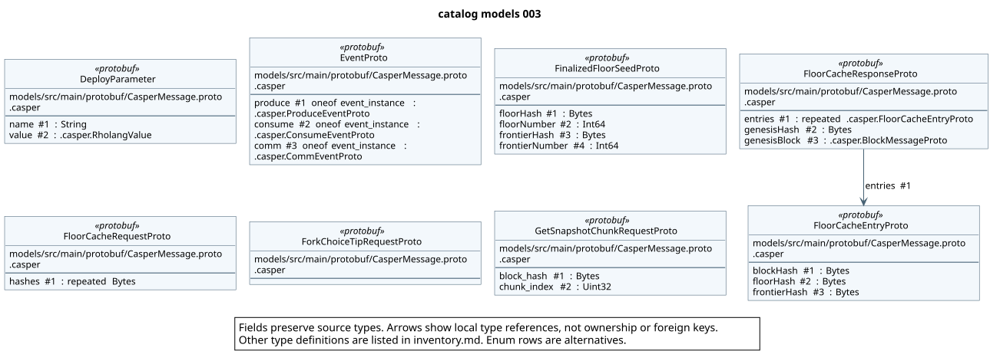

# catalog models 003

[Inventory](inventory.md) | [PlantUML](catalog-models-003.puml)

## Cross-Page References

- `DeployParameter: value #2 -> RholangValue [catalog-models-006.svg]`
- `EventProto: comm #3 oneof event_instance -> CommEventProto [catalog-models-002.svg]`
- `EventProto: consume #2 oneof event_instance -> ConsumeEventProto [catalog-models-002.svg]`
- `EventProto: produce #1 oneof event_instance -> ProduceEventProto [catalog-models-005.svg]`
- `FloorCacheResponseProto: genesisBlock #3 -> BlockMessageProto [catalog-models-001.svg]`
