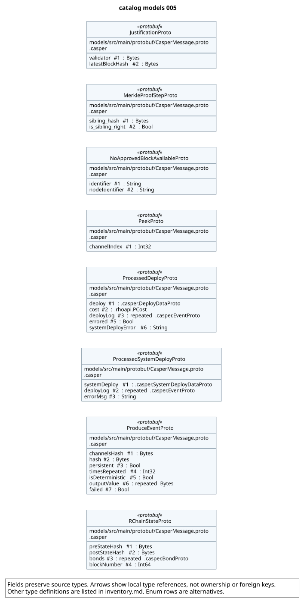

# catalog models 005

[Inventory](inventory.md) | [PlantUML](catalog-models-005.puml)

## Cross-Page References

- `ProcessedDeployProto: cost #2 -> PCost [catalog-models-023.svg]`
- `ProcessedDeployProto: deploy #1 -> DeployDataProto [catalog-models-002.svg]`
- `ProcessedDeployProto: deployLog #3 -> EventProto [catalog-models-003.svg]`
- `ProcessedSystemDeployProto: deployLog #2 -> EventProto [catalog-models-003.svg]`
- `ProcessedSystemDeployProto: systemDeploy #1 -> SystemDeployDataProto [catalog-models-007.svg]`
- `RChainStateProto: bonds #3 -> BondProto [catalog-models-002.svg]`
