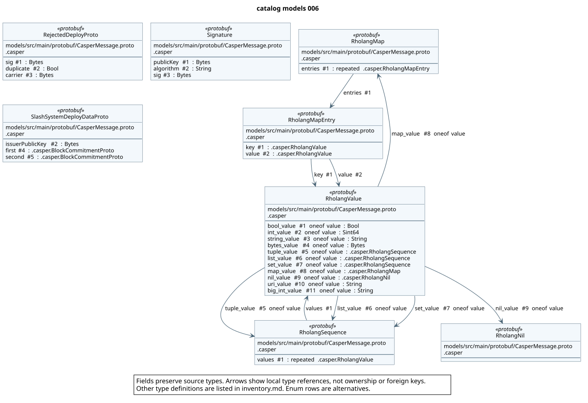

# catalog models 006

[Inventory](inventory.md) | [PlantUML](catalog-models-006.puml)

## Cross-Page References

- `SlashSystemDeployDataProto: first #4 -> BlockCommitmentProto [catalog-models-001.svg]`
- `SlashSystemDeployDataProto: second #5 -> BlockCommitmentProto [catalog-models-001.svg]`
