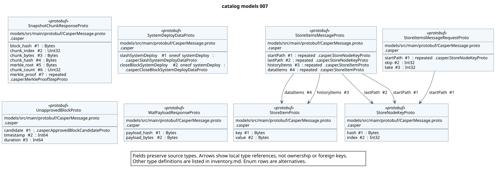

# catalog models 007

[Inventory](inventory.md) | [PlantUML](catalog-models-007.puml)

## Cross-Page References

- `SnapshotChunkResponseProto: merkle_proof #7 -> MerkleProofStepProto [catalog-models-005.svg]`
- `SystemDeployDataProto: closeBlockSystemDeploy #2 oneof systemDeploy -> CloseBlockSystemDeployDataProto [catalog-models-002.svg]`
- `SystemDeployDataProto: slashSystemDeploy #1 oneof systemDeploy -> SlashSystemDeployDataProto [catalog-models-006.svg]`
- `UnapprovedBlockProto: candidate #1 -> ApprovedBlockCandidateProto [catalog-models-001.svg]`
