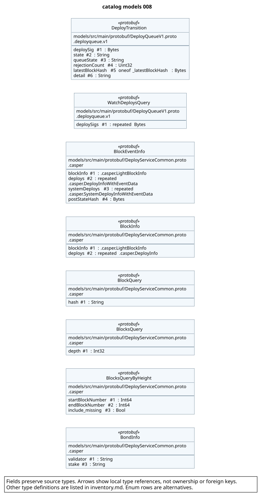

# catalog models 008

[Inventory](inventory.md) | [PlantUML](catalog-models-008.puml)

## Cross-Page References

- `BlockEventInfo: blockInfo #1 -> LightBlockInfo [catalog-models-011.svg]`
- `BlockEventInfo: deploys #2 -> DeployInfoWithEventData [catalog-models-010.svg]`
- `BlockEventInfo: systemDeploys #3 -> SystemDeployInfoWithEventData [catalog-models-013.svg]`
- `BlockInfo: blockInfo #1 -> LightBlockInfo [catalog-models-011.svg]`
- `BlockInfo: deploys #2 -> DeployInfo [catalog-models-010.svg]`
