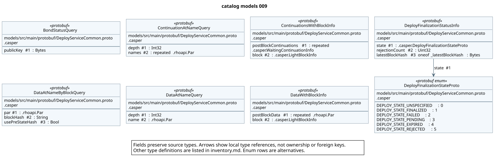

# catalog models 009

[Inventory](inventory.md) | [PlantUML](catalog-models-009.puml)

## Cross-Page References

- `ContinuationAtNameQuery: names #2 -> Par [catalog-models-023.svg]`
- `ContinuationsWithBlockInfo: block #2 -> LightBlockInfo [catalog-models-011.svg]`
- `ContinuationsWithBlockInfo: postBlockContinuations #1 -> WaitingContinuationInfo [catalog-models-013.svg]`
- `DataAtNameByBlockQuery: par #1 -> Par [catalog-models-023.svg]`
- `DataAtNameQuery: name #2 -> Par [catalog-models-023.svg]`
- `DataWithBlockInfo: block #2 -> LightBlockInfo [catalog-models-011.svg]`
- `DataWithBlockInfo: postBlockData #1 -> Par [catalog-models-023.svg]`
