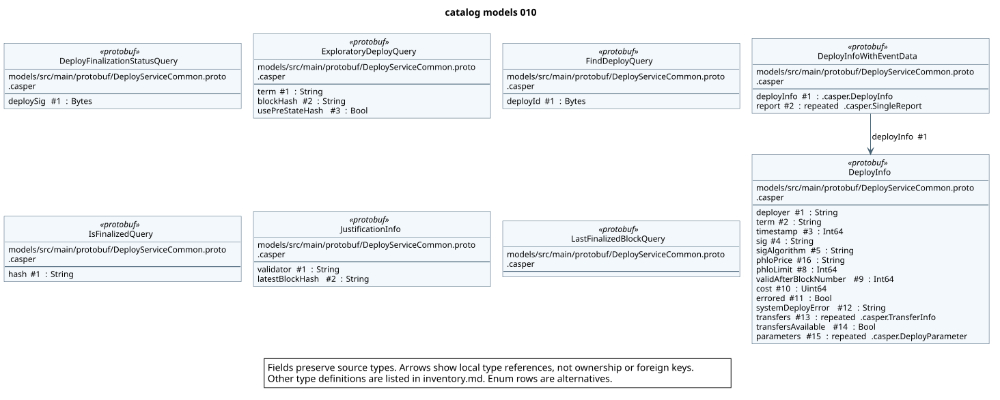

# catalog models 010

[Inventory](inventory.md) | [PlantUML](catalog-models-010.puml)

## Cross-Page References

- `DeployInfo: parameters #15 -> DeployParameter [catalog-models-003.svg]`
- `DeployInfo: transfers #13 -> TransferInfo [catalog-models-013.svg]`
- `DeployInfoWithEventData: report #2 -> SingleReport [catalog-models-012.svg]`
