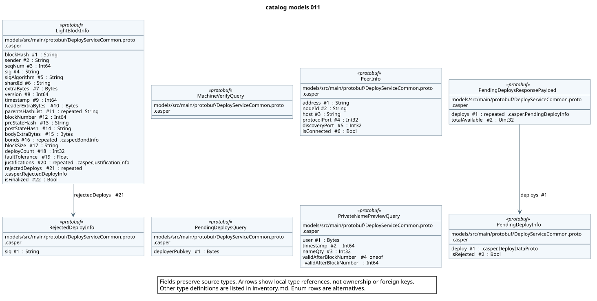

# catalog models 011

[Inventory](inventory.md) | [PlantUML](catalog-models-011.puml)

## Cardinality and Size

[Method, units, limits, and runtime evidence](sizing.md). These are declaration-level assessments, not measured live counts.

### LightBlockInfo

Cardinality: 0..n live values. Current count and owner-level limits are not derivable from this declaration.

Size: Generated Rust layout plus owned allocations. Encoded size is the sum of present field encodings.

| Field or variant | Cardinality | Inline bytes or layout | Additional storage or wire encoding |
| --- | --- | --- | --- |
| `blockHash #1` | 0..1 encoded value for these proto3 schemas | Generated Rust field layout required. Wire size is not heap size | Wire when present: tag + v(L) + L bytes, where L is the byte length. Defaults can be omitted. tag = v((field_number << 3) &#124; wire_type) |
| `sender #2` | 0..1 encoded value for these proto3 schemas | Generated Rust field layout required. Wire size is not heap size | Wire when present: tag + v(L) + L bytes, where L is the byte length. Defaults can be omitted. tag = v((field_number << 3) &#124; wire_type) |
| `seqNum #3` | 0..1 encoded value for these proto3 schemas | Generated Rust field layout required. Wire size is not heap size | Wire when present: tag + 1..10 B varint. Defaults can be omitted. tag = v((field_number << 3) &#124; wire_type) |
| `sig #4` | 0..1 encoded value for these proto3 schemas | Generated Rust field layout required. Wire size is not heap size | Wire when present: tag + v(L) + L bytes, where L is the byte length. Defaults can be omitted. tag = v((field_number << 3) &#124; wire_type) |
| `sigAlgorithm #5` | 0..1 encoded value for these proto3 schemas | Generated Rust field layout required. Wire size is not heap size | Wire when present: tag + v(L) + L bytes, where L is the byte length. Defaults can be omitted. tag = v((field_number << 3) &#124; wire_type) |
| `shardId #6` | 0..1 encoded value for these proto3 schemas | Generated Rust field layout required. Wire size is not heap size | Wire when present: tag + v(L) + L bytes, where L is the byte length. Defaults can be omitted. tag = v((field_number << 3) &#124; wire_type) |
| `extraBytes #7` | 0..1 encoded value for these proto3 schemas | Generated Rust field layout required. Wire size is not heap size | Wire when present: tag + v(L) + L bytes, where L is the byte length. Defaults can be omitted. tag = v((field_number << 3) &#124; wire_type) |
| `version #8` | 0..1 encoded value for these proto3 schemas | Generated Rust field layout required. Wire size is not heap size | Wire when present: tag + 1..10 B varint. Defaults can be omitted. tag = v((field_number << 3) &#124; wire_type) |
| `timestamp #9` | 0..1 encoded value for these proto3 schemas | Generated Rust field layout required. Wire size is not heap size | Wire when present: tag + 1..10 B varint. Defaults can be omitted. tag = v((field_number << 3) &#124; wire_type) |
| `headerExtraBytes #10` | 0..1 encoded value for these proto3 schemas | Generated Rust field layout required. Wire size is not heap size | Wire when present: tag + v(L) + L bytes, where L is the byte length. Defaults can be omitted. tag = v((field_number << 3) &#124; wire_type) |
| `parentsHashList #11` | 0..n encoded values | Generated Rust field layout required. Wire size is not heap size | Wire element: v(L) + L bytes, where L is the byte length. Unpacked: sum(tag + element). Packed numeric field: tag + v(sum(elements)) + sum(elements). Encoding depends on field options |
| `blockNumber #12` | 0..1 encoded value for these proto3 schemas | Generated Rust field layout required. Wire size is not heap size | Wire when present: tag + 1..10 B varint. Defaults can be omitted. tag = v((field_number << 3) &#124; wire_type) |
| `preStateHash #13` | 0..1 encoded value for these proto3 schemas | Generated Rust field layout required. Wire size is not heap size | Wire when present: tag + v(L) + L bytes, where L is the byte length. Defaults can be omitted. tag = v((field_number << 3) &#124; wire_type) |
| `postStateHash #14` | 0..1 encoded value for these proto3 schemas | Generated Rust field layout required. Wire size is not heap size | Wire when present: tag + v(L) + L bytes, where L is the byte length. Defaults can be omitted. tag = v((field_number << 3) &#124; wire_type) |
| `bodyExtraBytes #15` | 0..1 encoded value for these proto3 schemas | Generated Rust field layout required. Wire size is not heap size | Wire when present: tag + v(L) + L bytes, where L is the byte length. Defaults can be omitted. tag = v((field_number << 3) &#124; wire_type) |
| `bonds #16` | 0..n encoded values | Generated Rust field layout required. Wire size is not heap size | Wire element: Nested message: v(P) + P bytes. Enum: 1..10 B varint. Resolve the referenced declaration. Unpacked: sum(tag + element). Packed numeric field: tag + v(sum(elements)) + sum(elements). Encoding depends on field options |
| `blockSize #17` | 0..1 encoded value for these proto3 schemas | Generated Rust field layout required. Wire size is not heap size | Wire when present: tag + v(L) + L bytes, where L is the byte length. Defaults can be omitted. tag = v((field_number << 3) &#124; wire_type) |
| `deployCount #18` | 0..1 encoded value for these proto3 schemas | Generated Rust field layout required. Wire size is not heap size | Wire when present: tag + 1..10 B varint. Defaults can be omitted. tag = v((field_number << 3) &#124; wire_type) |
| `faultTolerance #19` | 0..1 encoded value for these proto3 schemas | Generated Rust field layout required. Wire size is not heap size | Wire when present: tag + 4 B. Defaults can be omitted. tag = v((field_number << 3) &#124; wire_type) |
| `justifications #20` | 0..n encoded values | Generated Rust field layout required. Wire size is not heap size | Wire element: Nested message: v(P) + P bytes. Enum: 1..10 B varint. Resolve the referenced declaration. Unpacked: sum(tag + element). Packed numeric field: tag + v(sum(elements)) + sum(elements). Encoding depends on field options |
| `rejectedDeploys #21` | 0..n encoded values | Generated Rust field layout required. Wire size is not heap size | Wire element: Nested message: v(P) + P bytes. Enum: 1..10 B varint. Resolve the referenced declaration. Unpacked: sum(tag + element). Packed numeric field: tag + v(sum(elements)) + sum(elements). Encoding depends on field options |
| `isFinalized #22` | 0..1 encoded value for these proto3 schemas | Generated Rust field layout required. Wire size is not heap size | Wire when present: tag + 1 B. Defaults can be omitted. tag = v((field_number << 3) &#124; wire_type) |

### MachineVerifyQuery

Cardinality: 0..n live values. Current count and owner-level limits are not derivable from this declaration.

Size: Generated Rust layout plus owned allocations. Encoded size is the sum of present field encodings.

| Field or variant | Cardinality | Inline bytes or layout | Additional storage or wire encoding |
| --- | --- | --- | --- |
| No declared fields | 0 field payloads | Compiler layout required | No field-owned allocations |

### PeerInfo

Cardinality: 0..n live values. Current count and owner-level limits are not derivable from this declaration.

Size: Generated Rust layout plus owned allocations. Encoded size is the sum of present field encodings.

| Field or variant | Cardinality | Inline bytes or layout | Additional storage or wire encoding |
| --- | --- | --- | --- |
| `address #1` | 0..1 encoded value for these proto3 schemas | Generated Rust field layout required. Wire size is not heap size | Wire when present: tag + v(L) + L bytes, where L is the byte length. Defaults can be omitted. tag = v((field_number << 3) &#124; wire_type) |
| `nodeId #2` | 0..1 encoded value for these proto3 schemas | Generated Rust field layout required. Wire size is not heap size | Wire when present: tag + v(L) + L bytes, where L is the byte length. Defaults can be omitted. tag = v((field_number << 3) &#124; wire_type) |
| `host #3` | 0..1 encoded value for these proto3 schemas | Generated Rust field layout required. Wire size is not heap size | Wire when present: tag + v(L) + L bytes, where L is the byte length. Defaults can be omitted. tag = v((field_number << 3) &#124; wire_type) |
| `protocolPort #4` | 0..1 encoded value for these proto3 schemas | Generated Rust field layout required. Wire size is not heap size | Wire when present: tag + 1..10 B varint. Defaults can be omitted. tag = v((field_number << 3) &#124; wire_type) |
| `discoveryPort #5` | 0..1 encoded value for these proto3 schemas | Generated Rust field layout required. Wire size is not heap size | Wire when present: tag + 1..10 B varint. Defaults can be omitted. tag = v((field_number << 3) &#124; wire_type) |
| `isConnected #6` | 0..1 encoded value for these proto3 schemas | Generated Rust field layout required. Wire size is not heap size | Wire when present: tag + 1 B. Defaults can be omitted. tag = v((field_number << 3) &#124; wire_type) |

### PendingDeployInfo

Cardinality: 0..n live values. Current count and owner-level limits are not derivable from this declaration.

Size: Generated Rust layout plus owned allocations. Encoded size is the sum of present field encodings.

| Field or variant | Cardinality | Inline bytes or layout | Additional storage or wire encoding |
| --- | --- | --- | --- |
| `deploy #1` | 0..1 encoded value for these proto3 schemas | Generated Rust field layout required. Wire size is not heap size | Wire when present: tag + Nested message: v(P) + P bytes. Enum: 1..10 B varint. Resolve the referenced declaration. Defaults can be omitted. tag = v((field_number << 3) &#124; wire_type) |
| `isRejected #2` | 0..1 encoded value for these proto3 schemas | Generated Rust field layout required. Wire size is not heap size | Wire when present: tag + 1 B. Defaults can be omitted. tag = v((field_number << 3) &#124; wire_type) |

### PendingDeploysQuery

Cardinality: 0..n live values. Current count and owner-level limits are not derivable from this declaration.

Size: Generated Rust layout plus owned allocations. Encoded size is the sum of present field encodings.

| Field or variant | Cardinality | Inline bytes or layout | Additional storage or wire encoding |
| --- | --- | --- | --- |
| `deployerPubkey #1` | 0..1 encoded value for these proto3 schemas | Generated Rust field layout required. Wire size is not heap size | Wire when present: tag + v(L) + L bytes, where L is the byte length. Defaults can be omitted. tag = v((field_number << 3) &#124; wire_type) |

### PendingDeploysResponsePayload

Cardinality: 0..n live values. Current count and owner-level limits are not derivable from this declaration.

Size: Generated Rust layout plus owned allocations. Encoded size is the sum of present field encodings.

| Field or variant | Cardinality | Inline bytes or layout | Additional storage or wire encoding |
| --- | --- | --- | --- |
| `deploys #1` | 0..n encoded values | Generated Rust field layout required. Wire size is not heap size | Wire element: Nested message: v(P) + P bytes. Enum: 1..10 B varint. Resolve the referenced declaration. Unpacked: sum(tag + element). Packed numeric field: tag + v(sum(elements)) + sum(elements). Encoding depends on field options |
| `totalAvailable #2` | 0..1 encoded value for these proto3 schemas | Generated Rust field layout required. Wire size is not heap size | Wire when present: tag + 1..5 B varint. Defaults can be omitted. tag = v((field_number << 3) &#124; wire_type) |

### PrivateNamePreviewQuery

Cardinality: 0..n live values. Current count and owner-level limits are not derivable from this declaration.

Size: Generated Rust layout plus owned allocations. Encoded size is the sum of present field encodings.

| Field or variant | Cardinality | Inline bytes or layout | Additional storage or wire encoding |
| --- | --- | --- | --- |
| `user #1` | 0..1 encoded value for these proto3 schemas | Generated Rust field layout required. Wire size is not heap size | Wire when present: tag + v(L) + L bytes, where L is the byte length. Defaults can be omitted. tag = v((field_number << 3) &#124; wire_type) |
| `timestamp #2` | 0..1 encoded value for these proto3 schemas | Generated Rust field layout required. Wire size is not heap size | Wire when present: tag + 1..10 B varint. Defaults can be omitted. tag = v((field_number << 3) &#124; wire_type) |
| `nameQty #3` | 0..1 encoded value for these proto3 schemas | Generated Rust field layout required. Wire size is not heap size | Wire when present: tag + 1..10 B varint. Defaults can be omitted. tag = v((field_number << 3) &#124; wire_type) |
| `validAfterBlockNumber #4 oneof _validAfterBlockNumber` | 0..1, exclusive within oneof | Generated Rust field layout required. Wire size is not heap size | Wire when present: tag + 1..10 B varint. Defaults can be omitted. tag = v((field_number << 3) &#124; wire_type) |

### RejectedDeployInfo

Cardinality: 0..n live values. Current count and owner-level limits are not derivable from this declaration.

Size: Generated Rust layout plus owned allocations. Encoded size is the sum of present field encodings.

| Field or variant | Cardinality | Inline bytes or layout | Additional storage or wire encoding |
| --- | --- | --- | --- |
| `sig #1` | 0..1 encoded value for these proto3 schemas | Generated Rust field layout required. Wire size is not heap size | Wire when present: tag + v(L) + L bytes, where L is the byte length. Defaults can be omitted. tag = v((field_number << 3) &#124; wire_type) |

## Cross-Page References

- `LightBlockInfo: bonds #16 -> BondInfo [catalog-models-008.svg]`
- `LightBlockInfo: justifications #20 -> JustificationInfo [catalog-models-010.svg]`
- `PendingDeployInfo: deploy #1 -> DeployDataProto [catalog-models-002.svg]`
