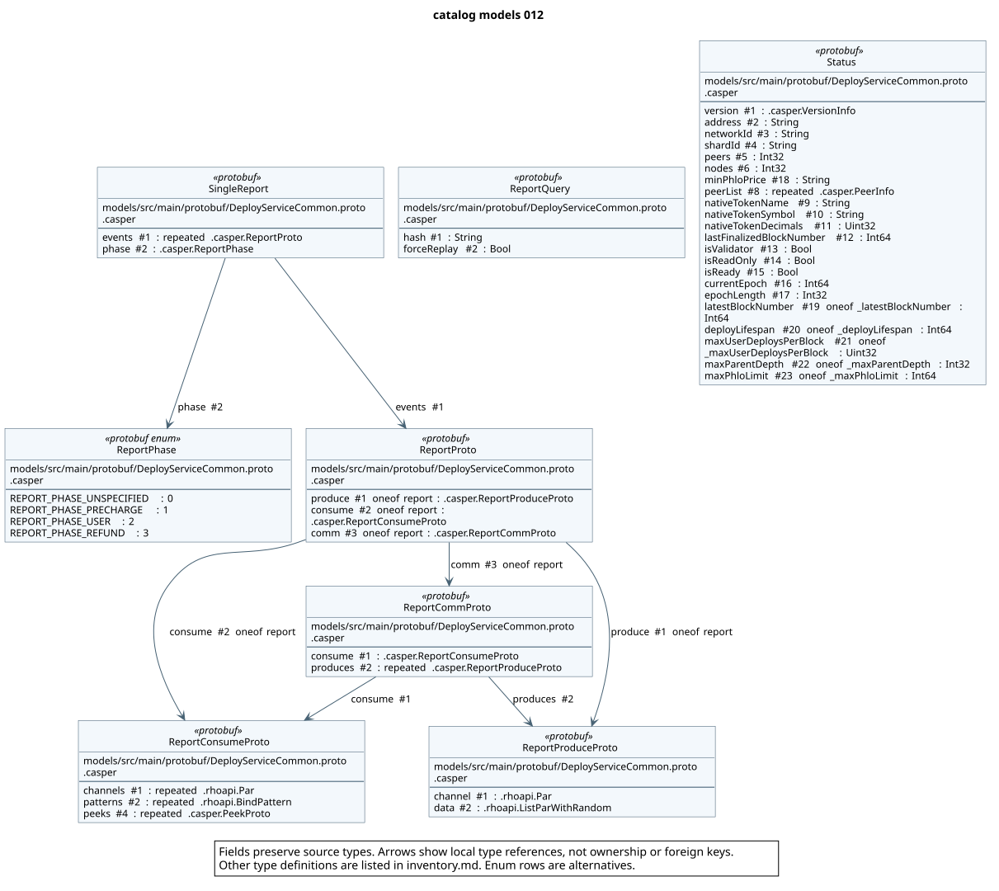

# catalog models 012

[Inventory](inventory.md) | [PlantUML](catalog-models-012.puml)

## Cross-Page References

- `ReportConsumeProto: channels #1 -> Par [catalog-models-023.svg]`
- `ReportConsumeProto: patterns #2 -> BindPattern [catalog-models-017.svg]`
- `ReportConsumeProto: peeks #4 -> PeekProto [catalog-models-005.svg]`
- `ReportProduceProto: channel #1 -> Par [catalog-models-023.svg]`
- `ReportProduceProto: data #2 -> ListParWithRandom [catalog-models-023.svg]`
- `Status: peerList #8 -> PeerInfo [catalog-models-011.svg]`
- `Status: version #1 -> VersionInfo [catalog-models-013.svg]`
