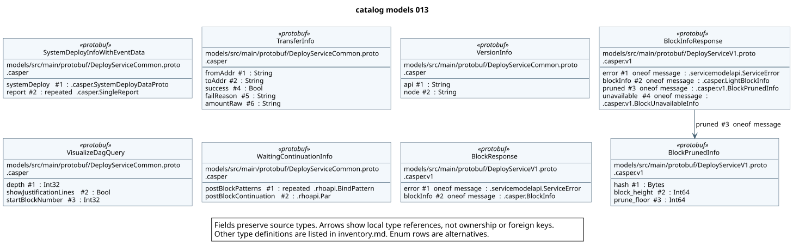

# catalog models 013

[Inventory](inventory.md) | [PlantUML](catalog-models-013.puml)

## Cardinality and Size

[Method, units, limits, and runtime evidence](sizing.md). These are declaration-level assessments, not measured live counts.

### SystemDeployInfoWithEventData

Cardinality: 0..n live values. Current count and owner-level limits are not derivable from this declaration.

Size: Generated Rust layout plus owned allocations. Encoded size is the sum of present field encodings.

| Field or variant | Cardinality | Inline bytes or layout | Additional storage or wire encoding |
| --- | --- | --- | --- |
| `systemDeploy #1` | 0..1 encoded value for these proto3 schemas | Generated Rust field layout required. Wire size is not heap size | Wire when present: tag + Nested message: v(P) + P bytes. Enum: 1..10 B varint. Resolve the referenced declaration. Defaults can be omitted. tag = v((field_number << 3) &#124; wire_type) |
| `report #2` | 0..n encoded values | Generated Rust field layout required. Wire size is not heap size | Wire element: Nested message: v(P) + P bytes. Enum: 1..10 B varint. Resolve the referenced declaration. Unpacked: sum(tag + element). Packed numeric field: tag + v(sum(elements)) + sum(elements). Encoding depends on field options |

### TransferInfo

Cardinality: 0..n live values. Current count and owner-level limits are not derivable from this declaration.

Size: Generated Rust layout plus owned allocations. Encoded size is the sum of present field encodings.

| Field or variant | Cardinality | Inline bytes or layout | Additional storage or wire encoding |
| --- | --- | --- | --- |
| `fromAddr #1` | 0..1 encoded value for these proto3 schemas | Generated Rust field layout required. Wire size is not heap size | Wire when present: tag + v(L) + L bytes, where L is the byte length. Defaults can be omitted. tag = v((field_number << 3) &#124; wire_type) |
| `toAddr #2` | 0..1 encoded value for these proto3 schemas | Generated Rust field layout required. Wire size is not heap size | Wire when present: tag + v(L) + L bytes, where L is the byte length. Defaults can be omitted. tag = v((field_number << 3) &#124; wire_type) |
| `success #4` | 0..1 encoded value for these proto3 schemas | Generated Rust field layout required. Wire size is not heap size | Wire when present: tag + 1 B. Defaults can be omitted. tag = v((field_number << 3) &#124; wire_type) |
| `failReason #5` | 0..1 encoded value for these proto3 schemas | Generated Rust field layout required. Wire size is not heap size | Wire when present: tag + v(L) + L bytes, where L is the byte length. Defaults can be omitted. tag = v((field_number << 3) &#124; wire_type) |
| `amountRaw #6` | 0..1 encoded value for these proto3 schemas | Generated Rust field layout required. Wire size is not heap size | Wire when present: tag + v(L) + L bytes, where L is the byte length. Defaults can be omitted. tag = v((field_number << 3) &#124; wire_type) |

### VersionInfo

Cardinality: 0..n live values. Current count and owner-level limits are not derivable from this declaration.

Size: Generated Rust layout plus owned allocations. Encoded size is the sum of present field encodings.

| Field or variant | Cardinality | Inline bytes or layout | Additional storage or wire encoding |
| --- | --- | --- | --- |
| `api #1` | 0..1 encoded value for these proto3 schemas | Generated Rust field layout required. Wire size is not heap size | Wire when present: tag + v(L) + L bytes, where L is the byte length. Defaults can be omitted. tag = v((field_number << 3) &#124; wire_type) |
| `node #2` | 0..1 encoded value for these proto3 schemas | Generated Rust field layout required. Wire size is not heap size | Wire when present: tag + v(L) + L bytes, where L is the byte length. Defaults can be omitted. tag = v((field_number << 3) &#124; wire_type) |

### VisualizeDagQuery

Cardinality: 0..n live values. Current count and owner-level limits are not derivable from this declaration.

Size: Generated Rust layout plus owned allocations. Encoded size is the sum of present field encodings.

| Field or variant | Cardinality | Inline bytes or layout | Additional storage or wire encoding |
| --- | --- | --- | --- |
| `depth #1` | 0..1 encoded value for these proto3 schemas | Generated Rust field layout required. Wire size is not heap size | Wire when present: tag + 1..10 B varint. Defaults can be omitted. tag = v((field_number << 3) &#124; wire_type) |
| `showJustificationLines #2` | 0..1 encoded value for these proto3 schemas | Generated Rust field layout required. Wire size is not heap size | Wire when present: tag + 1 B. Defaults can be omitted. tag = v((field_number << 3) &#124; wire_type) |
| `startBlockNumber #3` | 0..1 encoded value for these proto3 schemas | Generated Rust field layout required. Wire size is not heap size | Wire when present: tag + 1..10 B varint. Defaults can be omitted. tag = v((field_number << 3) &#124; wire_type) |

### WaitingContinuationInfo

Cardinality: 0..n live values. Current count and owner-level limits are not derivable from this declaration.

Size: Generated Rust layout plus owned allocations. Encoded size is the sum of present field encodings.

| Field or variant | Cardinality | Inline bytes or layout | Additional storage or wire encoding |
| --- | --- | --- | --- |
| `postBlockPatterns #1` | 0..n encoded values | Generated Rust field layout required. Wire size is not heap size | Wire element: Nested message: v(P) + P bytes. Enum: 1..10 B varint. Resolve the referenced declaration. Unpacked: sum(tag + element). Packed numeric field: tag + v(sum(elements)) + sum(elements). Encoding depends on field options |
| `postBlockContinuation #2` | 0..1 encoded value for these proto3 schemas | Generated Rust field layout required. Wire size is not heap size | Wire when present: tag + Nested message: v(P) + P bytes. Enum: 1..10 B varint. Resolve the referenced declaration. Defaults can be omitted. tag = v((field_number << 3) &#124; wire_type) |

### BlockInfoResponse

Cardinality: 0..n live values. Current count and owner-level limits are not derivable from this declaration.

Size: Generated Rust layout plus owned allocations. Encoded size is the sum of present field encodings.

| Field or variant | Cardinality | Inline bytes or layout | Additional storage or wire encoding |
| --- | --- | --- | --- |
| `error #1 oneof message` | 0..1, exclusive within oneof | Generated Rust field layout required. Wire size is not heap size | Wire when present: tag + Nested message: v(P) + P bytes. Enum: 1..10 B varint. Resolve the referenced declaration. Defaults can be omitted. tag = v((field_number << 3) &#124; wire_type) |
| `blockInfo #2 oneof message` | 0..1, exclusive within oneof | Generated Rust field layout required. Wire size is not heap size | Wire when present: tag + Nested message: v(P) + P bytes. Enum: 1..10 B varint. Resolve the referenced declaration. Defaults can be omitted. tag = v((field_number << 3) &#124; wire_type) |
| `pruned #3 oneof message` | 0..1, exclusive within oneof | Generated Rust field layout required. Wire size is not heap size | Wire when present: tag + Nested message: v(P) + P bytes. Enum: 1..10 B varint. Resolve the referenced declaration. Defaults can be omitted. tag = v((field_number << 3) &#124; wire_type) |
| `unavailable #4 oneof message` | 0..1, exclusive within oneof | Generated Rust field layout required. Wire size is not heap size | Wire when present: tag + Nested message: v(P) + P bytes. Enum: 1..10 B varint. Resolve the referenced declaration. Defaults can be omitted. tag = v((field_number << 3) &#124; wire_type) |

### BlockPrunedInfo

Cardinality: 0..n live values. Current count and owner-level limits are not derivable from this declaration.

Size: Generated Rust layout plus owned allocations. Encoded size is the sum of present field encodings.

| Field or variant | Cardinality | Inline bytes or layout | Additional storage or wire encoding |
| --- | --- | --- | --- |
| `hash #1` | 0..1 encoded value for these proto3 schemas | Generated Rust field layout required. Wire size is not heap size | Wire when present: tag + v(L) + L bytes, where L is the byte length. Defaults can be omitted. tag = v((field_number << 3) &#124; wire_type) |
| `block_height #2` | 0..1 encoded value for these proto3 schemas | Generated Rust field layout required. Wire size is not heap size | Wire when present: tag + 1..10 B varint. Defaults can be omitted. tag = v((field_number << 3) &#124; wire_type) |
| `prune_floor #3` | 0..1 encoded value for these proto3 schemas | Generated Rust field layout required. Wire size is not heap size | Wire when present: tag + 1..10 B varint. Defaults can be omitted. tag = v((field_number << 3) &#124; wire_type) |

### BlockResponse

Cardinality: 0..n live values. Current count and owner-level limits are not derivable from this declaration.

Size: Generated Rust layout plus owned allocations. Encoded size is the sum of present field encodings.

| Field or variant | Cardinality | Inline bytes or layout | Additional storage or wire encoding |
| --- | --- | --- | --- |
| `error #1 oneof message` | 0..1, exclusive within oneof | Generated Rust field layout required. Wire size is not heap size | Wire when present: tag + Nested message: v(P) + P bytes. Enum: 1..10 B varint. Resolve the referenced declaration. Defaults can be omitted. tag = v((field_number << 3) &#124; wire_type) |
| `blockInfo #2 oneof message` | 0..1, exclusive within oneof | Generated Rust field layout required. Wire size is not heap size | Wire when present: tag + Nested message: v(P) + P bytes. Enum: 1..10 B varint. Resolve the referenced declaration. Defaults can be omitted. tag = v((field_number << 3) &#124; wire_type) |

## Cross-Page References

- `BlockInfoResponse: blockInfo #2 oneof message -> LightBlockInfo [catalog-models-011.svg]`
- `BlockInfoResponse: error #1 oneof message -> ServiceError [catalog-models-024.svg]`
- `BlockInfoResponse: unavailable #4 oneof message -> BlockUnavailableInfo [catalog-models-014.svg]`
- `BlockResponse: blockInfo #2 oneof message -> BlockInfo [catalog-models-008.svg]`
- `BlockResponse: error #1 oneof message -> ServiceError [catalog-models-024.svg]`
- `SystemDeployInfoWithEventData: report #2 -> SingleReport [catalog-models-012.svg]`
- `SystemDeployInfoWithEventData: systemDeploy #1 -> SystemDeployDataProto [catalog-models-007.svg]`
- `WaitingContinuationInfo: postBlockContinuation #2 -> Par [catalog-models-023.svg]`
- `WaitingContinuationInfo: postBlockPatterns #1 -> BindPattern [catalog-models-017.svg]`
