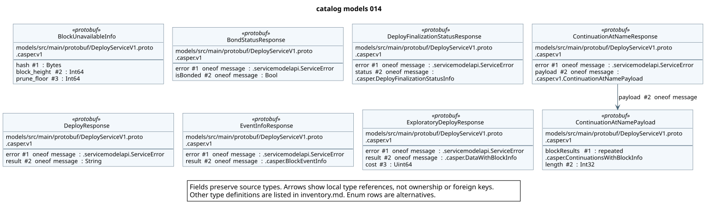

# catalog models 014

[Inventory](inventory.md) | [PlantUML](catalog-models-014.puml)

## Cardinality and Size

[Method, units, limits, and runtime evidence](sizing.md). These are declaration-level assessments, not measured live counts.

### BlockUnavailableInfo

Cardinality: 0..n live values. Current count and owner-level limits are not derivable from this declaration.

Size: Generated Rust layout plus owned allocations. Encoded size is the sum of present field encodings.

| Field or variant | Cardinality | Inline bytes or layout | Additional storage or wire encoding |
| --- | --- | --- | --- |
| `hash #1` | 0..1 encoded value for these proto3 schemas | Generated Rust field layout required. Wire size is not heap size | Wire when present: tag + v(L) + L bytes, where L is the byte length. Defaults can be omitted. tag = v((field_number << 3) &#124; wire_type) |
| `block_height #2` | 0..1 encoded value for these proto3 schemas | Generated Rust field layout required. Wire size is not heap size | Wire when present: tag + 1..10 B varint. Defaults can be omitted. tag = v((field_number << 3) &#124; wire_type) |
| `prune_floor #3` | 0..1 encoded value for these proto3 schemas | Generated Rust field layout required. Wire size is not heap size | Wire when present: tag + 1..10 B varint. Defaults can be omitted. tag = v((field_number << 3) &#124; wire_type) |

### BondStatusResponse

Cardinality: 0..n live values. Current count and owner-level limits are not derivable from this declaration.

Size: Generated Rust layout plus owned allocations. Encoded size is the sum of present field encodings.

| Field or variant | Cardinality | Inline bytes or layout | Additional storage or wire encoding |
| --- | --- | --- | --- |
| `error #1 oneof message` | 0..1, exclusive within oneof | Generated Rust field layout required. Wire size is not heap size | Wire when present: tag + Nested message: v(P) + P bytes. Enum: 1..10 B varint. Resolve the referenced declaration. Defaults can be omitted. tag = v((field_number << 3) &#124; wire_type) |
| `isBonded #2 oneof message` | 0..1, exclusive within oneof | Generated Rust field layout required. Wire size is not heap size | Wire when present: tag + 1 B. Defaults can be omitted. tag = v((field_number << 3) &#124; wire_type) |

### ContinuationAtNamePayload

Cardinality: 0..n live values. Current count and owner-level limits are not derivable from this declaration.

Size: Generated Rust layout plus owned allocations. Encoded size is the sum of present field encodings.

| Field or variant | Cardinality | Inline bytes or layout | Additional storage or wire encoding |
| --- | --- | --- | --- |
| `blockResults #1` | 0..n encoded values | Generated Rust field layout required. Wire size is not heap size | Wire element: Nested message: v(P) + P bytes. Enum: 1..10 B varint. Resolve the referenced declaration. Unpacked: sum(tag + element). Packed numeric field: tag + v(sum(elements)) + sum(elements). Encoding depends on field options |
| `length #2` | 0..1 encoded value for these proto3 schemas | Generated Rust field layout required. Wire size is not heap size | Wire when present: tag + 1..10 B varint. Defaults can be omitted. tag = v((field_number << 3) &#124; wire_type) |

### ContinuationAtNameResponse

Cardinality: 0..n live values. Current count and owner-level limits are not derivable from this declaration.

Size: Generated Rust layout plus owned allocations. Encoded size is the sum of present field encodings.

| Field or variant | Cardinality | Inline bytes or layout | Additional storage or wire encoding |
| --- | --- | --- | --- |
| `error #1 oneof message` | 0..1, exclusive within oneof | Generated Rust field layout required. Wire size is not heap size | Wire when present: tag + Nested message: v(P) + P bytes. Enum: 1..10 B varint. Resolve the referenced declaration. Defaults can be omitted. tag = v((field_number << 3) &#124; wire_type) |
| `payload #2 oneof message` | 0..1, exclusive within oneof | Generated Rust field layout required. Wire size is not heap size | Wire when present: tag + Nested message: v(P) + P bytes. Enum: 1..10 B varint. Resolve the referenced declaration. Defaults can be omitted. tag = v((field_number << 3) &#124; wire_type) |

### DeployFinalizationStatusResponse

Cardinality: 0..n live values. Current count and owner-level limits are not derivable from this declaration.

Size: Generated Rust layout plus owned allocations. Encoded size is the sum of present field encodings.

| Field or variant | Cardinality | Inline bytes or layout | Additional storage or wire encoding |
| --- | --- | --- | --- |
| `error #1 oneof message` | 0..1, exclusive within oneof | Generated Rust field layout required. Wire size is not heap size | Wire when present: tag + Nested message: v(P) + P bytes. Enum: 1..10 B varint. Resolve the referenced declaration. Defaults can be omitted. tag = v((field_number << 3) &#124; wire_type) |
| `status #2 oneof message` | 0..1, exclusive within oneof | Generated Rust field layout required. Wire size is not heap size | Wire when present: tag + Nested message: v(P) + P bytes. Enum: 1..10 B varint. Resolve the referenced declaration. Defaults can be omitted. tag = v((field_number << 3) &#124; wire_type) |

### DeployResponse

Cardinality: 0..n live values. Current count and owner-level limits are not derivable from this declaration.

Size: Generated Rust layout plus owned allocations. Encoded size is the sum of present field encodings.

| Field or variant | Cardinality | Inline bytes or layout | Additional storage or wire encoding |
| --- | --- | --- | --- |
| `error #1 oneof message` | 0..1, exclusive within oneof | Generated Rust field layout required. Wire size is not heap size | Wire when present: tag + Nested message: v(P) + P bytes. Enum: 1..10 B varint. Resolve the referenced declaration. Defaults can be omitted. tag = v((field_number << 3) &#124; wire_type) |
| `result #2 oneof message` | 0..1, exclusive within oneof | Generated Rust field layout required. Wire size is not heap size | Wire when present: tag + v(L) + L bytes, where L is the byte length. Defaults can be omitted. tag = v((field_number << 3) &#124; wire_type) |

### EventInfoResponse

Cardinality: 0..n live values. Current count and owner-level limits are not derivable from this declaration.

Size: Generated Rust layout plus owned allocations. Encoded size is the sum of present field encodings.

| Field or variant | Cardinality | Inline bytes or layout | Additional storage or wire encoding |
| --- | --- | --- | --- |
| `error #1 oneof message` | 0..1, exclusive within oneof | Generated Rust field layout required. Wire size is not heap size | Wire when present: tag + Nested message: v(P) + P bytes. Enum: 1..10 B varint. Resolve the referenced declaration. Defaults can be omitted. tag = v((field_number << 3) &#124; wire_type) |
| `result #2 oneof message` | 0..1, exclusive within oneof | Generated Rust field layout required. Wire size is not heap size | Wire when present: tag + Nested message: v(P) + P bytes. Enum: 1..10 B varint. Resolve the referenced declaration. Defaults can be omitted. tag = v((field_number << 3) &#124; wire_type) |

### ExploratoryDeployResponse

Cardinality: 0..n live values. Current count and owner-level limits are not derivable from this declaration.

Size: Generated Rust layout plus owned allocations. Encoded size is the sum of present field encodings.

| Field or variant | Cardinality | Inline bytes or layout | Additional storage or wire encoding |
| --- | --- | --- | --- |
| `error #1 oneof message` | 0..1, exclusive within oneof | Generated Rust field layout required. Wire size is not heap size | Wire when present: tag + Nested message: v(P) + P bytes. Enum: 1..10 B varint. Resolve the referenced declaration. Defaults can be omitted. tag = v((field_number << 3) &#124; wire_type) |
| `result #2 oneof message` | 0..1, exclusive within oneof | Generated Rust field layout required. Wire size is not heap size | Wire when present: tag + Nested message: v(P) + P bytes. Enum: 1..10 B varint. Resolve the referenced declaration. Defaults can be omitted. tag = v((field_number << 3) &#124; wire_type) |
| `cost #3` | 0..1 encoded value for these proto3 schemas | Generated Rust field layout required. Wire size is not heap size | Wire when present: tag + 1..10 B varint. Defaults can be omitted. tag = v((field_number << 3) &#124; wire_type) |

## Cross-Page References

- `BondStatusResponse: error #1 oneof message -> ServiceError [catalog-models-024.svg]`
- `ContinuationAtNamePayload: blockResults #1 -> ContinuationsWithBlockInfo [catalog-models-009.svg]`
- `ContinuationAtNameResponse: error #1 oneof message -> ServiceError [catalog-models-024.svg]`
- `DeployFinalizationStatusResponse: error #1 oneof message -> ServiceError [catalog-models-024.svg]`
- `DeployFinalizationStatusResponse: status #2 oneof message -> DeployFinalizationStatusInfo [catalog-models-009.svg]`
- `DeployResponse: error #1 oneof message -> ServiceError [catalog-models-024.svg]`
- `EventInfoResponse: error #1 oneof message -> ServiceError [catalog-models-024.svg]`
- `EventInfoResponse: result #2 oneof message -> BlockEventInfo [catalog-models-008.svg]`
- `ExploratoryDeployResponse: error #1 oneof message -> ServiceError [catalog-models-024.svg]`
- `ExploratoryDeployResponse: result #2 oneof message -> DataWithBlockInfo [catalog-models-009.svg]`
