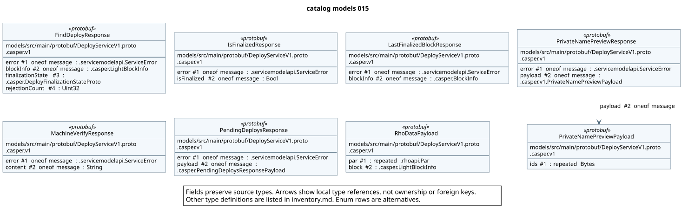

# catalog models 015

[Inventory](inventory.md) | [PlantUML](catalog-models-015.puml)

## Cardinality and Size

[Method, units, limits, and runtime evidence](sizing.md). These are declaration-level assessments, not measured live counts.

### FindDeployResponse

Cardinality: 0..n live values. Current count and owner-level limits are not derivable from this declaration.

Size: Generated Rust layout plus owned allocations. Encoded size is the sum of present field encodings.

| Field or variant | Cardinality | Inline bytes or layout | Additional storage or wire encoding |
| --- | --- | --- | --- |
| `error #1 oneof message` | 0..1, exclusive within oneof | Generated Rust field layout required. Wire size is not heap size | Wire when present: tag + Nested message: v(P) + P bytes. Enum: 1..10 B varint. Resolve the referenced declaration. Defaults can be omitted. tag = v((field_number << 3) &#124; wire_type) |
| `blockInfo #2 oneof message` | 0..1, exclusive within oneof | Generated Rust field layout required. Wire size is not heap size | Wire when present: tag + Nested message: v(P) + P bytes. Enum: 1..10 B varint. Resolve the referenced declaration. Defaults can be omitted. tag = v((field_number << 3) &#124; wire_type) |
| `finalizationState #3` | 0..1 encoded value for these proto3 schemas | Generated Rust field layout required. Wire size is not heap size | Wire when present: tag + Nested message: v(P) + P bytes. Enum: 1..10 B varint. Resolve the referenced declaration. Defaults can be omitted. tag = v((field_number << 3) &#124; wire_type) |
| `rejectionCount #4` | 0..1 encoded value for these proto3 schemas | Generated Rust field layout required. Wire size is not heap size | Wire when present: tag + 1..5 B varint. Defaults can be omitted. tag = v((field_number << 3) &#124; wire_type) |

### IsFinalizedResponse

Cardinality: 0..n live values. Current count and owner-level limits are not derivable from this declaration.

Size: Generated Rust layout plus owned allocations. Encoded size is the sum of present field encodings.

| Field or variant | Cardinality | Inline bytes or layout | Additional storage or wire encoding |
| --- | --- | --- | --- |
| `error #1 oneof message` | 0..1, exclusive within oneof | Generated Rust field layout required. Wire size is not heap size | Wire when present: tag + Nested message: v(P) + P bytes. Enum: 1..10 B varint. Resolve the referenced declaration. Defaults can be omitted. tag = v((field_number << 3) &#124; wire_type) |
| `isFinalized #2 oneof message` | 0..1, exclusive within oneof | Generated Rust field layout required. Wire size is not heap size | Wire when present: tag + 1 B. Defaults can be omitted. tag = v((field_number << 3) &#124; wire_type) |

### LastFinalizedBlockResponse

Cardinality: 0..n live values. Current count and owner-level limits are not derivable from this declaration.

Size: Generated Rust layout plus owned allocations. Encoded size is the sum of present field encodings.

| Field or variant | Cardinality | Inline bytes or layout | Additional storage or wire encoding |
| --- | --- | --- | --- |
| `error #1 oneof message` | 0..1, exclusive within oneof | Generated Rust field layout required. Wire size is not heap size | Wire when present: tag + Nested message: v(P) + P bytes. Enum: 1..10 B varint. Resolve the referenced declaration. Defaults can be omitted. tag = v((field_number << 3) &#124; wire_type) |
| `blockInfo #2 oneof message` | 0..1, exclusive within oneof | Generated Rust field layout required. Wire size is not heap size | Wire when present: tag + Nested message: v(P) + P bytes. Enum: 1..10 B varint. Resolve the referenced declaration. Defaults can be omitted. tag = v((field_number << 3) &#124; wire_type) |

### MachineVerifyResponse

Cardinality: 0..n live values. Current count and owner-level limits are not derivable from this declaration.

Size: Generated Rust layout plus owned allocations. Encoded size is the sum of present field encodings.

| Field or variant | Cardinality | Inline bytes or layout | Additional storage or wire encoding |
| --- | --- | --- | --- |
| `error #1 oneof message` | 0..1, exclusive within oneof | Generated Rust field layout required. Wire size is not heap size | Wire when present: tag + Nested message: v(P) + P bytes. Enum: 1..10 B varint. Resolve the referenced declaration. Defaults can be omitted. tag = v((field_number << 3) &#124; wire_type) |
| `content #2 oneof message` | 0..1, exclusive within oneof | Generated Rust field layout required. Wire size is not heap size | Wire when present: tag + v(L) + L bytes, where L is the byte length. Defaults can be omitted. tag = v((field_number << 3) &#124; wire_type) |

### PendingDeploysResponse

Cardinality: 0..n live values. Current count and owner-level limits are not derivable from this declaration.

Size: Generated Rust layout plus owned allocations. Encoded size is the sum of present field encodings.

| Field or variant | Cardinality | Inline bytes or layout | Additional storage or wire encoding |
| --- | --- | --- | --- |
| `error #1 oneof message` | 0..1, exclusive within oneof | Generated Rust field layout required. Wire size is not heap size | Wire when present: tag + Nested message: v(P) + P bytes. Enum: 1..10 B varint. Resolve the referenced declaration. Defaults can be omitted. tag = v((field_number << 3) &#124; wire_type) |
| `payload #2 oneof message` | 0..1, exclusive within oneof | Generated Rust field layout required. Wire size is not heap size | Wire when present: tag + Nested message: v(P) + P bytes. Enum: 1..10 B varint. Resolve the referenced declaration. Defaults can be omitted. tag = v((field_number << 3) &#124; wire_type) |

### PrivateNamePreviewPayload

Cardinality: 0..n live values. Current count and owner-level limits are not derivable from this declaration.

Size: Generated Rust layout plus owned allocations. Encoded size is the sum of present field encodings.

| Field or variant | Cardinality | Inline bytes or layout | Additional storage or wire encoding |
| --- | --- | --- | --- |
| `ids #1` | 0..n encoded values | Generated Rust field layout required. Wire size is not heap size | Wire element: v(L) + L bytes, where L is the byte length. Unpacked: sum(tag + element). Packed numeric field: tag + v(sum(elements)) + sum(elements). Encoding depends on field options |

### PrivateNamePreviewResponse

Cardinality: 0..n live values. Current count and owner-level limits are not derivable from this declaration.

Size: Generated Rust layout plus owned allocations. Encoded size is the sum of present field encodings.

| Field or variant | Cardinality | Inline bytes or layout | Additional storage or wire encoding |
| --- | --- | --- | --- |
| `error #1 oneof message` | 0..1, exclusive within oneof | Generated Rust field layout required. Wire size is not heap size | Wire when present: tag + Nested message: v(P) + P bytes. Enum: 1..10 B varint. Resolve the referenced declaration. Defaults can be omitted. tag = v((field_number << 3) &#124; wire_type) |
| `payload #2 oneof message` | 0..1, exclusive within oneof | Generated Rust field layout required. Wire size is not heap size | Wire when present: tag + Nested message: v(P) + P bytes. Enum: 1..10 B varint. Resolve the referenced declaration. Defaults can be omitted. tag = v((field_number << 3) &#124; wire_type) |

### RhoDataPayload

Cardinality: 0..n live values. Current count and owner-level limits are not derivable from this declaration.

Size: Generated Rust layout plus owned allocations. Encoded size is the sum of present field encodings.

| Field or variant | Cardinality | Inline bytes or layout | Additional storage or wire encoding |
| --- | --- | --- | --- |
| `par #1` | 0..n encoded values | Generated Rust field layout required. Wire size is not heap size | Wire element: Nested message: v(P) + P bytes. Enum: 1..10 B varint. Resolve the referenced declaration. Unpacked: sum(tag + element). Packed numeric field: tag + v(sum(elements)) + sum(elements). Encoding depends on field options |
| `block #2` | 0..1 encoded value for these proto3 schemas | Generated Rust field layout required. Wire size is not heap size | Wire when present: tag + Nested message: v(P) + P bytes. Enum: 1..10 B varint. Resolve the referenced declaration. Defaults can be omitted. tag = v((field_number << 3) &#124; wire_type) |

## Cross-Page References

- `FindDeployResponse: blockInfo #2 oneof message -> LightBlockInfo [catalog-models-011.svg]`
- `FindDeployResponse: error #1 oneof message -> ServiceError [catalog-models-024.svg]`
- `FindDeployResponse: finalizationState #3 -> DeployFinalizationStateProto [catalog-models-009.svg]`
- `IsFinalizedResponse: error #1 oneof message -> ServiceError [catalog-models-024.svg]`
- `LastFinalizedBlockResponse: blockInfo #2 oneof message -> BlockInfo [catalog-models-008.svg]`
- `LastFinalizedBlockResponse: error #1 oneof message -> ServiceError [catalog-models-024.svg]`
- `MachineVerifyResponse: error #1 oneof message -> ServiceError [catalog-models-024.svg]`
- `PendingDeploysResponse: error #1 oneof message -> ServiceError [catalog-models-024.svg]`
- `PendingDeploysResponse: payload #2 oneof message -> PendingDeploysResponsePayload [catalog-models-011.svg]`
- `PrivateNamePreviewResponse: error #1 oneof message -> ServiceError [catalog-models-024.svg]`
- `RhoDataPayload: block #2 -> LightBlockInfo [catalog-models-011.svg]`
- `RhoDataPayload: par #1 -> Par [catalog-models-023.svg]`
