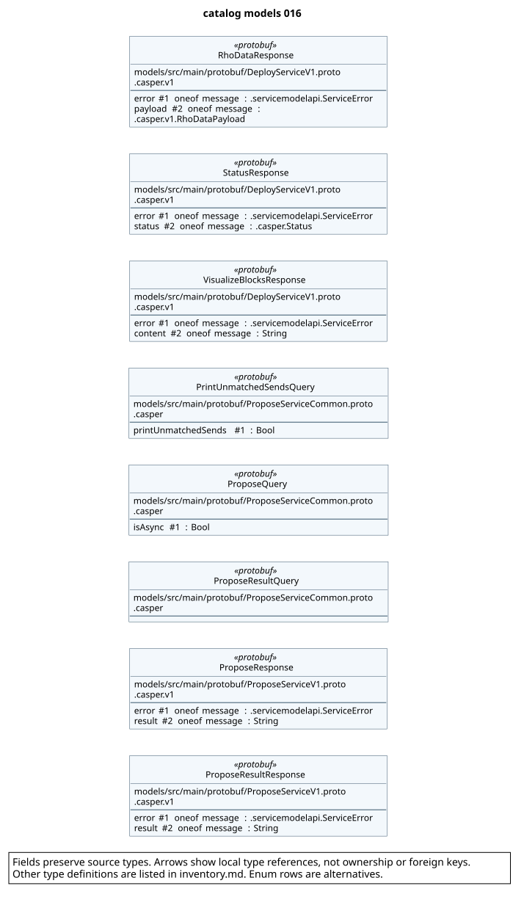

# catalog models 016

[Inventory](inventory.md) | [PlantUML](catalog-models-016.puml)

## Cross-Page References

- `ProposeResponse: error #1 oneof message -> ServiceError [catalog-models-024.svg]`
- `ProposeResultResponse: error #1 oneof message -> ServiceError [catalog-models-024.svg]`
- `RhoDataResponse: error #1 oneof message -> ServiceError [catalog-models-024.svg]`
- `RhoDataResponse: payload #2 oneof message -> RhoDataPayload [catalog-models-015.svg]`
- `StatusResponse: error #1 oneof message -> ServiceError [catalog-models-024.svg]`
- `StatusResponse: status #2 oneof message -> Status [catalog-models-012.svg]`
- `VisualizeBlocksResponse: error #1 oneof message -> ServiceError [catalog-models-024.svg]`
