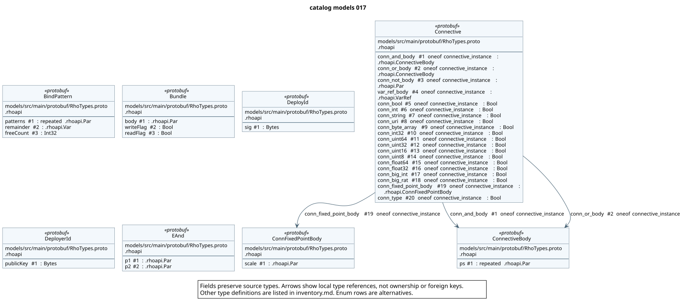

# catalog models 017

[Inventory](inventory.md) | [PlantUML](catalog-models-017.puml)

## Cross-Page References

- `BindPattern: patterns #1 -> Par [catalog-models-023.svg]`
- `BindPattern: remainder #2 -> Var [catalog-models-024.svg]`
- `Bundle: body #1 -> Par [catalog-models-023.svg]`
- `ConnFixedPointBody: scale #1 -> Par [catalog-models-023.svg]`
- `Connective: conn_not_body #3 oneof connective_instance -> Par [catalog-models-023.svg]`
- `Connective: var_ref_body #4 oneof connective_instance -> VarRef [catalog-models-024.svg]`
- `ConnectiveBody: ps #1 -> Par [catalog-models-023.svg]`
- `EAnd: p1 #1 -> Par [catalog-models-023.svg]`
- `EAnd: p2 #2 -> Par [catalog-models-023.svg]`
