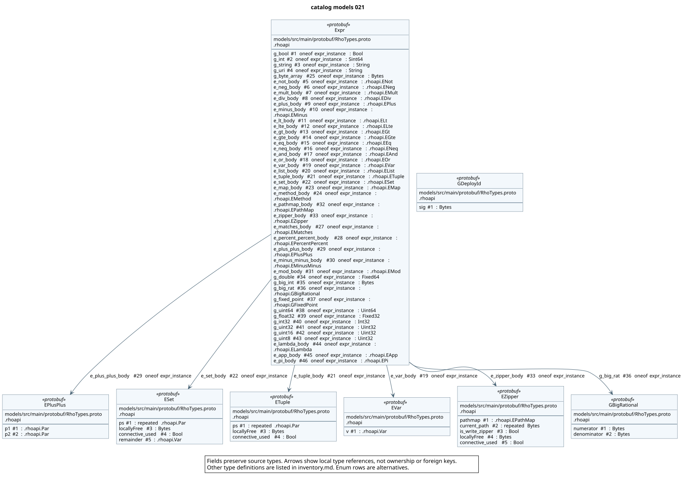

# catalog models 021

[Inventory](inventory.md) | [PlantUML](catalog-models-021.puml)

## Cross-Page References

- `EPlusPlus: p1 #1 -> Par [catalog-models-023.svg]`
- `EPlusPlus: p2 #2 -> Par [catalog-models-023.svg]`
- `ESet: ps #1 -> Par [catalog-models-023.svg]`
- `ESet: remainder #5 -> Var [catalog-models-024.svg]`
- `ETuple: ps #1 -> Par [catalog-models-023.svg]`
- `EVar: v #1 -> Var [catalog-models-024.svg]`
- `EZipper: pathmap #1 -> EPathMap [catalog-models-020.svg]`
- `Expr: e_and_body #17 oneof expr_instance -> EAnd [catalog-models-017.svg]`
- `Expr: e_app_body #45 oneof expr_instance -> EApp [catalog-models-018.svg]`
- `Expr: e_div_body #8 oneof expr_instance -> EDiv [catalog-models-018.svg]`
- `Expr: e_eq_body #15 oneof expr_instance -> EEq [catalog-models-018.svg]`
- `Expr: e_gt_body #13 oneof expr_instance -> EGt [catalog-models-018.svg]`
- `Expr: e_gte_body #14 oneof expr_instance -> EGte [catalog-models-018.svg]`
- `Expr: e_lambda_body #44 oneof expr_instance -> ELambda [catalog-models-018.svg]`
- `Expr: e_list_body #20 oneof expr_instance -> EList [catalog-models-018.svg]`
- `Expr: e_lt_body #11 oneof expr_instance -> ELt [catalog-models-018.svg]`
- `Expr: e_lte_body #12 oneof expr_instance -> ELte [catalog-models-019.svg]`
- `Expr: e_map_body #23 oneof expr_instance -> EMap [catalog-models-019.svg]`
- `Expr: e_matches_body #27 oneof expr_instance -> EMatches [catalog-models-019.svg]`
- `Expr: e_method_body #24 oneof expr_instance -> EMethod [catalog-models-019.svg]`
- `Expr: e_minus_body #10 oneof expr_instance -> EMinus [catalog-models-019.svg]`
- `Expr: e_minus_minus_body #30 oneof expr_instance -> EMinusMinus [catalog-models-019.svg]`
- `Expr: e_mod_body #31 oneof expr_instance -> EMod [catalog-models-019.svg]`
- `Expr: e_mult_body #7 oneof expr_instance -> EMult [catalog-models-019.svg]`
- `Expr: e_neg_body #6 oneof expr_instance -> ENeg [catalog-models-020.svg]`
- `Expr: e_neq_body #16 oneof expr_instance -> ENeq [catalog-models-020.svg]`
- `Expr: e_not_body #5 oneof expr_instance -> ENot [catalog-models-020.svg]`
- `Expr: e_or_body #18 oneof expr_instance -> EOr [catalog-models-020.svg]`
- `Expr: e_pathmap_body #32 oneof expr_instance -> EPathMap [catalog-models-020.svg]`
- `Expr: e_percent_percent_body #28 oneof expr_instance -> EPercentPercent [catalog-models-020.svg]`
- `Expr: e_pi_body #46 oneof expr_instance -> EPi [catalog-models-020.svg]`
- `Expr: e_plus_body #9 oneof expr_instance -> EPlus [catalog-models-020.svg]`
- `Expr: g_fixed_point #37 oneof expr_instance -> GFixedPoint [catalog-models-022.svg]`
