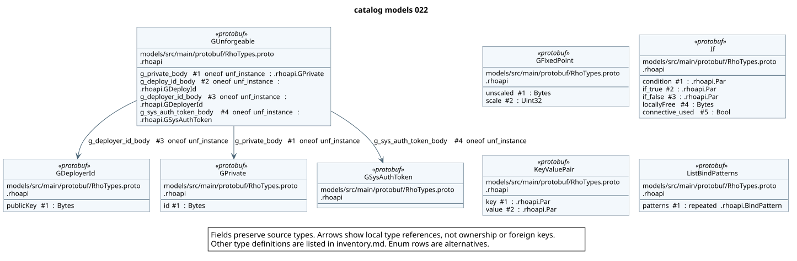

# catalog models 022

[Inventory](inventory.md) | [PlantUML](catalog-models-022.puml)

## Cross-Page References

- `GUnforgeable: g_deploy_id_body #2 oneof unf_instance -> GDeployId [catalog-models-021.svg]`
- `If: condition #1 -> Par [catalog-models-023.svg]`
- `If: if_false #3 -> Par [catalog-models-023.svg]`
- `If: if_true #2 -> Par [catalog-models-023.svg]`
- `KeyValuePair: key #1 -> Par [catalog-models-023.svg]`
- `KeyValuePair: value #2 -> Par [catalog-models-023.svg]`
- `ListBindPatterns: patterns #1 -> BindPattern [catalog-models-017.svg]`
