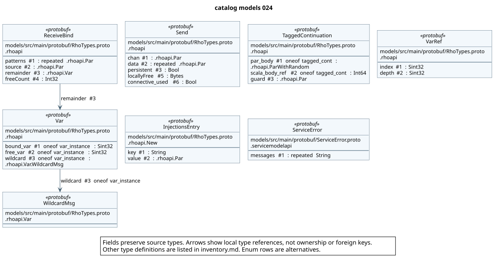

# catalog models 024

[Inventory](inventory.md) | [PlantUML](catalog-models-024.puml)

## Cross-Page References

- `InjectionsEntry: value #2 -> Par [catalog-models-023.svg]`
- `ReceiveBind: patterns #1 -> Par [catalog-models-023.svg]`
- `ReceiveBind: source #2 -> Par [catalog-models-023.svg]`
- `Send: chan #1 -> Par [catalog-models-023.svg]`
- `Send: data #2 -> Par [catalog-models-023.svg]`
- `TaggedContinuation: guard #3 -> Par [catalog-models-023.svg]`
- `TaggedContinuation: par_body #1 oneof tagged_cont -> ParWithRandom [catalog-models-023.svg]`
