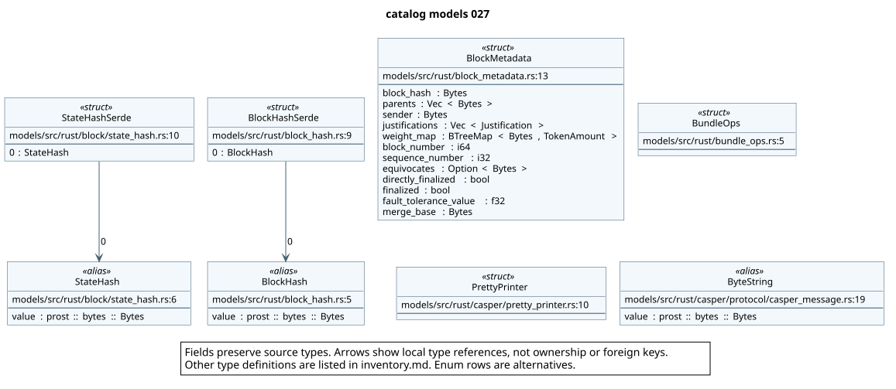

# catalog models 027

[Inventory](inventory.md) | [PlantUML](catalog-models-027.puml)

## Cross-Page References

- `BlockMetadata: justifications -> Justification [catalog-models-031.svg]`
- `BlockMetadata: weight_map -> TokenAmount [catalog-shared-009.svg]`
