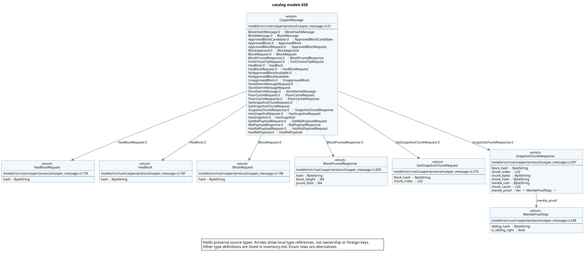

# catalog models 028

[Inventory](inventory.md) | [PlantUML](catalog-models-028.puml)

## Cardinality and Size

[Method, units, limits, and runtime evidence](sizing.md). These are declaration-level assessments, not measured live counts.

### CasperMessage

Cardinality: 0..n live values. Current count and owner-level limits are not derivable from this declaration.

Size: Compiler enum layout plus allocations of the active variant only. Do not sum alternative variants.

| Field or variant | Cardinality | Inline bytes or layout | Additional storage or wire encoding |
| --- | --- | --- | --- |
| `BlockHashMessage.0` | 1 value when this variant is active | Compiler layout required | Follow the referenced declaration or external implementation. No allocation bound established. |
| `BlockMessage.0` | 1 value when this variant is active | Compiler layout required | Follow the referenced declaration or external implementation. No allocation bound established. |
| `ApprovedBlockCandidate.0` | 1 value when this variant is active | Compiler layout required | Follow the referenced declaration or external implementation. No allocation bound established. |
| `ApprovedBlock.0` | 1 value when this variant is active | Compiler layout required | Follow the referenced declaration or external implementation. No allocation bound established. |
| `ApprovedBlockRequest.0` | 1 value when this variant is active | Compiler layout required | Follow the referenced declaration or external implementation. No allocation bound established. |
| `BlockApproval.0` | 1 value when this variant is active | Compiler layout required | Follow the referenced declaration or external implementation. No allocation bound established. |
| `BlockRequest.0` | 1 value when this variant is active | Compiler layout required | Follow the referenced declaration or external implementation. No allocation bound established. |
| `BlockPrunedResponse.0` | 1 value when this variant is active | Compiler layout required | Follow the referenced declaration or external implementation. No allocation bound established. |
| `ForkChoiceTipRequest.0` | 1 value when this variant is active | Compiler layout required | Follow the referenced declaration or external implementation. No allocation bound established. |
| `HasBlock.0` | 1 value when this variant is active | Compiler layout required | Follow the referenced declaration or external implementation. No allocation bound established. |
| `HasBlockRequest.0` | 1 value when this variant is active | Compiler layout required | Follow the referenced declaration or external implementation. No allocation bound established. |
| `NoApprovedBlockAvailable.0` | 1 value when this variant is active | Compiler layout required | Follow the referenced declaration or external implementation. No allocation bound established. |
| `UnapprovedBlock.0` | 1 value when this variant is active | Compiler layout required | Follow the referenced declaration or external implementation. No allocation bound established. |
| `StoreItemsMessageRequest.0` | 1 value when this variant is active | Compiler layout required | Follow the referenced declaration or external implementation. No allocation bound established. |
| `StoreItemsMessage.0` | 1 value when this variant is active | Compiler layout required | Follow the referenced declaration or external implementation. No allocation bound established. |
| `FloorCacheRequest.0` | 1 value when this variant is active | Compiler layout required | Follow the referenced declaration or external implementation. No allocation bound established. |
| `FloorCacheResponse.0` | 1 value when this variant is active | Compiler layout required | Follow the referenced declaration or external implementation. No allocation bound established. |
| `GetSnapshotChunkRequest.0` | 1 value when this variant is active | Compiler layout required | Follow the referenced declaration or external implementation. No allocation bound established. |
| `SnapshotChunkResponse.0` | 1 value when this variant is active | Compiler layout required | Follow the referenced declaration or external implementation. No allocation bound established. |
| `HasSnapshotRequest.0` | 1 value when this variant is active | Compiler layout required | Follow the referenced declaration or external implementation. No allocation bound established. |
| `HasSnapshot.0` | 1 value when this variant is active | Compiler layout required | Follow the referenced declaration or external implementation. No allocation bound established. |
| `GetWalPayloadRequest.0` | 1 value when this variant is active | Compiler layout required | Follow the referenced declaration or external implementation. No allocation bound established. |
| `WalPayloadResponse.0` | 1 value when this variant is active | Compiler layout required | Follow the referenced declaration or external implementation. No allocation bound established. |
| `HasWalPayloadRequest.0` | 1 value when this variant is active | Compiler layout required | Follow the referenced declaration or external implementation. No allocation bound established. |
| `HasWalPayload.0` | 1 value when this variant is active | Compiler layout required | Follow the referenced declaration or external implementation. No allocation bound established. |

### HasBlockRequest

Cardinality: 0..n live values. Current count and owner-level limits are not derivable from this declaration.

Size: Sum of field inline layouts plus compiler padding, then uniquely owned allocations. repr and custom implementations can change layout.

| Field or variant | Cardinality | Inline bytes or layout | Additional storage or wire encoding |
| --- | --- | --- | --- |
| `hash` | 1 value | Compiler layout required | Follow the referenced declaration or external implementation. No allocation bound established. |

### HasBlock

Cardinality: 0..n live values. Current count and owner-level limits are not derivable from this declaration.

Size: Sum of field inline layouts plus compiler padding, then uniquely owned allocations. repr and custom implementations can change layout.

| Field or variant | Cardinality | Inline bytes or layout | Additional storage or wire encoding |
| --- | --- | --- | --- |
| `hash` | 1 value | Compiler layout required | Follow the referenced declaration or external implementation. No allocation bound established. |

### BlockRequest

Cardinality: 0..n live values. Current count and owner-level limits are not derivable from this declaration.

Size: Sum of field inline layouts plus compiler padding, then uniquely owned allocations. repr and custom implementations can change layout.

| Field or variant | Cardinality | Inline bytes or layout | Additional storage or wire encoding |
| --- | --- | --- | --- |
| `hash` | 1 value | Compiler layout required | Follow the referenced declaration or external implementation. No allocation bound established. |

### BlockPrunedResponse

Cardinality: 0..n live values. Current count and owner-level limits are not derivable from this declaration.

Size: Sum of field inline layouts plus compiler padding, then uniquely owned allocations. repr and custom implementations can change layout.

| Field or variant | Cardinality | Inline bytes or layout | Additional storage or wire encoding |
| --- | --- | --- | --- |
| `hash` | 1 value | Compiler layout required | Follow the referenced declaration or external implementation. No allocation bound established. |
| `block_height` | 1 scalar | 8 B | None |
| `prune_floor` | 1 scalar | 8 B | None |

### MerkleProofStep

Cardinality: 0..n live values. Current count and owner-level limits are not derivable from this declaration.

Size: Sum of field inline layouts plus compiler padding, then uniquely owned allocations. repr and custom implementations can change layout.

| Field or variant | Cardinality | Inline bytes or layout | Additional storage or wire encoding |
| --- | --- | --- | --- |
| `sibling_hash` | 1 value | Compiler layout required | Follow the referenced declaration or external implementation. No allocation bound established. |
| `is_sibling_right` | 1 scalar | 1 B | None |

### GetSnapshotChunkRequest

Cardinality: 0..n live values. Current count and owner-level limits are not derivable from this declaration.

Size: Sum of field inline layouts plus compiler padding, then uniquely owned allocations. repr and custom implementations can change layout.

| Field or variant | Cardinality | Inline bytes or layout | Additional storage or wire encoding |
| --- | --- | --- | --- |
| `block_hash` | 1 value | Compiler layout required | Follow the referenced declaration or external implementation. No allocation bound established. |
| `chunk_index` | 1 scalar | 4 B | None |

### SnapshotChunkResponse

Cardinality: 0..n live values. Current count and owner-level limits are not derivable from this declaration.

Size: Sum of field inline layouts plus compiler padding, then uniquely owned allocations. repr and custom implementations can change layout.

| Field or variant | Cardinality | Inline bytes or layout | Additional storage or wire encoding |
| --- | --- | --- | --- |
| `block_hash` | 1 value | Compiler layout required | Follow the referenced declaration or external implementation. No allocation bound established. |
| `chunk_index` | 1 scalar | 4 B | None |
| `chunk_bytes` | 1 value | Compiler layout required | Follow the referenced declaration or external implementation. No allocation bound established. |
| `chunk_hash` | 1 value | Compiler layout required | Follow the referenced declaration or external implementation. No allocation bound established. |
| `merkle_root` | 1 value | Compiler layout required | Follow the referenced declaration or external implementation. No allocation bound established. |
| `chunk_count` | 1 scalar | 4 B | None |
| `merkle_proof` | 0..n elements | 24 B. Vec header on the generator target | capacity * I(element), plus live element-owned allocations. Zero-sized elements need no backing allocation. Element: Follow the referenced declaration or external implementation. No allocation bound established. |

## Cross-Page References

- `BlockPrunedResponse: hash -> ByteString [catalog-models-027.svg]`
- `BlockRequest: hash -> ByteString [catalog-models-027.svg]`
- `CasperMessage: ApprovedBlock.0 -> ApprovedBlock [catalog-models-030.svg]`
- `CasperMessage: ApprovedBlockCandidate.0 -> ApprovedBlockCandidate [catalog-models-029.svg]`
- `CasperMessage: ApprovedBlockRequest.0 -> ApprovedBlockRequest [catalog-models-031.svg]`
- `CasperMessage: BlockApproval.0 -> BlockApproval [catalog-models-030.svg]`
- `CasperMessage: BlockHashMessage.0 -> BlockHashMessage [catalog-models-031.svg]`
- `CasperMessage: BlockMessage.0 -> BlockMessage [catalog-models-031.svg]`
- `CasperMessage: FloorCacheRequest.0 -> FloorCacheRequest [catalog-models-030.svg]`
- `CasperMessage: FloorCacheResponse.0 -> FloorCacheResponse [catalog-models-030.svg]`
- `CasperMessage: ForkChoiceTipRequest.0 -> ForkChoiceTipRequest [catalog-models-029.svg]`
- `CasperMessage: GetWalPayloadRequest.0 -> GetWalPayloadRequest [catalog-models-029.svg]`
- `CasperMessage: HasSnapshot.0 -> HasSnapshot [catalog-models-029.svg]`
- `CasperMessage: HasSnapshotRequest.0 -> HasSnapshotRequest [catalog-models-029.svg]`
- `CasperMessage: HasWalPayload.0 -> HasWalPayload [catalog-models-029.svg]`
- `CasperMessage: HasWalPayloadRequest.0 -> HasWalPayloadRequest [catalog-models-029.svg]`
- `CasperMessage: NoApprovedBlockAvailable.0 -> NoApprovedBlockAvailable [catalog-models-030.svg]`
- `CasperMessage: StoreItemsMessage.0 -> StoreItemsMessage [catalog-models-033.svg]`
- `CasperMessage: StoreItemsMessageRequest.0 -> StoreItemsMessageRequest [catalog-models-033.svg]`
- `CasperMessage: UnapprovedBlock.0 -> UnapprovedBlock [catalog-models-030.svg]`
- `CasperMessage: WalPayloadResponse.0 -> WalPayloadResponse [catalog-models-029.svg]`
- `GetSnapshotChunkRequest: block_hash -> ByteString [catalog-models-027.svg]`
- `HasBlock: hash -> ByteString [catalog-models-027.svg]`
- `HasBlockRequest: hash -> ByteString [catalog-models-027.svg]`
- `MerkleProofStep: sibling_hash -> ByteString [catalog-models-027.svg]`
- `SnapshotChunkResponse: block_hash -> ByteString [catalog-models-027.svg]`
- `SnapshotChunkResponse: chunk_bytes -> ByteString [catalog-models-027.svg]`
- `SnapshotChunkResponse: chunk_hash -> ByteString [catalog-models-027.svg]`
- `SnapshotChunkResponse: merkle_root -> ByteString [catalog-models-027.svg]`
