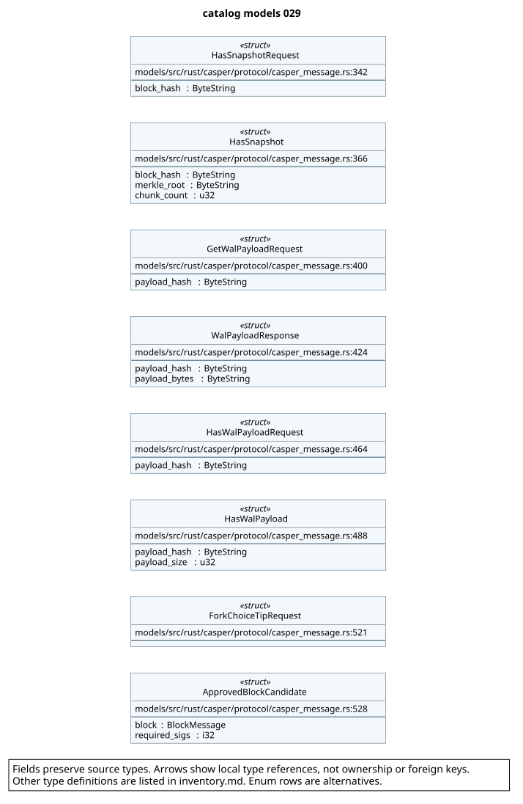

# catalog models 029

[Inventory](inventory.md) | [PlantUML](catalog-models-029.puml)

## Cardinality and Size

[Method, units, limits, and runtime evidence](sizing.md). These are declaration-level assessments, not measured live counts.

### HasSnapshotRequest

Cardinality: 0..n live values. Current count and owner-level limits are not derivable from this declaration.

Size: Sum of field inline layouts plus compiler padding, then uniquely owned allocations. repr and custom implementations can change layout.

| Field or variant | Cardinality | Inline bytes or layout | Additional storage or wire encoding |
| --- | --- | --- | --- |
| `block_hash` | 1 value | Compiler layout required | Follow the referenced declaration or external implementation. No allocation bound established. |

### HasSnapshot

Cardinality: 0..n live values. Current count and owner-level limits are not derivable from this declaration.

Size: Sum of field inline layouts plus compiler padding, then uniquely owned allocations. repr and custom implementations can change layout.

| Field or variant | Cardinality | Inline bytes or layout | Additional storage or wire encoding |
| --- | --- | --- | --- |
| `block_hash` | 1 value | Compiler layout required | Follow the referenced declaration or external implementation. No allocation bound established. |
| `merkle_root` | 1 value | Compiler layout required | Follow the referenced declaration or external implementation. No allocation bound established. |
| `chunk_count` | 1 scalar | 4 B | None |

### GetWalPayloadRequest

Cardinality: 0..n live values. Current count and owner-level limits are not derivable from this declaration.

Size: Sum of field inline layouts plus compiler padding, then uniquely owned allocations. repr and custom implementations can change layout.

| Field or variant | Cardinality | Inline bytes or layout | Additional storage or wire encoding |
| --- | --- | --- | --- |
| `payload_hash` | 1 value | Compiler layout required | Follow the referenced declaration or external implementation. No allocation bound established. |

### WalPayloadResponse

Cardinality: 0..n live values. Current count and owner-level limits are not derivable from this declaration.

Size: Sum of field inline layouts plus compiler padding, then uniquely owned allocations. repr and custom implementations can change layout.

| Field or variant | Cardinality | Inline bytes or layout | Additional storage or wire encoding |
| --- | --- | --- | --- |
| `payload_hash` | 1 value | Compiler layout required | Follow the referenced declaration or external implementation. No allocation bound established. |
| `payload_bytes` | 1 value | Compiler layout required | Follow the referenced declaration or external implementation. No allocation bound established. |

### HasWalPayloadRequest

Cardinality: 0..n live values. Current count and owner-level limits are not derivable from this declaration.

Size: Sum of field inline layouts plus compiler padding, then uniquely owned allocations. repr and custom implementations can change layout.

| Field or variant | Cardinality | Inline bytes or layout | Additional storage or wire encoding |
| --- | --- | --- | --- |
| `payload_hash` | 1 value | Compiler layout required | Follow the referenced declaration or external implementation. No allocation bound established. |

### HasWalPayload

Cardinality: 0..n live values. Current count and owner-level limits are not derivable from this declaration.

Size: Sum of field inline layouts plus compiler padding, then uniquely owned allocations. repr and custom implementations can change layout.

| Field or variant | Cardinality | Inline bytes or layout | Additional storage or wire encoding |
| --- | --- | --- | --- |
| `payload_hash` | 1 value | Compiler layout required | Follow the referenced declaration or external implementation. No allocation bound established. |
| `payload_size` | 1 scalar | 4 B | None |

### ForkChoiceTipRequest

Cardinality: 0..n live values. Current count and owner-level limits are not derivable from this declaration.

Size: Sum of field inline layouts plus compiler padding, then uniquely owned allocations. repr and custom implementations can change layout.

| Field or variant | Cardinality | Inline bytes or layout | Additional storage or wire encoding |
| --- | --- | --- | --- |
| No declared fields | 0 field payloads | Compiler layout required | No field-owned allocations |

### ApprovedBlockCandidate

Cardinality: 0..n live values. Current count and owner-level limits are not derivable from this declaration.

Size: Sum of field inline layouts plus compiler padding, then uniquely owned allocations. repr and custom implementations can change layout.

| Field or variant | Cardinality | Inline bytes or layout | Additional storage or wire encoding |
| --- | --- | --- | --- |
| `block` | 1 value | Compiler layout required | Follow the referenced declaration or external implementation. No allocation bound established. |
| `required_sigs` | 1 scalar | 4 B | None |

## Cross-Page References

- `ApprovedBlockCandidate: block -> BlockMessage [catalog-models-031.svg]`
- `GetWalPayloadRequest: payload_hash -> ByteString [catalog-models-027.svg]`
- `HasSnapshot: block_hash -> ByteString [catalog-models-027.svg]`
- `HasSnapshot: merkle_root -> ByteString [catalog-models-027.svg]`
- `HasSnapshotRequest: block_hash -> ByteString [catalog-models-027.svg]`
- `HasWalPayload: payload_hash -> ByteString [catalog-models-027.svg]`
- `HasWalPayloadRequest: payload_hash -> ByteString [catalog-models-027.svg]`
- `WalPayloadResponse: payload_bytes -> ByteString [catalog-models-027.svg]`
- `WalPayloadResponse: payload_hash -> ByteString [catalog-models-027.svg]`
