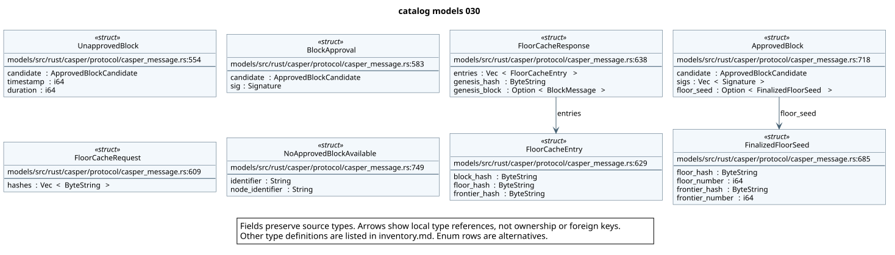

# catalog models 030

[Inventory](inventory.md) | [PlantUML](catalog-models-030.puml)

## Cardinality and Size

[Method, units, limits, and runtime evidence](sizing.md). These are declaration-level assessments, not measured live counts.

### UnapprovedBlock

Cardinality: 0..n live values. Current count and owner-level limits are not derivable from this declaration.

Size: Sum of field inline layouts plus compiler padding, then uniquely owned allocations. repr and custom implementations can change layout.

| Field or variant | Cardinality | Inline bytes or layout | Additional storage or wire encoding |
| --- | --- | --- | --- |
| `candidate` | 1 value | Compiler layout required | Follow the referenced declaration or external implementation. No allocation bound established. |
| `timestamp` | 1 scalar | 8 B | None |
| `duration` | 1 scalar | 8 B | None |

### BlockApproval

Cardinality: 0..n live values. Current count and owner-level limits are not derivable from this declaration.

Size: Sum of field inline layouts plus compiler padding, then uniquely owned allocations. repr and custom implementations can change layout.

| Field or variant | Cardinality | Inline bytes or layout | Additional storage or wire encoding |
| --- | --- | --- | --- |
| `candidate` | 1 value | Compiler layout required | Follow the referenced declaration or external implementation. No allocation bound established. |
| `sig` | 1 value | Compiler layout required | Follow the referenced declaration or external implementation. No allocation bound established. |

### FloorCacheRequest

Cardinality: 0..n live values. Current count and owner-level limits are not derivable from this declaration.

Size: Sum of field inline layouts plus compiler padding, then uniquely owned allocations. repr and custom implementations can change layout.

| Field or variant | Cardinality | Inline bytes or layout | Additional storage or wire encoding |
| --- | --- | --- | --- |
| `hashes` | 0..n elements | 24 B. Vec header on the generator target | capacity * I(element), plus live element-owned allocations. Zero-sized elements need no backing allocation. Element: Follow the referenced declaration or external implementation. No allocation bound established. |

### FloorCacheEntry

Cardinality: 0..n live values. Current count and owner-level limits are not derivable from this declaration.

Size: Sum of field inline layouts plus compiler padding, then uniquely owned allocations. repr and custom implementations can change layout.

| Field or variant | Cardinality | Inline bytes or layout | Additional storage or wire encoding |
| --- | --- | --- | --- |
| `block_hash` | 1 value | Compiler layout required | Follow the referenced declaration or external implementation. No allocation bound established. |
| `floor_hash` | 1 value | Compiler layout required | Follow the referenced declaration or external implementation. No allocation bound established. |
| `frontier_hash` | 1 value | Compiler layout required | Follow the referenced declaration or external implementation. No allocation bound established. |

### FloorCacheResponse

Cardinality: 0..n live values. Current count and owner-level limits are not derivable from this declaration.

Size: Sum of field inline layouts plus compiler padding, then uniquely owned allocations. repr and custom implementations can change layout.

| Field or variant | Cardinality | Inline bytes or layout | Additional storage or wire encoding |
| --- | --- | --- | --- |
| `entries` | 0..n elements | 24 B. Vec header on the generator target | capacity * I(element), plus live element-owned allocations. Zero-sized elements need no backing allocation. Element: Follow the referenced declaration or external implementation. No allocation bound established. |
| `genesis_hash` | 1 value | Compiler layout required | Follow the referenced declaration or external implementation. No allocation bound established. |
| `genesis_block` | 0..1 present payload | Option layout includes any tag or niche optimization. Do not assume I(T) + 1 | None when absent. Present payload: 1 value. Follow the referenced declaration or external implementation. No allocation bound established. |

### FinalizedFloorSeed

Cardinality: 0..n live values. Current count and owner-level limits are not derivable from this declaration.

Size: Sum of field inline layouts plus compiler padding, then uniquely owned allocations. repr and custom implementations can change layout.

| Field or variant | Cardinality | Inline bytes or layout | Additional storage or wire encoding |
| --- | --- | --- | --- |
| `floor_hash` | 1 value | Compiler layout required | Follow the referenced declaration or external implementation. No allocation bound established. |
| `floor_number` | 1 scalar | 8 B | None |
| `frontier_hash` | 1 value | Compiler layout required | Follow the referenced declaration or external implementation. No allocation bound established. |
| `frontier_number` | 1 scalar | 8 B | None |

### ApprovedBlock

Cardinality: 0..n live values. Current count and owner-level limits are not derivable from this declaration.

Size: Sum of field inline layouts plus compiler padding, then uniquely owned allocations. repr and custom implementations can change layout.

| Field or variant | Cardinality | Inline bytes or layout | Additional storage or wire encoding |
| --- | --- | --- | --- |
| `candidate` | 1 value | Compiler layout required | Follow the referenced declaration or external implementation. No allocation bound established. |
| `sigs` | 0..n elements | 24 B. Vec header on the generator target | capacity * I(element), plus live element-owned allocations. Zero-sized elements need no backing allocation. Element: Follow the referenced declaration or external implementation. No allocation bound established. |
| `floor_seed` | 0..1 present payload | Option layout includes any tag or niche optimization. Do not assume I(T) + 1 | None when absent. Present payload: 1 value. Follow the referenced declaration or external implementation. No allocation bound established. |

### NoApprovedBlockAvailable

Cardinality: 0..n live values. Current count and owner-level limits are not derivable from this declaration.

Size: Sum of field inline layouts plus compiler padding, then uniquely owned allocations. repr and custom implementations can change layout.

| Field or variant | Cardinality | Inline bytes or layout | Additional storage or wire encoding |
| --- | --- | --- | --- |
| `identifier` | 0..n UTF-8 bytes | 24 B. String header on the generator target | capacity() bytes, excluding allocator overhead. UTF-8 byte length is not character count |
| `node_identifier` | 0..n UTF-8 bytes | 24 B. String header on the generator target | capacity() bytes, excluding allocator overhead. UTF-8 byte length is not character count |

## Cross-Page References

- `ApprovedBlock: candidate -> ApprovedBlockCandidate [catalog-models-029.svg]`
- `ApprovedBlock: sigs -> Signature [catalog-casper-057.svg]`
- `BlockApproval: candidate -> ApprovedBlockCandidate [catalog-models-029.svg]`
- `BlockApproval: sig -> Signature [catalog-casper-057.svg]`
- `FinalizedFloorSeed: floor_hash -> ByteString [catalog-models-027.svg]`
- `FinalizedFloorSeed: frontier_hash -> ByteString [catalog-models-027.svg]`
- `FloorCacheEntry: block_hash -> ByteString [catalog-models-027.svg]`
- `FloorCacheEntry: floor_hash -> ByteString [catalog-models-027.svg]`
- `FloorCacheEntry: frontier_hash -> ByteString [catalog-models-027.svg]`
- `FloorCacheRequest: hashes -> ByteString [catalog-models-027.svg]`
- `FloorCacheResponse: genesis_block -> BlockMessage [catalog-models-031.svg]`
- `FloorCacheResponse: genesis_hash -> ByteString [catalog-models-027.svg]`
- `UnapprovedBlock: candidate -> ApprovedBlockCandidate [catalog-models-029.svg]`
