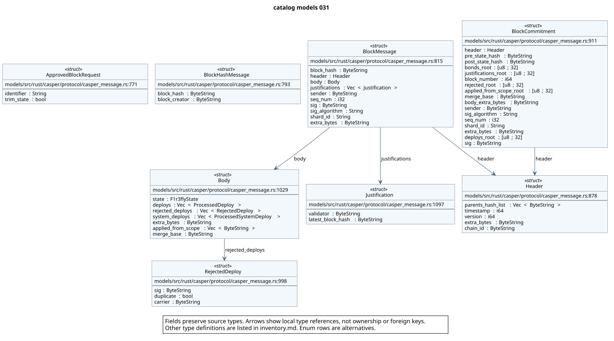

# catalog models 031

[Inventory](inventory.md) | [PlantUML](catalog-models-031.puml)

## Cross-Page References

- `BlockCommitment: body_extra_bytes -> ByteString [catalog-models-027.svg]`
- `BlockCommitment: extra_bytes -> ByteString [catalog-models-027.svg]`
- `BlockCommitment: merge_base -> ByteString [catalog-models-027.svg]`
- `BlockCommitment: post_state_hash -> ByteString [catalog-models-027.svg]`
- `BlockCommitment: pre_state_hash -> ByteString [catalog-models-027.svg]`
- `BlockCommitment: sender -> ByteString [catalog-models-027.svg]`
- `BlockCommitment: sig -> ByteString [catalog-models-027.svg]`
- `BlockHashMessage: block_creator -> ByteString [catalog-models-027.svg]`
- `BlockHashMessage: block_hash -> ByteString [catalog-models-027.svg]`
- `BlockMessage: block_hash -> ByteString [catalog-models-027.svg]`
- `BlockMessage: extra_bytes -> ByteString [catalog-models-027.svg]`
- `BlockMessage: sender -> ByteString [catalog-models-027.svg]`
- `BlockMessage: sig -> ByteString [catalog-models-027.svg]`
- `Body: applied_from_scope -> ByteString [catalog-models-027.svg]`
- `Body: deploys -> ProcessedDeploy [catalog-models-032.svg]`
- `Body: extra_bytes -> ByteString [catalog-models-027.svg]`
- `Body: merge_base -> ByteString [catalog-models-027.svg]`
- `Body: state -> F1r3flyState [catalog-models-032.svg]`
- `Body: system_deploys -> ProcessedSystemDeploy [catalog-models-032.svg]`
- `Header: chain_id -> ByteString [catalog-models-027.svg]`
- `Header: extra_bytes -> ByteString [catalog-models-027.svg]`
- `Header: parents_hash_list -> ByteString [catalog-models-027.svg]`
- `Justification: latest_block_hash -> ByteString [catalog-models-027.svg]`
- `Justification: validator -> ByteString [catalog-models-027.svg]`
- `RejectedDeploy: carrier -> ByteString [catalog-models-027.svg]`
- `RejectedDeploy: sig -> ByteString [catalog-models-027.svg]`
