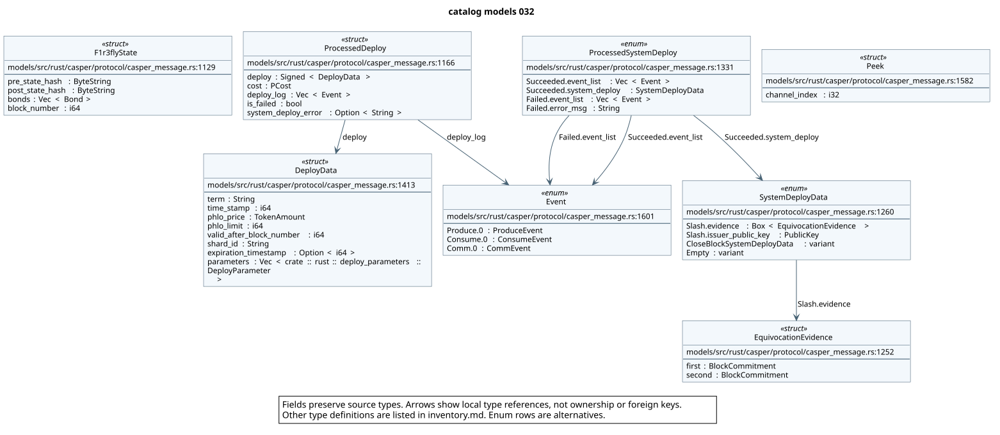

# catalog models 032

[Inventory](inventory.md) | [PlantUML](catalog-models-032.puml)

## Cardinality and Size

[Method, units, limits, and runtime evidence](sizing.md). These are declaration-level assessments, not measured live counts.

### F1r3flyState

Cardinality: 0..n live values. Current count and owner-level limits are not derivable from this declaration.

Size: Sum of field inline layouts plus compiler padding, then uniquely owned allocations. repr and custom implementations can change layout.

| Field or variant | Cardinality | Inline bytes or layout | Additional storage or wire encoding |
| --- | --- | --- | --- |
| `pre_state_hash` | 1 value | Compiler layout required | Follow the referenced declaration or external implementation. No allocation bound established. |
| `post_state_hash` | 1 value | Compiler layout required | Follow the referenced declaration or external implementation. No allocation bound established. |
| `bonds` | 0..n elements | 24 B. Vec header on the generator target | capacity * I(element), plus live element-owned allocations. Zero-sized elements need no backing allocation. Element: Follow the referenced declaration or external implementation. No allocation bound established. |
| `block_number` | 1 scalar | 8 B | None |

### ProcessedDeploy

Cardinality: 0..n live values. Current count and owner-level limits are not derivable from this declaration.

Size: Sum of field inline layouts plus compiler padding, then uniquely owned allocations. repr and custom implementations can change layout.

| Field or variant | Cardinality | Inline bytes or layout | Additional storage or wire encoding |
| --- | --- | --- | --- |
| `deploy` | 1 value | Compiler layout required | Follow the referenced declaration or external implementation. No allocation bound established. |
| `cost` | 1 value | Compiler layout required | Follow the referenced declaration or external implementation. No allocation bound established. |
| `deploy_log` | 0..n elements | 24 B. Vec header on the generator target | capacity * I(element), plus live element-owned allocations. Zero-sized elements need no backing allocation. Element: Follow the referenced declaration or external implementation. No allocation bound established. |
| `is_failed` | 1 scalar | 1 B | None |
| `system_deploy_error` | 0..1 present payload | Option layout includes any tag or niche optimization. Do not assume I(T) + 1 | None when absent. Present payload: 0..n UTF-8 bytes. capacity() bytes, excluding allocator overhead. UTF-8 byte length is not character count |

### EquivocationEvidence

Cardinality: 0..n live values. Current count and owner-level limits are not derivable from this declaration.

Size: Sum of field inline layouts plus compiler padding, then uniquely owned allocations. repr and custom implementations can change layout.

| Field or variant | Cardinality | Inline bytes or layout | Additional storage or wire encoding |
| --- | --- | --- | --- |
| `first` | 1 value | Compiler layout required | Follow the referenced declaration or external implementation. No allocation bound established. |
| `second` | 1 value | Compiler layout required | Follow the referenced declaration or external implementation. No allocation bound established. |

### SystemDeployData

Cardinality: 0..n live values. Current count and owner-level limits are not derivable from this declaration.

Size: Compiler enum layout plus allocations of the active variant only. Do not sum alternative variants.

| Field or variant | Cardinality | Inline bytes or layout | Additional storage or wire encoding |
| --- | --- | --- | --- |
| `Slash.evidence` | 1 owned target when this variant is active | Pointer or fat pointer, depending on target type | I(target) and its owned allocations, plus allocator overhead. Zero-sized targets need no allocation |
| `Slash.issuer_public_key` | 1 value when this variant is active | Compiler layout required | Follow the referenced declaration or external implementation. No allocation bound established. |
| `CloseBlockSystemDeployData` | 1 mutually exclusive alternative | No payload. Enum discriminant layout required | None for this unit variant |
| `Empty` | 1 mutually exclusive alternative | No payload. Enum discriminant layout required | None for this unit variant |

### ProcessedSystemDeploy

Cardinality: 0..n live values. Current count and owner-level limits are not derivable from this declaration.

Size: Compiler enum layout plus allocations of the active variant only. Do not sum alternative variants.

| Field or variant | Cardinality | Inline bytes or layout | Additional storage or wire encoding |
| --- | --- | --- | --- |
| `Succeeded.event_list` | 0..n elements when this variant is active | 24 B. Vec header on the generator target | capacity * I(element), plus live element-owned allocations. Zero-sized elements need no backing allocation. Element: Follow the referenced declaration or external implementation. No allocation bound established. |
| `Succeeded.system_deploy` | 1 value when this variant is active | Compiler layout required | Follow the referenced declaration or external implementation. No allocation bound established. |
| `Failed.event_list` | 0..n elements when this variant is active | 24 B. Vec header on the generator target | capacity * I(element), plus live element-owned allocations. Zero-sized elements need no backing allocation. Element: Follow the referenced declaration or external implementation. No allocation bound established. |
| `Failed.error_msg` | 0..n UTF-8 bytes when this variant is active | 24 B. String header on the generator target | capacity() bytes, excluding allocator overhead. UTF-8 byte length is not character count |

### DeployData

Cardinality: 0..n live values. Current count and owner-level limits are not derivable from this declaration.

Size: Sum of field inline layouts plus compiler padding, then uniquely owned allocations. repr and custom implementations can change layout.

| Field or variant | Cardinality | Inline bytes or layout | Additional storage or wire encoding |
| --- | --- | --- | --- |
| `term` | 0..n UTF-8 bytes | 24 B. String header on the generator target | capacity() bytes, excluding allocator overhead. UTF-8 byte length is not character count |
| `time_stamp` | 1 scalar | 8 B | None |
| `phlo_price` | 1 value | Compiler layout required | Follow the referenced declaration or external implementation. No allocation bound established. |
| `phlo_limit` | 1 scalar | 8 B | None |
| `valid_after_block_number` | 1 scalar | 8 B | None |
| `shard_id` | 0..n UTF-8 bytes | 24 B. String header on the generator target | capacity() bytes, excluding allocator overhead. UTF-8 byte length is not character count |
| `expiration_timestamp` | 0..1 present payload | Option layout includes any tag or niche optimization. Do not assume I(T) + 1 | None when absent. Present payload: 1 scalar. None |
| `parameters` | 0..n elements | 24 B. Vec header on the generator target | capacity * I(element), plus live element-owned allocations. Zero-sized elements need no backing allocation. Element: Follow the referenced declaration or external implementation. No allocation bound established. |

### Peek

Cardinality: 0..n live values. Current count and owner-level limits are not derivable from this declaration.

Size: Sum of field inline layouts plus compiler padding, then uniquely owned allocations. repr and custom implementations can change layout.

| Field or variant | Cardinality | Inline bytes or layout | Additional storage or wire encoding |
| --- | --- | --- | --- |
| `channel_index` | 1 scalar | 4 B | None |

### Event

Cardinality: 0..n live values. Current count and owner-level limits are not derivable from this declaration.

Size: Compiler enum layout plus allocations of the active variant only. Do not sum alternative variants.

| Field or variant | Cardinality | Inline bytes or layout | Additional storage or wire encoding |
| --- | --- | --- | --- |
| `Produce.0` | 1 value when this variant is active | Compiler layout required | Follow the referenced declaration or external implementation. No allocation bound established. |
| `Consume.0` | 1 value when this variant is active | Compiler layout required | Follow the referenced declaration or external implementation. No allocation bound established. |
| `Comm.0` | 1 value when this variant is active | Compiler layout required | Follow the referenced declaration or external implementation. No allocation bound established. |

## Cross-Page References

- `DeployData: parameters -> DeployParameter [catalog-models-034.svg]`
- `DeployData: phlo_price -> TokenAmount [catalog-shared-009.svg]`
- `EquivocationEvidence: first -> BlockCommitment [catalog-models-031.svg]`
- `EquivocationEvidence: second -> BlockCommitment [catalog-models-031.svg]`
- `Event: Comm.0 -> CommEvent [catalog-models-033.svg]`
- `Event: Consume.0 -> ConsumeEvent [catalog-models-033.svg]`
- `Event: Produce.0 -> ProduceEvent [catalog-models-033.svg]`
- `F1r3flyState: bonds -> Bond [catalog-models-033.svg]`
- `F1r3flyState: post_state_hash -> ByteString [catalog-models-027.svg]`
- `F1r3flyState: pre_state_hash -> ByteString [catalog-models-027.svg]`
- `ProcessedDeploy: deploy -> Signed [catalog-crypto-003.svg]`
