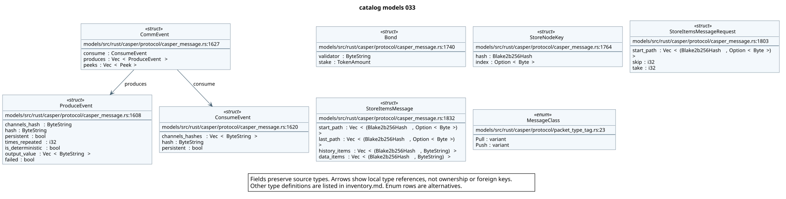

# catalog models 033

[Inventory](inventory.md) | [PlantUML](catalog-models-033.puml)

## Cross-Page References

- `Bond: stake -> TokenAmount [catalog-shared-009.svg]`
- `Bond: validator -> ByteString [catalog-models-027.svg]`
- `CommEvent: peeks -> Peek [catalog-models-032.svg]`
- `ConsumeEvent: channels_hashes -> ByteString [catalog-models-027.svg]`
- `ConsumeEvent: hash -> ByteString [catalog-models-027.svg]`
- `ProduceEvent: channels_hash -> ByteString [catalog-models-027.svg]`
- `ProduceEvent: hash -> ByteString [catalog-models-027.svg]`
- `ProduceEvent: output_value -> ByteString [catalog-models-027.svg]`
- `StoreItemsMessage: data_items -> Blake2b256Hash [catalog-rspacepp-002.svg]`
- `StoreItemsMessage: data_items -> ByteString [catalog-models-027.svg]`
- `StoreItemsMessage: history_items -> Blake2b256Hash [catalog-rspacepp-002.svg]`
- `StoreItemsMessage: history_items -> ByteString [catalog-models-027.svg]`
- `StoreItemsMessage: last_path -> Blake2b256Hash [catalog-rspacepp-002.svg]`
- `StoreItemsMessage: last_path -> Byte [catalog-shared-002.svg]`
- `StoreItemsMessage: start_path -> Blake2b256Hash [catalog-rspacepp-002.svg]`
- `StoreItemsMessage: start_path -> Byte [catalog-shared-002.svg]`
- `StoreItemsMessageRequest: start_path -> Blake2b256Hash [catalog-rspacepp-002.svg]`
- `StoreItemsMessageRequest: start_path -> Byte [catalog-shared-002.svg]`
- `StoreNodeKey: hash -> Blake2b256Hash [catalog-rspacepp-002.svg]`
- `StoreNodeKey: index -> Byte [catalog-shared-002.svg]`
