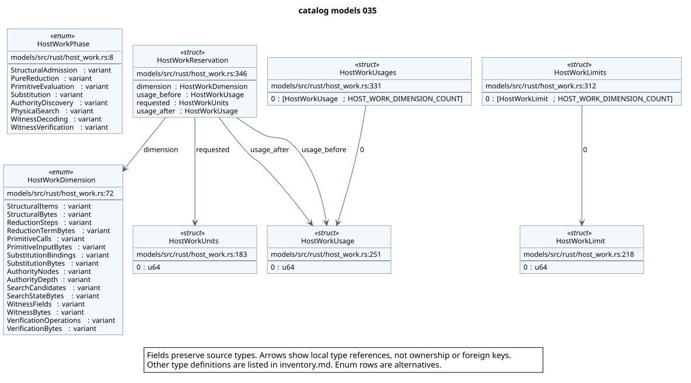

# catalog models 035

[Inventory](inventory.md) | [PlantUML](catalog-models-035.puml)

## Cardinality and Size

[Method, units, limits, and runtime evidence](sizing.md). These are declaration-level assessments, not measured live counts.

### HostWorkPhase

Cardinality: 0..n live values. Current count and owner-level limits are not derivable from this declaration.

Size: Compiler enum layout plus allocations of the active variant only. Do not sum alternative variants.

| Field or variant | Cardinality | Inline bytes or layout | Additional storage or wire encoding |
| --- | --- | --- | --- |
| `StructuralAdmission` | 1 mutually exclusive alternative | No payload. Enum discriminant layout required | None for this unit variant |
| `PureReduction` | 1 mutually exclusive alternative | No payload. Enum discriminant layout required | None for this unit variant |
| `PrimitiveEvaluation` | 1 mutually exclusive alternative | No payload. Enum discriminant layout required | None for this unit variant |
| `Substitution` | 1 mutually exclusive alternative | No payload. Enum discriminant layout required | None for this unit variant |
| `AuthorityDiscovery` | 1 mutually exclusive alternative | No payload. Enum discriminant layout required | None for this unit variant |
| `PhysicalSearch` | 1 mutually exclusive alternative | No payload. Enum discriminant layout required | None for this unit variant |
| `WitnessDecoding` | 1 mutually exclusive alternative | No payload. Enum discriminant layout required | None for this unit variant |
| `WitnessVerification` | 1 mutually exclusive alternative | No payload. Enum discriminant layout required | None for this unit variant |

### HostWorkDimension

Cardinality: 0..n live values. Current count and owner-level limits are not derivable from this declaration.

Size: Compiler enum layout plus allocations of the active variant only. Do not sum alternative variants.

| Field or variant | Cardinality | Inline bytes or layout | Additional storage or wire encoding |
| --- | --- | --- | --- |
| `StructuralItems` | 1 mutually exclusive alternative | No payload. Enum discriminant layout required | None for this unit variant |
| `StructuralBytes` | 1 mutually exclusive alternative | No payload. Enum discriminant layout required | None for this unit variant |
| `ReductionSteps` | 1 mutually exclusive alternative | No payload. Enum discriminant layout required | None for this unit variant |
| `ReductionTermBytes` | 1 mutually exclusive alternative | No payload. Enum discriminant layout required | None for this unit variant |
| `PrimitiveCalls` | 1 mutually exclusive alternative | No payload. Enum discriminant layout required | None for this unit variant |
| `PrimitiveInputBytes` | 1 mutually exclusive alternative | No payload. Enum discriminant layout required | None for this unit variant |
| `SubstitutionBindings` | 1 mutually exclusive alternative | No payload. Enum discriminant layout required | None for this unit variant |
| `SubstitutionBytes` | 1 mutually exclusive alternative | No payload. Enum discriminant layout required | None for this unit variant |
| `AuthorityNodes` | 1 mutually exclusive alternative | No payload. Enum discriminant layout required | None for this unit variant |
| `AuthorityDepth` | 1 mutually exclusive alternative | No payload. Enum discriminant layout required | None for this unit variant |
| `SearchCandidates` | 1 mutually exclusive alternative | No payload. Enum discriminant layout required | None for this unit variant |
| `SearchStateBytes` | 1 mutually exclusive alternative | No payload. Enum discriminant layout required | None for this unit variant |
| `WitnessFields` | 1 mutually exclusive alternative | No payload. Enum discriminant layout required | None for this unit variant |
| `WitnessBytes` | 1 mutually exclusive alternative | No payload. Enum discriminant layout required | None for this unit variant |
| `VerificationOperations` | 1 mutually exclusive alternative | No payload. Enum discriminant layout required | None for this unit variant |
| `VerificationBytes` | 1 mutually exclusive alternative | No payload. Enum discriminant layout required | None for this unit variant |

### HostWorkUnits

Cardinality: 0..n live values. Current count and owner-level limits are not derivable from this declaration.

Size: Sum of field inline layouts plus compiler padding, then uniquely owned allocations. repr and custom implementations can change layout.

| Field or variant | Cardinality | Inline bytes or layout | Additional storage or wire encoding |
| --- | --- | --- | --- |
| `0` | 1 scalar | 8 B | None |

### HostWorkLimit

Cardinality: 0..n live values. Current count and owner-level limits are not derivable from this declaration.

Size: Sum of field inline layouts plus compiler padding, then uniquely owned allocations. repr and custom implementations can change layout.

| Field or variant | Cardinality | Inline bytes or layout | Additional storage or wire encoding |
| --- | --- | --- | --- |
| `0` | 1 scalar | 8 B | None |

### HostWorkUsage

Cardinality: 0..n live values. Current count and owner-level limits are not derivable from this declaration.

Size: Sum of field inline layouts plus compiler padding, then uniquely owned allocations. repr and custom implementations can change layout.

| Field or variant | Cardinality | Inline bytes or layout | Additional storage or wire encoding |
| --- | --- | --- | --- |
| `0` | 1 scalar | 8 B | None |

### HostWorkLimits

Cardinality: 0..n live values. Current count and owner-level limits are not derivable from this declaration.

Size: Sum of field inline layouts plus compiler padding, then uniquely owned allocations. repr and custom implementations can change layout.

| Field or variant | Cardinality | Inline bytes or layout | Additional storage or wire encoding |
| --- | --- | --- | --- |
| `0` | HOST_WORK_DIMENSION_COUNT elements | HOST_WORK_DIMENSION_COUNT * I(element), inline array | Sum of element-owned allocations. Element: Follow the referenced declaration or external implementation. No allocation bound established. |

### HostWorkUsages

Cardinality: 0..n live values. Current count and owner-level limits are not derivable from this declaration.

Size: Sum of field inline layouts plus compiler padding, then uniquely owned allocations. repr and custom implementations can change layout.

| Field or variant | Cardinality | Inline bytes or layout | Additional storage or wire encoding |
| --- | --- | --- | --- |
| `0` | HOST_WORK_DIMENSION_COUNT elements | HOST_WORK_DIMENSION_COUNT * I(element), inline array | Sum of element-owned allocations. Element: Follow the referenced declaration or external implementation. No allocation bound established. |

### HostWorkReservation

Cardinality: 0..n live values. Current count and owner-level limits are not derivable from this declaration.

Size: Sum of field inline layouts plus compiler padding, then uniquely owned allocations. repr and custom implementations can change layout.

| Field or variant | Cardinality | Inline bytes or layout | Additional storage or wire encoding |
| --- | --- | --- | --- |
| `dimension` | 1 value | Compiler layout required | Follow the referenced declaration or external implementation. No allocation bound established. |
| `usage_before` | 1 value | Compiler layout required | Follow the referenced declaration or external implementation. No allocation bound established. |
| `requested` | 1 value | Compiler layout required | Follow the referenced declaration or external implementation. No allocation bound established. |
| `usage_after` | 1 value | Compiler layout required | Follow the referenced declaration or external implementation. No allocation bound established. |

## Cross-Page References

No resolved cross-page references.
