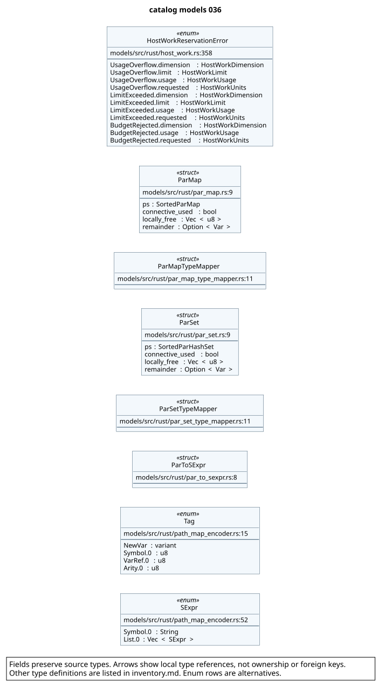

# catalog models 036

[Inventory](inventory.md) | [PlantUML](catalog-models-036.puml)

## Cross-Page References

- `HostWorkReservationError: BudgetRejected.dimension -> HostWorkDimension [catalog-models-035.svg]`
- `HostWorkReservationError: BudgetRejected.requested -> HostWorkUnits [catalog-models-035.svg]`
- `HostWorkReservationError: BudgetRejected.usage -> HostWorkUsage [catalog-models-035.svg]`
- `HostWorkReservationError: LimitExceeded.dimension -> HostWorkDimension [catalog-models-035.svg]`
- `HostWorkReservationError: LimitExceeded.limit -> HostWorkLimit [catalog-models-035.svg]`
- `HostWorkReservationError: LimitExceeded.requested -> HostWorkUnits [catalog-models-035.svg]`
- `HostWorkReservationError: LimitExceeded.usage -> HostWorkUsage [catalog-models-035.svg]`
- `HostWorkReservationError: UsageOverflow.dimension -> HostWorkDimension [catalog-models-035.svg]`
- `HostWorkReservationError: UsageOverflow.limit -> HostWorkLimit [catalog-models-035.svg]`
- `HostWorkReservationError: UsageOverflow.requested -> HostWorkUnits [catalog-models-035.svg]`
- `HostWorkReservationError: UsageOverflow.usage -> HostWorkUsage [catalog-models-035.svg]`
- `ParMap: ps -> SortedParMap [catalog-models-040.svg]`
- `ParSet: ps -> SortedParHashSet [catalog-models-040.svg]`
