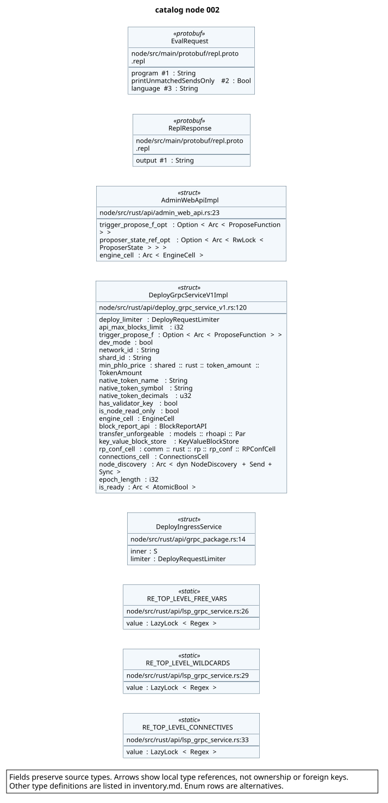

# catalog node 002

[Inventory](inventory.md) | [PlantUML](catalog-node-002.puml)

## Cross-Page References

- `AdminWebApiImpl: engine_cell -> EngineCell [catalog-casper-021.svg]`
- `AdminWebApiImpl: proposer_state_ref_opt -> ProposerState [catalog-casper-049.svg]`
- `AdminWebApiImpl: trigger_propose_f_opt -> ProposeFunction [catalog-casper-039.svg]`
- `DeployGrpcServiceV1Impl: block_report_api -> BlockReportAPI [catalog-casper-004.svg]`
- `DeployGrpcServiceV1Impl: connections_cell -> ConnectionsCell [catalog-comm-004.svg]`
- `DeployGrpcServiceV1Impl: deploy_limiter -> DeployRequestLimiter [catalog-node-003.svg]`
- `DeployGrpcServiceV1Impl: engine_cell -> EngineCell [catalog-casper-021.svg]`
- `DeployGrpcServiceV1Impl: key_value_block_store -> KeyValueBlockStore [catalog-block-storage-008.svg]`
- `DeployGrpcServiceV1Impl: min_phlo_price -> TokenAmount [catalog-shared-009.svg]`
- `DeployGrpcServiceV1Impl: rp_conf_cell -> RPConfCell [catalog-comm-004.svg]`
- `DeployGrpcServiceV1Impl: trigger_propose_f -> ProposeFunction [catalog-casper-039.svg]`
- `DeployIngressService: limiter -> DeployRequestLimiter [catalog-node-003.svg]`
