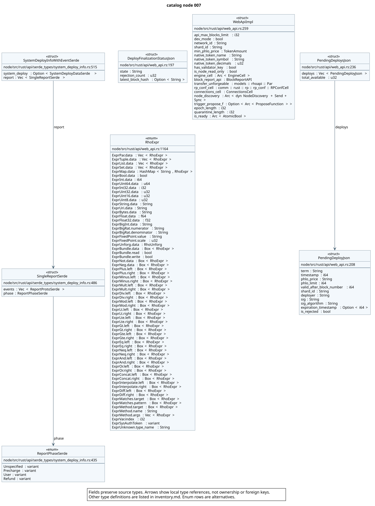

# catalog node 007

[Inventory](inventory.md) | [PlantUML](catalog-node-007.puml)

## Cardinality and Size

[Method, units, limits, and runtime evidence](sizing.md). These are declaration-level assessments, not measured live counts.

### ReportPhaseSerde

Cardinality: 0..n live values. Current count and owner-level limits are not derivable from this declaration.

Size: Compiler enum layout plus allocations of the active variant only. Do not sum alternative variants.

| Field or variant | Cardinality | Inline bytes or layout | Additional storage or wire encoding |
| --- | --- | --- | --- |
| `Unspecified` | 1 mutually exclusive alternative | No payload. Enum discriminant layout required | None for this unit variant |
| `Precharge` | 1 mutually exclusive alternative | No payload. Enum discriminant layout required | None for this unit variant |
| `User` | 1 mutually exclusive alternative | No payload. Enum discriminant layout required | None for this unit variant |
| `Refund` | 1 mutually exclusive alternative | No payload. Enum discriminant layout required | None for this unit variant |

### SingleReportSerde

Cardinality: 0..n live values. Current count and owner-level limits are not derivable from this declaration.

Size: Sum of field inline layouts plus compiler padding, then uniquely owned allocations. repr and custom implementations can change layout.

| Field or variant | Cardinality | Inline bytes or layout | Additional storage or wire encoding |
| --- | --- | --- | --- |
| `events` | 0..n elements | 24 B. Vec header on the generator target | capacity * I(element), plus live element-owned allocations. Zero-sized elements need no backing allocation. Element: Follow the referenced declaration or external implementation. No allocation bound established. |
| `phase` | 1 value | Compiler layout required | Follow the referenced declaration or external implementation. No allocation bound established. |

### SystemDeployInfoWithEventSerde

Cardinality: 0..n live values. Current count and owner-level limits are not derivable from this declaration.

Size: Sum of field inline layouts plus compiler padding, then uniquely owned allocations. repr and custom implementations can change layout.

| Field or variant | Cardinality | Inline bytes or layout | Additional storage or wire encoding |
| --- | --- | --- | --- |
| `system_deploy` | 0..1 present payload | Option layout includes any tag or niche optimization. Do not assume I(T) + 1 | None when absent. Present payload: 1 value. Follow the referenced declaration or external implementation. No allocation bound established. |
| `report` | 0..n elements | 24 B. Vec header on the generator target | capacity * I(element), plus live element-owned allocations. Zero-sized elements need no backing allocation. Element: Follow the referenced declaration or external implementation. No allocation bound established. |

### DeployFinalizationStatusJson

Cardinality: 0..n live values. Current count and owner-level limits are not derivable from this declaration.

Size: Sum of field inline layouts plus compiler padding, then uniquely owned allocations. repr and custom implementations can change layout.

| Field or variant | Cardinality | Inline bytes or layout | Additional storage or wire encoding |
| --- | --- | --- | --- |
| `state` | 0..n UTF-8 bytes | 24 B. String header on the generator target | capacity() bytes, excluding allocator overhead. UTF-8 byte length is not character count |
| `rejection_count` | 1 scalar | 4 B | None |
| `latest_block_hash` | 0..1 present payload | Option layout includes any tag or niche optimization. Do not assume I(T) + 1 | None when absent. Present payload: 0..n UTF-8 bytes. capacity() bytes, excluding allocator overhead. UTF-8 byte length is not character count |

### PendingDeployJson

Cardinality: 0..n live values. Current count and owner-level limits are not derivable from this declaration.

Size: Sum of field inline layouts plus compiler padding, then uniquely owned allocations. repr and custom implementations can change layout.

| Field or variant | Cardinality | Inline bytes or layout | Additional storage or wire encoding |
| --- | --- | --- | --- |
| `term` | 0..n UTF-8 bytes | 24 B. String header on the generator target | capacity() bytes, excluding allocator overhead. UTF-8 byte length is not character count |
| `timestamp` | 1 scalar | 8 B | None |
| `phlo_price` | 0..n UTF-8 bytes | 24 B. String header on the generator target | capacity() bytes, excluding allocator overhead. UTF-8 byte length is not character count |
| `phlo_limit` | 1 scalar | 8 B | None |
| `valid_after_block_number` | 1 scalar | 8 B | None |
| `shard_id` | 0..n UTF-8 bytes | 24 B. String header on the generator target | capacity() bytes, excluding allocator overhead. UTF-8 byte length is not character count |
| `deployer` | 0..n UTF-8 bytes | 24 B. String header on the generator target | capacity() bytes, excluding allocator overhead. UTF-8 byte length is not character count |
| `sig` | 0..n UTF-8 bytes | 24 B. String header on the generator target | capacity() bytes, excluding allocator overhead. UTF-8 byte length is not character count |
| `sig_algorithm` | 0..n UTF-8 bytes | 24 B. String header on the generator target | capacity() bytes, excluding allocator overhead. UTF-8 byte length is not character count |
| `expiration_timestamp` | 0..1 present payload | Option layout includes any tag or niche optimization. Do not assume I(T) + 1 | None when absent. Present payload: 1 scalar. None |
| `is_rejected` | 1 scalar | 1 B | None |

### PendingDeploysJson

Cardinality: 0..n live values. Current count and owner-level limits are not derivable from this declaration.

Size: Sum of field inline layouts plus compiler padding, then uniquely owned allocations. repr and custom implementations can change layout.

| Field or variant | Cardinality | Inline bytes or layout | Additional storage or wire encoding |
| --- | --- | --- | --- |
| `deploys` | 0..n elements | 24 B. Vec header on the generator target | capacity * I(element), plus live element-owned allocations. Zero-sized elements need no backing allocation. Element: Follow the referenced declaration or external implementation. No allocation bound established. |
| `total_available` | 1 scalar | 4 B | None |

### WebApiImpl

Cardinality: 0..n live values. Current count and owner-level limits are not derivable from this declaration.

Size: Sum of field inline layouts plus compiler padding, then uniquely owned allocations. repr and custom implementations can change layout.

| Field or variant | Cardinality | Inline bytes or layout | Additional storage or wire encoding |
| --- | --- | --- | --- |
| `api_max_blocks_limit` | 1 scalar | 4 B | None |
| `dev_mode` | 1 scalar | 1 B | None |
| `network_id` | 0..n UTF-8 bytes | 24 B. String header on the generator target | capacity() bytes, excluding allocator overhead. UTF-8 byte length is not character count |
| `shard_id` | 0..n UTF-8 bytes | 24 B. String header on the generator target | capacity() bytes, excluding allocator overhead. UTF-8 byte length is not character count |
| `min_phlo_price` | 1 value | Compiler layout required | Follow the referenced declaration or external implementation. No allocation bound established. |
| `native_token_name` | 0..n UTF-8 bytes | 24 B. String header on the generator target | capacity() bytes, excluding allocator overhead. UTF-8 byte length is not character count |
| `native_token_symbol` | 0..n UTF-8 bytes | 24 B. String header on the generator target | capacity() bytes, excluding allocator overhead. UTF-8 byte length is not character count |
| `native_token_decimals` | 1 scalar | 4 B | None |
| `has_validator_key` | 1 scalar | 1 B | None |
| `is_node_read_only` | 1 scalar | 1 B | None |
| `engine_cell` | 1 shared strong reference | Pointer or fat pointer, depending on target type | One shared allocation holds the target, counters and alignment. Count it once across all handles |
| `block_report_api` | 1 value | Compiler layout required | Follow the referenced declaration or external implementation. No allocation bound established. |
| `transfer_unforgeable` | 1 value | Compiler layout required | Follow the referenced declaration or external implementation. No allocation bound established. |
| `rp_conf_cell` | 1 value | Compiler layout required | Follow the referenced declaration or external implementation. No allocation bound established. |
| `connections_cell` | 1 value | Compiler layout required | Follow the referenced declaration or external implementation. No allocation bound established. |
| `node_discovery` | 1 shared strong reference | Pointer or fat pointer, depending on target type | One shared allocation holds the target, counters and alignment. Count it once across all handles |
| `trigger_propose_f` | 0..1 present payload | Option layout includes any tag or niche optimization. Do not assume I(T) + 1 | None when absent. Present payload: 1 shared strong reference. One shared allocation holds the target, counters and alignment. Count it once across all handles |
| `epoch_length` | 1 scalar | 4 B | None |
| `quarantine_length` | 1 scalar | 4 B | None |
| `is_ready` | 1 shared strong reference | Pointer or fat pointer, depending on target type | One shared allocation holds the target, counters and alignment. Count it once across all handles |

### RhoExpr

Cardinality: 0..n live values. Current count and owner-level limits are not derivable from this declaration.

Size: Compiler enum layout plus allocations of the active variant only. Do not sum alternative variants.

| Field or variant | Cardinality | Inline bytes or layout | Additional storage or wire encoding |
| --- | --- | --- | --- |
| `ExprPar.data` | 0..n elements when this variant is active | 24 B. Vec header on the generator target | capacity * I(element), plus live element-owned allocations. Zero-sized elements need no backing allocation. Element: Follow the referenced declaration or external implementation. No allocation bound established. |
| `ExprTuple.data` | 0..n elements when this variant is active | 24 B. Vec header on the generator target | capacity * I(element), plus live element-owned allocations. Zero-sized elements need no backing allocation. Element: Follow the referenced declaration or external implementation. No allocation bound established. |
| `ExprList.data` | 0..n elements when this variant is active | 24 B. Vec header on the generator target | capacity * I(element), plus live element-owned allocations. Zero-sized elements need no backing allocation. Element: Follow the referenced declaration or external implementation. No allocation bound established. |
| `ExprSet.data` | 0..n elements when this variant is active | 24 B. Vec header on the generator target | capacity * I(element), plus live element-owned allocations. Zero-sized elements need no backing allocation. Element: Follow the referenced declaration or external implementation. No allocation bound established. |
| `ExprMap.data` | 0..n key/value pairs when this variant is active | Container and hasher implementation required | n keys and n values, their owned allocations, spare capacity, buckets or tree nodes, and control bytes. No type-level count cap |
| `ExprBool.data` | 1 scalar when this variant is active | 1 B | None |
| `ExprInt.data` | 1 scalar when this variant is active | 8 B | None |
| `ExprUint64.data` | 1 scalar when this variant is active | 8 B | None |
| `ExprInt32.data` | 1 scalar when this variant is active | 4 B | None |
| `ExprUint32.data` | 1 scalar when this variant is active | 4 B | None |
| `ExprUint16.data` | 1 scalar when this variant is active | 4 B | None |
| `ExprUint8.data` | 1 scalar when this variant is active | 4 B | None |
| `ExprString.data` | 0..n UTF-8 bytes when this variant is active | 24 B. String header on the generator target | capacity() bytes, excluding allocator overhead. UTF-8 byte length is not character count |
| `ExprUri.data` | 0..n UTF-8 bytes when this variant is active | 24 B. String header on the generator target | capacity() bytes, excluding allocator overhead. UTF-8 byte length is not character count |
| `ExprBytes.data` | 0..n UTF-8 bytes when this variant is active | 24 B. String header on the generator target | capacity() bytes, excluding allocator overhead. UTF-8 byte length is not character count |
| `ExprFloat.data` | 1 scalar when this variant is active | 8 B | None |
| `ExprFloat32.data` | 1 scalar when this variant is active | 4 B | None |
| `ExprBigInt.data` | 0..n UTF-8 bytes when this variant is active | 24 B. String header on the generator target | capacity() bytes, excluding allocator overhead. UTF-8 byte length is not character count |
| `ExprBigRat.numerator` | 0..n UTF-8 bytes when this variant is active | 24 B. String header on the generator target | capacity() bytes, excluding allocator overhead. UTF-8 byte length is not character count |
| `ExprBigRat.denominator` | 0..n UTF-8 bytes when this variant is active | 24 B. String header on the generator target | capacity() bytes, excluding allocator overhead. UTF-8 byte length is not character count |
| `ExprFixedPoint.value` | 0..n UTF-8 bytes when this variant is active | 24 B. String header on the generator target | capacity() bytes, excluding allocator overhead. UTF-8 byte length is not character count |
| `ExprFixedPoint.scale` | 1 scalar when this variant is active | 4 B | None |
| `ExprUnforg.data` | 1 value when this variant is active | Compiler layout required | Follow the referenced declaration or external implementation. No allocation bound established. |
| `ExprBundle.data` | 1 owned target when this variant is active | Pointer or fat pointer, depending on target type | I(target) and its owned allocations, plus allocator overhead. Zero-sized targets need no allocation |
| `ExprBundle.read` | 1 scalar when this variant is active | 1 B | None |
| `ExprBundle.write` | 1 scalar when this variant is active | 1 B | None |
| `ExprNot.data` | 1 owned target when this variant is active | Pointer or fat pointer, depending on target type | I(target) and its owned allocations, plus allocator overhead. Zero-sized targets need no allocation |
| `ExprNeg.data` | 1 owned target when this variant is active | Pointer or fat pointer, depending on target type | I(target) and its owned allocations, plus allocator overhead. Zero-sized targets need no allocation |
| `ExprPlus.left` | 1 owned target when this variant is active | Pointer or fat pointer, depending on target type | I(target) and its owned allocations, plus allocator overhead. Zero-sized targets need no allocation |
| `ExprPlus.right` | 1 owned target when this variant is active | Pointer or fat pointer, depending on target type | I(target) and its owned allocations, plus allocator overhead. Zero-sized targets need no allocation |
| `ExprMinus.left` | 1 owned target when this variant is active | Pointer or fat pointer, depending on target type | I(target) and its owned allocations, plus allocator overhead. Zero-sized targets need no allocation |
| `ExprMinus.right` | 1 owned target when this variant is active | Pointer or fat pointer, depending on target type | I(target) and its owned allocations, plus allocator overhead. Zero-sized targets need no allocation |
| `ExprMult.left` | 1 owned target when this variant is active | Pointer or fat pointer, depending on target type | I(target) and its owned allocations, plus allocator overhead. Zero-sized targets need no allocation |
| `ExprMult.right` | 1 owned target when this variant is active | Pointer or fat pointer, depending on target type | I(target) and its owned allocations, plus allocator overhead. Zero-sized targets need no allocation |
| `ExprDiv.left` | 1 owned target when this variant is active | Pointer or fat pointer, depending on target type | I(target) and its owned allocations, plus allocator overhead. Zero-sized targets need no allocation |
| `ExprDiv.right` | 1 owned target when this variant is active | Pointer or fat pointer, depending on target type | I(target) and its owned allocations, plus allocator overhead. Zero-sized targets need no allocation |
| `ExprMod.left` | 1 owned target when this variant is active | Pointer or fat pointer, depending on target type | I(target) and its owned allocations, plus allocator overhead. Zero-sized targets need no allocation |
| `ExprMod.right` | 1 owned target when this variant is active | Pointer or fat pointer, depending on target type | I(target) and its owned allocations, plus allocator overhead. Zero-sized targets need no allocation |
| `ExprLt.left` | 1 owned target when this variant is active | Pointer or fat pointer, depending on target type | I(target) and its owned allocations, plus allocator overhead. Zero-sized targets need no allocation |
| `ExprLt.right` | 1 owned target when this variant is active | Pointer or fat pointer, depending on target type | I(target) and its owned allocations, plus allocator overhead. Zero-sized targets need no allocation |
| `ExprLte.left` | 1 owned target when this variant is active | Pointer or fat pointer, depending on target type | I(target) and its owned allocations, plus allocator overhead. Zero-sized targets need no allocation |
| `ExprLte.right` | 1 owned target when this variant is active | Pointer or fat pointer, depending on target type | I(target) and its owned allocations, plus allocator overhead. Zero-sized targets need no allocation |
| `ExprGt.left` | 1 owned target when this variant is active | Pointer or fat pointer, depending on target type | I(target) and its owned allocations, plus allocator overhead. Zero-sized targets need no allocation |
| `ExprGt.right` | 1 owned target when this variant is active | Pointer or fat pointer, depending on target type | I(target) and its owned allocations, plus allocator overhead. Zero-sized targets need no allocation |
| `ExprGte.left` | 1 owned target when this variant is active | Pointer or fat pointer, depending on target type | I(target) and its owned allocations, plus allocator overhead. Zero-sized targets need no allocation |
| `ExprGte.right` | 1 owned target when this variant is active | Pointer or fat pointer, depending on target type | I(target) and its owned allocations, plus allocator overhead. Zero-sized targets need no allocation |
| `ExprEq.left` | 1 owned target when this variant is active | Pointer or fat pointer, depending on target type | I(target) and its owned allocations, plus allocator overhead. Zero-sized targets need no allocation |
| `ExprEq.right` | 1 owned target when this variant is active | Pointer or fat pointer, depending on target type | I(target) and its owned allocations, plus allocator overhead. Zero-sized targets need no allocation |
| `ExprNeq.left` | 1 owned target when this variant is active | Pointer or fat pointer, depending on target type | I(target) and its owned allocations, plus allocator overhead. Zero-sized targets need no allocation |
| `ExprNeq.right` | 1 owned target when this variant is active | Pointer or fat pointer, depending on target type | I(target) and its owned allocations, plus allocator overhead. Zero-sized targets need no allocation |
| `ExprAnd.left` | 1 owned target when this variant is active | Pointer or fat pointer, depending on target type | I(target) and its owned allocations, plus allocator overhead. Zero-sized targets need no allocation |
| `ExprAnd.right` | 1 owned target when this variant is active | Pointer or fat pointer, depending on target type | I(target) and its owned allocations, plus allocator overhead. Zero-sized targets need no allocation |
| `ExprOr.left` | 1 owned target when this variant is active | Pointer or fat pointer, depending on target type | I(target) and its owned allocations, plus allocator overhead. Zero-sized targets need no allocation |
| `ExprOr.right` | 1 owned target when this variant is active | Pointer or fat pointer, depending on target type | I(target) and its owned allocations, plus allocator overhead. Zero-sized targets need no allocation |
| `ExprConcat.left` | 1 owned target when this variant is active | Pointer or fat pointer, depending on target type | I(target) and its owned allocations, plus allocator overhead. Zero-sized targets need no allocation |
| `ExprConcat.right` | 1 owned target when this variant is active | Pointer or fat pointer, depending on target type | I(target) and its owned allocations, plus allocator overhead. Zero-sized targets need no allocation |
| `ExprInterpolate.left` | 1 owned target when this variant is active | Pointer or fat pointer, depending on target type | I(target) and its owned allocations, plus allocator overhead. Zero-sized targets need no allocation |
| `ExprInterpolate.right` | 1 owned target when this variant is active | Pointer or fat pointer, depending on target type | I(target) and its owned allocations, plus allocator overhead. Zero-sized targets need no allocation |
| `ExprDiff.left` | 1 owned target when this variant is active | Pointer or fat pointer, depending on target type | I(target) and its owned allocations, plus allocator overhead. Zero-sized targets need no allocation |
| `ExprDiff.right` | 1 owned target when this variant is active | Pointer or fat pointer, depending on target type | I(target) and its owned allocations, plus allocator overhead. Zero-sized targets need no allocation |
| `ExprMatches.target` | 1 owned target when this variant is active | Pointer or fat pointer, depending on target type | I(target) and its owned allocations, plus allocator overhead. Zero-sized targets need no allocation |
| `ExprMatches.pattern` | 1 owned target when this variant is active | Pointer or fat pointer, depending on target type | I(target) and its owned allocations, plus allocator overhead. Zero-sized targets need no allocation |
| `ExprMethod.target` | 1 owned target when this variant is active | Pointer or fat pointer, depending on target type | I(target) and its owned allocations, plus allocator overhead. Zero-sized targets need no allocation |
| `ExprMethod.name` | 0..n UTF-8 bytes when this variant is active | 24 B. String header on the generator target | capacity() bytes, excluding allocator overhead. UTF-8 byte length is not character count |
| `ExprMethod.args` | 0..n elements when this variant is active | 24 B. Vec header on the generator target | capacity * I(element), plus live element-owned allocations. Zero-sized elements need no backing allocation. Element: Follow the referenced declaration or external implementation. No allocation bound established. |
| `ExprVar.index` | 1 scalar when this variant is active | 4 B | None |
| `ExprSysAuthToken` | 1 mutually exclusive alternative | No payload. Enum discriminant layout required | None for this unit variant |
| `ExprUnknown.type_name` | 0..n UTF-8 bytes when this variant is active | 24 B. String header on the generator target | capacity() bytes, excluding allocator overhead. UTF-8 byte length is not character count |

## Cross-Page References

- `RhoExpr: ExprUnforg.data -> RhoUnforg [catalog-node-008.svg]`
- `SingleReportSerde: events -> ReportProtoSerde [catalog-node-006.svg]`
- `SystemDeployInfoWithEventSerde: system_deploy -> SystemDeployDataSerde [catalog-node-006.svg]`
- `WebApiImpl: block_report_api -> BlockReportAPI [catalog-casper-004.svg]`
- `WebApiImpl: connections_cell -> ConnectionsCell [catalog-comm-004.svg]`
- `WebApiImpl: engine_cell -> EngineCell [catalog-casper-021.svg]`
- `WebApiImpl: min_phlo_price -> TokenAmount [catalog-shared-009.svg]`
- `WebApiImpl: rp_conf_cell -> RPConfCell [catalog-comm-004.svg]`
- `WebApiImpl: trigger_propose_f -> ProposeFunction [catalog-casper-039.svg]`
