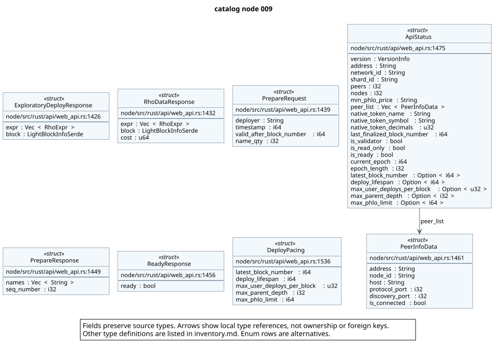

# catalog node 009

[Inventory](inventory.md) | [PlantUML](catalog-node-009.puml)

## Cross-Page References

- `ApiStatus: version -> VersionInfo [catalog-node-010.svg]`
- `ExploratoryDeployResponse: block -> LightBlockInfoSerde [catalog-node-004.svg]`
- `ExploratoryDeployResponse: expr -> RhoExpr [catalog-node-007.svg]`
- `RhoDataResponse: block -> LightBlockInfoSerde [catalog-node-004.svg]`
- `RhoDataResponse: expr -> RhoExpr [catalog-node-007.svg]`
