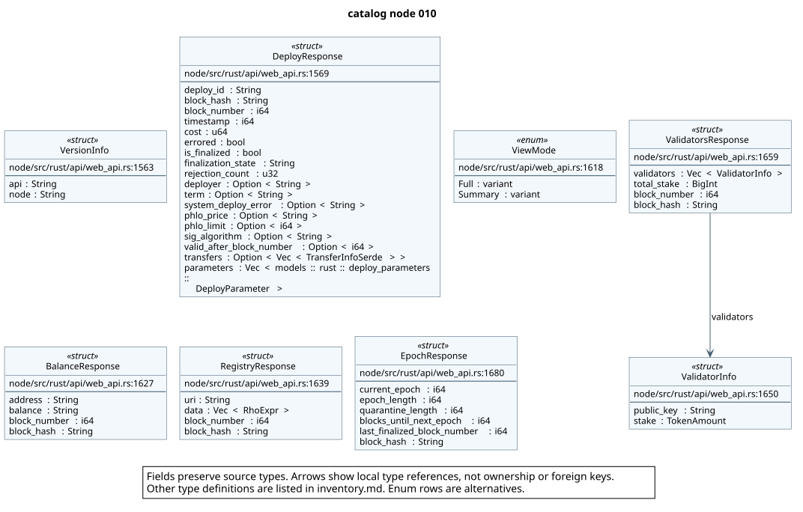

# catalog node 010

[Inventory](inventory.md) | [PlantUML](catalog-node-010.puml)

## Cross-Page References

- `DeployResponse: parameters -> DeployParameter [catalog-models-034.svg]`
- `DeployResponse: transfers -> TransferInfoSerde [catalog-node-004.svg]`
- `RegistryResponse: data -> RhoExpr [catalog-node-007.svg]`
- `ValidatorInfo: stake -> TokenAmount [catalog-shared-009.svg]`
