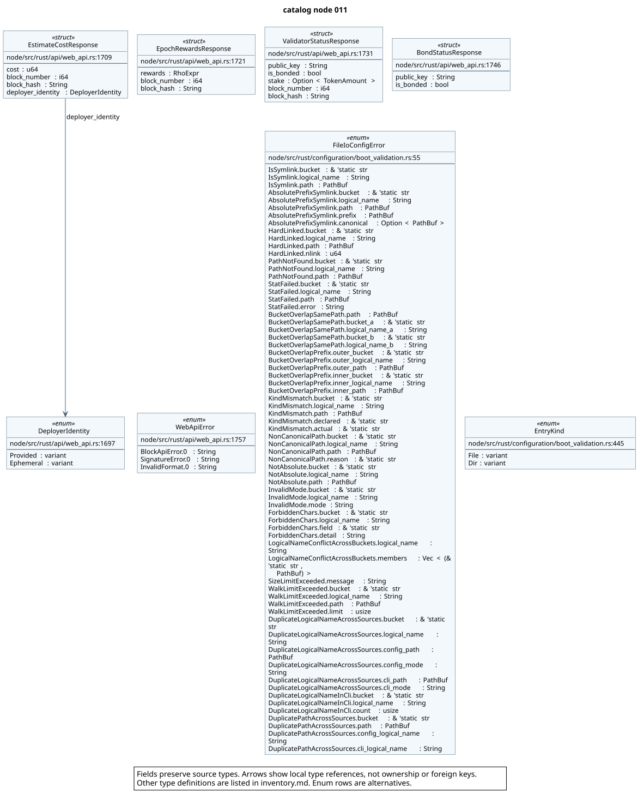

# catalog node 011

[Inventory](inventory.md) | [PlantUML](catalog-node-011.puml)

## Cross-Page References

- `EpochRewardsResponse: rewards -> RhoExpr [catalog-node-007.svg]`
- `ValidatorStatusResponse: stake -> TokenAmount [catalog-shared-009.svg]`
