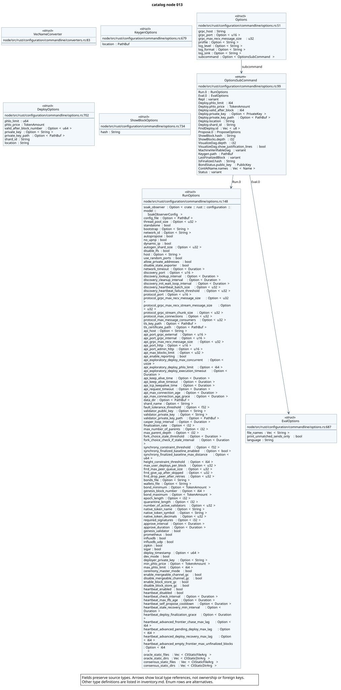

# catalog node 013

[Inventory](inventory.md) | [PlantUML](catalog-node-013.puml)

## Cross-Page References

- `DeployOptions: phlo_price -> TokenAmount [catalog-shared-009.svg]`
- `OptionsSubCommand: Deploy.phlo_price -> TokenAmount [catalog-shared-009.svg]`
- `OptionsSubCommand: Deploy.private_key -> PrivateKey [catalog-crypto-001.svg]`
- `OptionsSubCommand: Propose.0 -> ProposeOptions [catalog-node-014.svg]`
- `RunOptions: bond_maximum -> TokenAmount [catalog-shared-009.svg]`
- `RunOptions: bond_minimum -> TokenAmount [catalog-shared-009.svg]`
- `RunOptions: consensus_static_dirs -> CliStaticDirArg [catalog-node-012.svg]`
- `RunOptions: consensus_static_files -> CliStaticFileArg [catalog-node-012.svg]`
- `RunOptions: min_phlo_price -> TokenAmount [catalog-shared-009.svg]`
- `RunOptions: oracle_static_dirs -> CliStaticDirArg [catalog-node-012.svg]`
- `RunOptions: oracle_static_files -> CliStaticFileArg [catalog-node-012.svg]`
- `RunOptions: soak_observer -> SoakObserverConfig [catalog-node-015.svg]`
