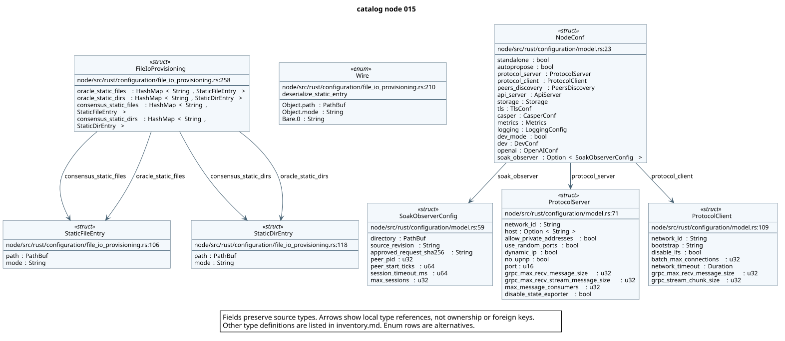

# catalog node 015

[Inventory](inventory.md) | [PlantUML](catalog-node-015.puml)

## Cross-Page References

- `NodeConf: api_server -> ApiServer [catalog-node-016.svg]`
- `NodeConf: casper -> CasperConf [catalog-casper-020.svg]`
- `NodeConf: dev -> DevConf [catalog-node-016.svg]`
- `NodeConf: logging -> LoggingConfig [catalog-shared-010.svg]`
- `NodeConf: metrics -> Metrics [catalog-node-016.svg]`
- `NodeConf: openai -> OpenAIConf [catalog-node-017.svg]`
- `NodeConf: peers_discovery -> PeersDiscovery [catalog-node-016.svg]`
- `NodeConf: storage -> Storage [catalog-node-016.svg]`
- `NodeConf: tls -> TlsConf [catalog-node-016.svg]`
