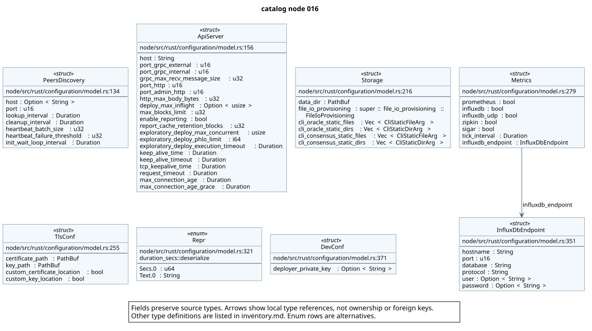

# catalog node 016

[Inventory](inventory.md) | [PlantUML](catalog-node-016.puml)

## Cardinality and Size

[Method, units, limits, and runtime evidence](sizing.md). These are declaration-level assessments, not measured live counts.

### PeersDiscovery

Cardinality: 0..n live values. Current count and owner-level limits are not derivable from this declaration.

Size: Sum of field inline layouts plus compiler padding, then uniquely owned allocations. repr and custom implementations can change layout.

| Field or variant | Cardinality | Inline bytes or layout | Additional storage or wire encoding |
| --- | --- | --- | --- |
| `host` | 0..1 present payload | Option layout includes any tag or niche optimization. Do not assume I(T) + 1 | None when absent. Present payload: 0..n UTF-8 bytes. capacity() bytes, excluding allocator overhead. UTF-8 byte length is not character count |
| `port` | 1 scalar | 2 B | None |
| `lookup_interval` | 1 value | Compiler layout required | Follow the referenced declaration or external implementation. No allocation bound established. |
| `cleanup_interval` | 1 value | Compiler layout required | Follow the referenced declaration or external implementation. No allocation bound established. |
| `heartbeat_batch_size` | 1 scalar | 4 B | None |
| `heartbeat_failure_threshold` | 1 scalar | 4 B | None |
| `init_wait_loop_interval` | 1 value | Compiler layout required | Follow the referenced declaration or external implementation. No allocation bound established. |

### ApiServer

Cardinality: 0..n live values. Current count and owner-level limits are not derivable from this declaration.

Size: Sum of field inline layouts plus compiler padding, then uniquely owned allocations. repr and custom implementations can change layout.

| Field or variant | Cardinality | Inline bytes or layout | Additional storage or wire encoding |
| --- | --- | --- | --- |
| `host` | 0..n UTF-8 bytes | 24 B. String header on the generator target | capacity() bytes, excluding allocator overhead. UTF-8 byte length is not character count |
| `port_grpc_external` | 1 scalar | 2 B | None |
| `port_grpc_internal` | 1 scalar | 2 B | None |
| `grpc_max_recv_message_size` | 1 scalar | 4 B | None |
| `port_http` | 1 scalar | 2 B | None |
| `port_admin_http` | 1 scalar | 2 B | None |
| `http_max_body_bytes` | 1 scalar | 4 B | None |
| `deploy_max_inflight` | 0..1 present payload | Option layout includes any tag or niche optimization. Do not assume I(T) + 1 | None when absent. Present payload: 1 scalar. None |
| `max_blocks_limit` | 1 scalar | 4 B | None |
| `enable_reporting` | 1 scalar | 1 B | None |
| `report_cache_retention_blocks` | 1 scalar | 4 B | None |
| `exploratory_deploy_max_concurrent` | 1 scalar | 8 B | None |
| `exploratory_deploy_phlo_limit` | 1 scalar | 8 B | None |
| `exploratory_deploy_execution_timeout` | 1 value | Compiler layout required | Follow the referenced declaration or external implementation. No allocation bound established. |
| `keep_alive_time` | 1 value | Compiler layout required | Follow the referenced declaration or external implementation. No allocation bound established. |
| `keep_alive_timeout` | 1 value | Compiler layout required | Follow the referenced declaration or external implementation. No allocation bound established. |
| `tcp_keepalive_time` | 1 value | Compiler layout required | Follow the referenced declaration or external implementation. No allocation bound established. |
| `request_timeout` | 1 value | Compiler layout required | Follow the referenced declaration or external implementation. No allocation bound established. |
| `max_connection_age` | 1 value | Compiler layout required | Follow the referenced declaration or external implementation. No allocation bound established. |
| `max_connection_age_grace` | 1 value | Compiler layout required | Follow the referenced declaration or external implementation. No allocation bound established. |

### Storage

Cardinality: 0..n live values. Current count and owner-level limits are not derivable from this declaration.

Size: Sum of field inline layouts plus compiler padding, then uniquely owned allocations. repr and custom implementations can change layout.

| Field or variant | Cardinality | Inline bytes or layout | Additional storage or wire encoding |
| --- | --- | --- | --- |
| `data_dir` | 1 value | Compiler layout required | Follow the referenced declaration or external implementation. No allocation bound established. |
| `file_io_provisioning` | 1 value | Compiler layout required | Follow the referenced declaration or external implementation. No allocation bound established. |
| `cli_oracle_static_files` | 0..n elements | 24 B. Vec header on the generator target | capacity * I(element), plus live element-owned allocations. Zero-sized elements need no backing allocation. Element: Follow the referenced declaration or external implementation. No allocation bound established. |
| `cli_oracle_static_dirs` | 0..n elements | 24 B. Vec header on the generator target | capacity * I(element), plus live element-owned allocations. Zero-sized elements need no backing allocation. Element: Follow the referenced declaration or external implementation. No allocation bound established. |
| `cli_consensus_static_files` | 0..n elements | 24 B. Vec header on the generator target | capacity * I(element), plus live element-owned allocations. Zero-sized elements need no backing allocation. Element: Follow the referenced declaration or external implementation. No allocation bound established. |
| `cli_consensus_static_dirs` | 0..n elements | 24 B. Vec header on the generator target | capacity * I(element), plus live element-owned allocations. Zero-sized elements need no backing allocation. Element: Follow the referenced declaration or external implementation. No allocation bound established. |

### TlsConf

Cardinality: 0..n live values. Current count and owner-level limits are not derivable from this declaration.

Size: Sum of field inline layouts plus compiler padding, then uniquely owned allocations. repr and custom implementations can change layout.

| Field or variant | Cardinality | Inline bytes or layout | Additional storage or wire encoding |
| --- | --- | --- | --- |
| `certificate_path` | 1 value | Compiler layout required | Follow the referenced declaration or external implementation. No allocation bound established. |
| `key_path` | 1 value | Compiler layout required | Follow the referenced declaration or external implementation. No allocation bound established. |
| `custom_certificate_location` | 1 scalar | 1 B | None |
| `custom_key_location` | 1 scalar | 1 B | None |

### Metrics

Cardinality: 0..n live values. Current count and owner-level limits are not derivable from this declaration.

Size: Sum of field inline layouts plus compiler padding, then uniquely owned allocations. repr and custom implementations can change layout.

| Field or variant | Cardinality | Inline bytes or layout | Additional storage or wire encoding |
| --- | --- | --- | --- |
| `prometheus` | 1 scalar | 1 B | None |
| `influxdb` | 1 scalar | 1 B | None |
| `influxdb_udp` | 1 scalar | 1 B | None |
| `zipkin` | 1 scalar | 1 B | None |
| `sigar` | 1 scalar | 1 B | None |
| `tick_interval` | 1 value | Compiler layout required | Follow the referenced declaration or external implementation. No allocation bound established. |
| `influxdb_endpoint` | 1 value | Compiler layout required | Follow the referenced declaration or external implementation. No allocation bound established. |

### Repr

Cardinality: 0..n live values. Current count and owner-level limits are not derivable from this declaration.

Size: Compiler enum layout plus allocations of the active variant only. Do not sum alternative variants.

| Field or variant | Cardinality | Inline bytes or layout | Additional storage or wire encoding |
| --- | --- | --- | --- |
| `Secs.0` | 1 scalar when this variant is active | 8 B | None |
| `Text.0` | 0..n UTF-8 bytes when this variant is active | 24 B. String header on the generator target | capacity() bytes, excluding allocator overhead. UTF-8 byte length is not character count |

### InfluxDbEndpoint

Cardinality: 0..n live values. Current count and owner-level limits are not derivable from this declaration.

Size: Sum of field inline layouts plus compiler padding, then uniquely owned allocations. repr and custom implementations can change layout.

| Field or variant | Cardinality | Inline bytes or layout | Additional storage or wire encoding |
| --- | --- | --- | --- |
| `hostname` | 0..n UTF-8 bytes | 24 B. String header on the generator target | capacity() bytes, excluding allocator overhead. UTF-8 byte length is not character count |
| `port` | 1 scalar | 2 B | None |
| `database` | 0..n UTF-8 bytes | 24 B. String header on the generator target | capacity() bytes, excluding allocator overhead. UTF-8 byte length is not character count |
| `protocol` | 0..n UTF-8 bytes | 24 B. String header on the generator target | capacity() bytes, excluding allocator overhead. UTF-8 byte length is not character count |
| `user` | 0..1 present payload | Option layout includes any tag or niche optimization. Do not assume I(T) + 1 | None when absent. Present payload: 0..n UTF-8 bytes. capacity() bytes, excluding allocator overhead. UTF-8 byte length is not character count |
| `password` | 0..1 present payload | Option layout includes any tag or niche optimization. Do not assume I(T) + 1 | None when absent. Present payload: 0..n UTF-8 bytes. capacity() bytes, excluding allocator overhead. UTF-8 byte length is not character count |

### DevConf

Cardinality: 0..n live values. Current count and owner-level limits are not derivable from this declaration.

Size: Sum of field inline layouts plus compiler padding, then uniquely owned allocations. repr and custom implementations can change layout.

| Field or variant | Cardinality | Inline bytes or layout | Additional storage or wire encoding |
| --- | --- | --- | --- |
| `deployer_private_key` | 0..1 present payload | Option layout includes any tag or niche optimization. Do not assume I(T) + 1 | None when absent. Present payload: 0..n UTF-8 bytes. capacity() bytes, excluding allocator overhead. UTF-8 byte length is not character count |

## Cross-Page References

- `Storage: cli_consensus_static_dirs -> CliStaticDirArg [catalog-node-012.svg]`
- `Storage: cli_consensus_static_files -> CliStaticFileArg [catalog-node-012.svg]`
- `Storage: cli_oracle_static_dirs -> CliStaticDirArg [catalog-node-012.svg]`
- `Storage: cli_oracle_static_files -> CliStaticFileArg [catalog-node-012.svg]`
- `Storage: file_io_provisioning -> FileIoProvisioning [catalog-node-015.svg]`
