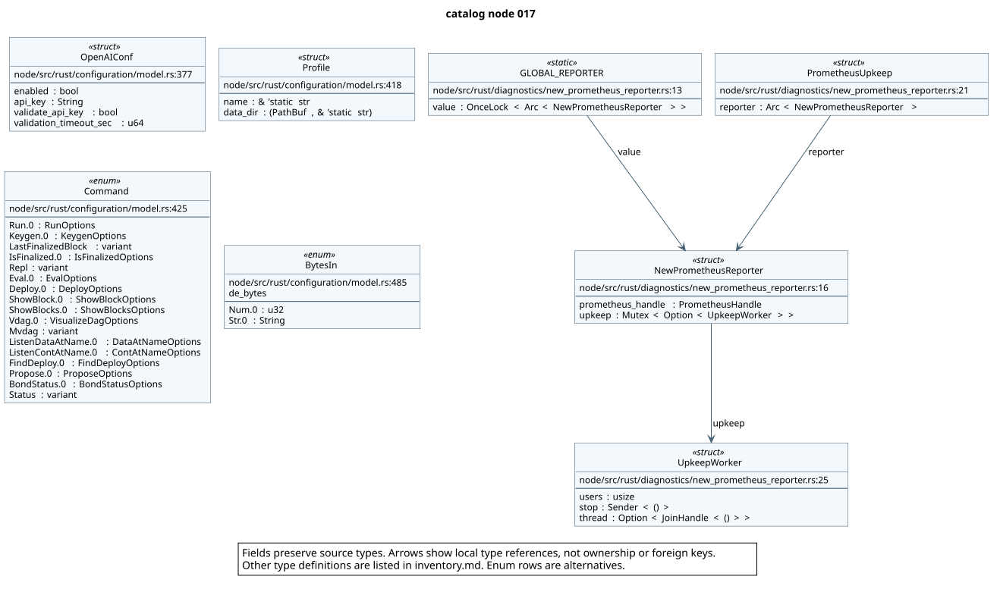

# catalog node 017

[Inventory](inventory.md) | [PlantUML](catalog-node-017.puml)

## Cross-Page References

- `Command: BondStatus.0 -> BondStatusOptions [catalog-node-014.svg]`
- `Command: Deploy.0 -> DeployOptions [catalog-node-013.svg]`
- `Command: Eval.0 -> EvalOptions [catalog-node-013.svg]`
- `Command: FindDeploy.0 -> FindDeployOptions [catalog-node-014.svg]`
- `Command: IsFinalized.0 -> IsFinalizedOptions [catalog-node-014.svg]`
- `Command: Keygen.0 -> KeygenOptions [catalog-node-013.svg]`
- `Command: ListenContAtName.0 -> ContAtNameOptions [catalog-node-014.svg]`
- `Command: ListenDataAtName.0 -> DataAtNameOptions [catalog-node-014.svg]`
- `Command: Propose.0 -> ProposeOptions [catalog-node-014.svg]`
- `Command: Run.0 -> RunOptions [catalog-node-013.svg]`
- `Command: ShowBlock.0 -> ShowBlockOptions [catalog-node-013.svg]`
- `Command: ShowBlocks.0 -> ShowBlocksOptions [catalog-node-014.svg]`
- `Command: Vdag.0 -> VisualizeDagOptions [catalog-node-014.svg]`
