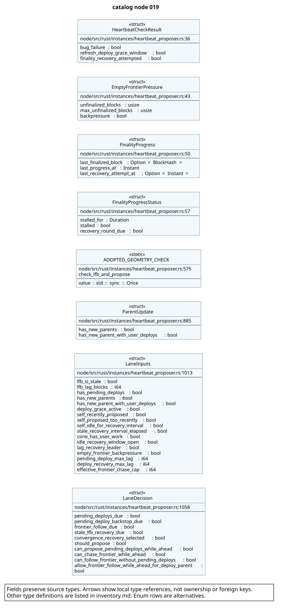

# catalog node 019

[Inventory](inventory.md) | [PlantUML](catalog-node-019.puml)

## Cardinality and Size

[Method, units, limits, and runtime evidence](sizing.md). These are declaration-level assessments, not measured live counts.

### HeartbeatCheckResult

Cardinality: 0..n live values. Current count and owner-level limits are not derivable from this declaration.

Size: Sum of field inline layouts plus compiler padding, then uniquely owned allocations. repr and custom implementations can change layout.

| Field or variant | Cardinality | Inline bytes or layout | Additional storage or wire encoding |
| --- | --- | --- | --- |
| `bug_failure` | 1 scalar | 1 B | None |
| `refresh_deploy_grace_window` | 1 scalar | 1 B | None |
| `finality_recovery_attempted` | 1 scalar | 1 B | None |

### EmptyFrontierPressure

Cardinality: 0..n live values. Current count and owner-level limits are not derivable from this declaration.

Size: Sum of field inline layouts plus compiler padding, then uniquely owned allocations. repr and custom implementations can change layout.

| Field or variant | Cardinality | Inline bytes or layout | Additional storage or wire encoding |
| --- | --- | --- | --- |
| `unfinalized_blocks` | 1 scalar | 8 B | None |
| `max_unfinalized_blocks` | 1 scalar | 8 B | None |
| `backpressure` | 1 scalar | 1 B | None |

### FinalityProgress

Cardinality: 0..n live values. Current count and owner-level limits are not derivable from this declaration.

Size: Sum of field inline layouts plus compiler padding, then uniquely owned allocations. repr and custom implementations can change layout.

| Field or variant | Cardinality | Inline bytes or layout | Additional storage or wire encoding |
| --- | --- | --- | --- |
| `last_finalized_block` | 0..1 present payload | Option layout includes any tag or niche optimization. Do not assume I(T) + 1 | None when absent. Present payload: 1 value. Follow the referenced declaration or external implementation. No allocation bound established. |
| `last_progress_at` | 1 value | Compiler layout required | Follow the referenced declaration or external implementation. No allocation bound established. |
| `last_recovery_attempt_at` | 0..1 present payload | Option layout includes any tag or niche optimization. Do not assume I(T) + 1 | None when absent. Present payload: 1 value. Follow the referenced declaration or external implementation. No allocation bound established. |

### FinalityProgressStatus

Cardinality: 0..n live values. Current count and owner-level limits are not derivable from this declaration.

Size: Sum of field inline layouts plus compiler padding, then uniquely owned allocations. repr and custom implementations can change layout.

| Field or variant | Cardinality | Inline bytes or layout | Additional storage or wire encoding |
| --- | --- | --- | --- |
| `stalled_for` | 1 value | Compiler layout required | Follow the referenced declaration or external implementation. No allocation bound established. |
| `stalled` | 1 scalar | 1 B | None |
| `recovery_round_due` | 1 scalar | 1 B | None |

### ADOPTED_GEOMETRY_CHECK

Cardinality: One slot per linked process instance. Lazy payload can be uninitialized.

Size: Declared slot or lazy wrapper layout plus initialized owned allocations.

| Field or variant | Cardinality | Inline bytes or layout | Additional storage or wire encoding |
| --- | --- | --- | --- |
| `value` | 1 value | Compiler layout required | Follow the referenced declaration or external implementation. No allocation bound established. |

### ParentUpdate

Cardinality: 0..n live values. Current count and owner-level limits are not derivable from this declaration.

Size: Sum of field inline layouts plus compiler padding, then uniquely owned allocations. repr and custom implementations can change layout.

| Field or variant | Cardinality | Inline bytes or layout | Additional storage or wire encoding |
| --- | --- | --- | --- |
| `has_new_parents` | 1 scalar | 1 B | None |
| `has_new_parent_with_user_deploys` | 1 scalar | 1 B | None |

### LaneInputs

Cardinality: 0..n live values. Current count and owner-level limits are not derivable from this declaration.

Size: Sum of field inline layouts plus compiler padding, then uniquely owned allocations. repr and custom implementations can change layout.

| Field or variant | Cardinality | Inline bytes or layout | Additional storage or wire encoding |
| --- | --- | --- | --- |
| `lfb_is_stale` | 1 scalar | 1 B | None |
| `lfb_lag_blocks` | 1 scalar | 8 B | None |
| `has_pending_deploys` | 1 scalar | 1 B | None |
| `has_new_parents` | 1 scalar | 1 B | None |
| `has_new_parent_with_user_deploys` | 1 scalar | 1 B | None |
| `deploy_grace_active` | 1 scalar | 1 B | None |
| `self_recently_proposed` | 1 scalar | 1 B | None |
| `self_proposed_too_recently` | 1 scalar | 1 B | None |
| `self_idle_for_recovery_interval` | 1 scalar | 1 B | None |
| `stale_recovery_interval_elapsed` | 1 scalar | 1 B | None |
| `cone_has_user_work` | 1 scalar | 1 B | None |
| `idle_recovery_window_open` | 1 scalar | 1 B | None |
| `lag_recovery_leader` | 1 scalar | 1 B | None |
| `empty_frontier_backpressure` | 1 scalar | 1 B | None |
| `pending_deploy_max_lag` | 1 scalar | 8 B | None |
| `deploy_recovery_max_lag` | 1 scalar | 8 B | None |
| `effective_frontier_chase_cap` | 1 scalar | 8 B | None |

### LaneDecision

Cardinality: 0..n live values. Current count and owner-level limits are not derivable from this declaration.

Size: Sum of field inline layouts plus compiler padding, then uniquely owned allocations. repr and custom implementations can change layout.

| Field or variant | Cardinality | Inline bytes or layout | Additional storage or wire encoding |
| --- | --- | --- | --- |
| `pending_deploys_due` | 1 scalar | 1 B | None |
| `pending_deploy_backstop_due` | 1 scalar | 1 B | None |
| `frontier_follow_due` | 1 scalar | 1 B | None |
| `stale_lfb_recovery_due` | 1 scalar | 1 B | None |
| `convergence_recovery_selected` | 1 scalar | 1 B | None |
| `should_propose` | 1 scalar | 1 B | None |
| `can_propose_pending_deploys_while_ahead` | 1 scalar | 1 B | None |
| `can_chase_frontier_while_ahead` | 1 scalar | 1 B | None |
| `can_follow_frontier_without_pending_deploys` | 1 scalar | 1 B | None |
| `allow_frontier_follow_while_ahead_for_deploy_parent` | 1 scalar | 1 B | None |

## Cross-Page References

- `FinalityProgress: last_finalized_block -> BlockHash [catalog-models-027.svg]`
