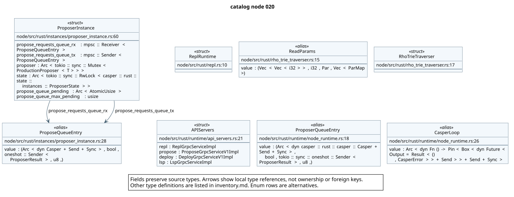

# catalog node 020

[Inventory](inventory.md) | [PlantUML](catalog-node-020.puml)

## Cross-Page References

- `APIServers: deploy -> DeployGrpcServiceV1Impl [catalog-node-002.svg]`
- `APIServers: lsp -> LspGrpcServiceImpl [catalog-node-003.svg]`
- `APIServers: propose -> ProposeGrpcServiceV1Impl [catalog-node-003.svg]`
- `APIServers: repl -> ReplGrpcServiceImpl [catalog-node-003.svg]`
- `CasperLoop: value -> CasperError [catalog-casper-030.svg]`
- `ProposeQueueEntry: value -> ProposerResult [catalog-casper-018.svg]`
- `ProposerInstance: proposer -> ProductionProposer [catalog-casper-018.svg]`
- `ProposerInstance: state -> ProposerState [catalog-casper-049.svg]`
- `ProposerQueueEntry: value -> ProposerResult [catalog-casper-018.svg]`
- `ReadParams: value -> ParMap [catalog-models-036.svg]`
