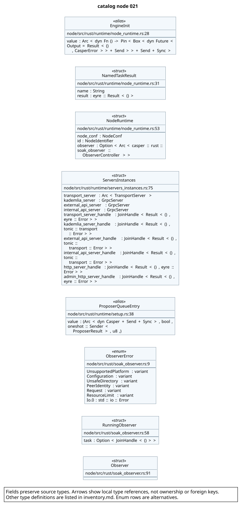

# catalog node 021

[Inventory](inventory.md) | [PlantUML](catalog-node-021.puml)

## Cardinality and Size

[Method, units, limits, and runtime evidence](sizing.md). These are declaration-level assessments, not measured live counts.

### EngineInit

Cardinality: Alias, not a separate allocation. Count values of the target type.

Size: Same layout and allocations as target. Do not add alias bytes again.

| Field or variant | Cardinality | Inline bytes or layout | Additional storage or wire encoding |
| --- | --- | --- | --- |
| `value` | 1 shared strong reference | Pointer or fat pointer, depending on target type | One shared allocation holds the target, counters and alignment. Count it once across all handles |

### NamedTaskResult

Cardinality: 0..n live values. Current count and owner-level limits are not derivable from this declaration.

Size: Sum of field inline layouts plus compiler padding, then uniquely owned allocations. repr and custom implementations can change layout.

| Field or variant | Cardinality | Inline bytes or layout | Additional storage or wire encoding |
| --- | --- | --- | --- |
| `name` | 0..n UTF-8 bytes | 24 B. String header on the generator target | capacity() bytes, excluding allocator overhead. UTF-8 byte length is not character count |
| `result` | 1 of 2 alternatives | Maximum variant layout plus compiler tag and padding | Only the active Ok or Err payload contributes owned allocations |

### NodeRuntime

Cardinality: 0..n live values. Current count and owner-level limits are not derivable from this declaration.

Size: Sum of field inline layouts plus compiler padding, then uniquely owned allocations. repr and custom implementations can change layout.

| Field or variant | Cardinality | Inline bytes or layout | Additional storage or wire encoding |
| --- | --- | --- | --- |
| `node_conf` | 1 value | Compiler layout required | Follow the referenced declaration or external implementation. No allocation bound established. |
| `id` | 1 value | Compiler layout required | Follow the referenced declaration or external implementation. No allocation bound established. |
| `observer` | 0..1 present payload | Option layout includes any tag or niche optimization. Do not assume I(T) + 1 | None when absent. Present payload: 1 shared strong reference. One shared allocation holds the target, counters and alignment. Count it once across all handles |

### ServersInstances

Cardinality: 0..n live values. Current count and owner-level limits are not derivable from this declaration.

Size: Sum of field inline layouts plus compiler padding, then uniquely owned allocations. repr and custom implementations can change layout.

| Field or variant | Cardinality | Inline bytes or layout | Additional storage or wire encoding |
| --- | --- | --- | --- |
| `transport_server` | 1 shared strong reference | Pointer or fat pointer, depending on target type | One shared allocation holds the target, counters and alignment. Count it once across all handles |
| `kademlia_server` | 1 value | Compiler layout required | Follow the referenced declaration or external implementation. No allocation bound established. |
| `external_api_server` | 1 value | Compiler layout required | Follow the referenced declaration or external implementation. No allocation bound established. |
| `internal_api_server` | 1 value | Compiler layout required | Follow the referenced declaration or external implementation. No allocation bound established. |
| `transport_server_handle` | 1 value | Compiler layout required | Follow the referenced declaration or external implementation. No allocation bound established. |
| `kademlia_server_handle` | 1 value | Compiler layout required | Follow the referenced declaration or external implementation. No allocation bound established. |
| `external_api_server_handle` | 1 value | Compiler layout required | Follow the referenced declaration or external implementation. No allocation bound established. |
| `internal_api_server_handle` | 1 value | Compiler layout required | Follow the referenced declaration or external implementation. No allocation bound established. |
| `http_server_handle` | 1 value | Compiler layout required | Follow the referenced declaration or external implementation. No allocation bound established. |
| `admin_http_server_handle` | 1 value | Compiler layout required | Follow the referenced declaration or external implementation. No allocation bound established. |

### ProposerQueueEntry

Cardinality: Alias, not a separate allocation. Count values of the target type.

Size: Same layout and allocations as target. Do not add alias bytes again.

| Field or variant | Cardinality | Inline bytes or layout | Additional storage or wire encoding |
| --- | --- | --- | --- |
| `value` | 4 component values | Sum of component inline sizes plus compiler padding | Sum of component-owned allocations |

### ObserverError

Cardinality: 0..n live values. Current count and owner-level limits are not derivable from this declaration.

Size: Compiler enum layout plus allocations of the active variant only. Do not sum alternative variants.

| Field or variant | Cardinality | Inline bytes or layout | Additional storage or wire encoding |
| --- | --- | --- | --- |
| `UnsupportedPlatform` | 1 mutually exclusive alternative | No payload. Enum discriminant layout required | None for this unit variant |
| `Configuration` | 1 mutually exclusive alternative | No payload. Enum discriminant layout required | None for this unit variant |
| `UnsafeDirectory` | 1 mutually exclusive alternative | No payload. Enum discriminant layout required | None for this unit variant |
| `PeerIdentity` | 1 mutually exclusive alternative | No payload. Enum discriminant layout required | None for this unit variant |
| `Request` | 1 mutually exclusive alternative | No payload. Enum discriminant layout required | None for this unit variant |
| `ResourceLimit` | 1 mutually exclusive alternative | No payload. Enum discriminant layout required | None for this unit variant |
| `Io.0` | 1 value when this variant is active | Compiler layout required | Follow the referenced declaration or external implementation. No allocation bound established. |

### RunningObserver

Cardinality: 0..n live values. Current count and owner-level limits are not derivable from this declaration.

Size: Sum of field inline layouts plus compiler padding, then uniquely owned allocations. repr and custom implementations can change layout.

| Field or variant | Cardinality | Inline bytes or layout | Additional storage or wire encoding |
| --- | --- | --- | --- |
| `task` | 0..1 present payload | Option layout includes any tag or niche optimization. Do not assume I(T) + 1 | None when absent. Present payload: 1 value. Follow the referenced declaration or external implementation. No allocation bound established. |

### Observer

Cardinality: 0..n live values. Current count and owner-level limits are not derivable from this declaration.

Size: Sum of field inline layouts plus compiler padding, then uniquely owned allocations. repr and custom implementations can change layout.

| Field or variant | Cardinality | Inline bytes or layout | Additional storage or wire encoding |
| --- | --- | --- | --- |
| No declared fields | 0 field payloads | Compiler layout required | No field-owned allocations |

## Cross-Page References

- `EngineInit: value -> CasperError [catalog-casper-030.svg]`
- `NodeRuntime: id -> NodeIdentifier [catalog-comm-003.svg]`
- `NodeRuntime: node_conf -> NodeConf [catalog-node-015.svg]`
- `NodeRuntime: observer -> ObserverController [catalog-casper-045.svg]`
- `ProposerQueueEntry: value -> ProposerResult [catalog-casper-018.svg]`
- `ServersInstances: external_api_server -> GrpcServer [catalog-shared-001.svg]`
- `ServersInstances: internal_api_server -> GrpcServer [catalog-shared-001.svg]`
- `ServersInstances: kademlia_server -> GrpcServer [catalog-shared-001.svg]`
- `ServersInstances: transport_server -> TransportServer [catalog-comm-010.svg]`
