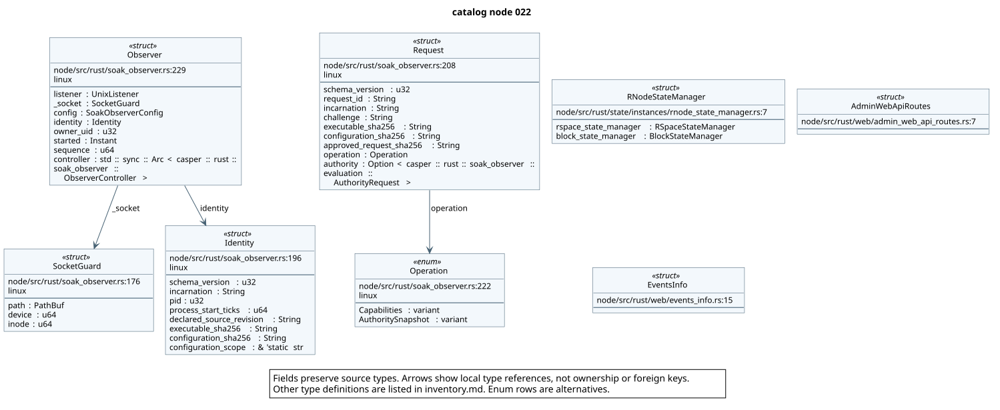

# catalog node 022

[Inventory](inventory.md) | [PlantUML](catalog-node-022.puml)

## Cardinality and Size

[Method, units, limits, and runtime evidence](sizing.md). These are declaration-level assessments, not measured live counts.

### SocketGuard

Cardinality: 0..n live values. Current count and owner-level limits are not derivable from this declaration.

Size: Sum of field inline layouts plus compiler padding, then uniquely owned allocations. repr and custom implementations can change layout.

| Field or variant | Cardinality | Inline bytes or layout | Additional storage or wire encoding |
| --- | --- | --- | --- |
| `path` | 1 value | Compiler layout required | Follow the referenced declaration or external implementation. No allocation bound established. |
| `device` | 1 scalar | 8 B | None |
| `inode` | 1 scalar | 8 B | None |

### Identity

Cardinality: 0..n live values. Current count and owner-level limits are not derivable from this declaration.

Size: Sum of field inline layouts plus compiler padding, then uniquely owned allocations. repr and custom implementations can change layout.

| Field or variant | Cardinality | Inline bytes or layout | Additional storage or wire encoding |
| --- | --- | --- | --- |
| `schema_version` | 1 scalar | 4 B | None |
| `incarnation` | 0..n UTF-8 bytes | 24 B. String header on the generator target | capacity() bytes, excluding allocator overhead. UTF-8 byte length is not character count |
| `pid` | 1 scalar | 4 B | None |
| `process_start_ticks` | 1 scalar | 8 B | None |
| `declared_source_revision` | 0..n UTF-8 bytes | 24 B. String header on the generator target | capacity() bytes, excluding allocator overhead. UTF-8 byte length is not character count |
| `executable_sha256` | 0..n UTF-8 bytes | 24 B. String header on the generator target | capacity() bytes, excluding allocator overhead. UTF-8 byte length is not character count |
| `configuration_sha256` | 0..n UTF-8 bytes | 24 B. String header on the generator target | capacity() bytes, excluding allocator overhead. UTF-8 byte length is not character count |
| `configuration_scope` | 1 borrowed reference | Pointer or fat pointer. Referent layout required | No owned allocation. Referent: 1 value |

### Request

Cardinality: 0..n live values. Current count and owner-level limits are not derivable from this declaration.

Size: Sum of field inline layouts plus compiler padding, then uniquely owned allocations. repr and custom implementations can change layout.

| Field or variant | Cardinality | Inline bytes or layout | Additional storage or wire encoding |
| --- | --- | --- | --- |
| `schema_version` | 1 scalar | 4 B | None |
| `request_id` | 0..n UTF-8 bytes | 24 B. String header on the generator target | capacity() bytes, excluding allocator overhead. UTF-8 byte length is not character count |
| `incarnation` | 0..n UTF-8 bytes | 24 B. String header on the generator target | capacity() bytes, excluding allocator overhead. UTF-8 byte length is not character count |
| `challenge` | 0..n UTF-8 bytes | 24 B. String header on the generator target | capacity() bytes, excluding allocator overhead. UTF-8 byte length is not character count |
| `executable_sha256` | 0..n UTF-8 bytes | 24 B. String header on the generator target | capacity() bytes, excluding allocator overhead. UTF-8 byte length is not character count |
| `configuration_sha256` | 0..n UTF-8 bytes | 24 B. String header on the generator target | capacity() bytes, excluding allocator overhead. UTF-8 byte length is not character count |
| `approved_request_sha256` | 0..n UTF-8 bytes | 24 B. String header on the generator target | capacity() bytes, excluding allocator overhead. UTF-8 byte length is not character count |
| `operation` | 1 value | Compiler layout required | Follow the referenced declaration or external implementation. No allocation bound established. |
| `authority` | 0..1 present payload | Option layout includes any tag or niche optimization. Do not assume I(T) + 1 | None when absent. Present payload: 1 value. Follow the referenced declaration or external implementation. No allocation bound established. |

### Operation

Cardinality: 0..n live values. Current count and owner-level limits are not derivable from this declaration.

Size: Compiler enum layout plus allocations of the active variant only. Do not sum alternative variants.

| Field or variant | Cardinality | Inline bytes or layout | Additional storage or wire encoding |
| --- | --- | --- | --- |
| `Capabilities` | 1 mutually exclusive alternative | No payload. Enum discriminant layout required | None for this unit variant |
| `AuthoritySnapshot` | 1 mutually exclusive alternative | No payload. Enum discriminant layout required | None for this unit variant |

### Observer

Cardinality: 0..n live values. Current count and owner-level limits are not derivable from this declaration.

Size: Sum of field inline layouts plus compiler padding, then uniquely owned allocations. repr and custom implementations can change layout.

| Field or variant | Cardinality | Inline bytes or layout | Additional storage or wire encoding |
| --- | --- | --- | --- |
| `listener` | 1 value | Compiler layout required | Follow the referenced declaration or external implementation. No allocation bound established. |
| `_socket` | 1 value | Compiler layout required | Follow the referenced declaration or external implementation. No allocation bound established. |
| `config` | 1 value | Compiler layout required | Follow the referenced declaration or external implementation. No allocation bound established. |
| `identity` | 1 value | Compiler layout required | Follow the referenced declaration or external implementation. No allocation bound established. |
| `owner_uid` | 1 scalar | 4 B | None |
| `started` | 1 value | Compiler layout required | Follow the referenced declaration or external implementation. No allocation bound established. |
| `sequence` | 1 scalar | 8 B | None |
| `controller` | 1 shared strong reference | Pointer or fat pointer, depending on target type | One shared allocation holds the target, counters and alignment. Count it once across all handles |

### RNodeStateManager

Cardinality: 0..n live values. Current count and owner-level limits are not derivable from this declaration.

Size: Sum of field inline layouts plus compiler padding, then uniquely owned allocations. repr and custom implementations can change layout.

| Field or variant | Cardinality | Inline bytes or layout | Additional storage or wire encoding |
| --- | --- | --- | --- |
| `rspace_state_manager` | 1 value | Compiler layout required | Follow the referenced declaration or external implementation. No allocation bound established. |
| `block_state_manager` | 1 value | Compiler layout required | Follow the referenced declaration or external implementation. No allocation bound established. |

### AdminWebApiRoutes

Cardinality: 0..n live values. Current count and owner-level limits are not derivable from this declaration.

Size: Sum of field inline layouts plus compiler padding, then uniquely owned allocations. repr and custom implementations can change layout.

| Field or variant | Cardinality | Inline bytes or layout | Additional storage or wire encoding |
| --- | --- | --- | --- |
| No declared fields | 0 field payloads | Compiler layout required | No field-owned allocations |

### EventsInfo

Cardinality: 0..n live values. Current count and owner-level limits are not derivable from this declaration.

Size: Sum of field inline layouts plus compiler padding, then uniquely owned allocations. repr and custom implementations can change layout.

| Field or variant | Cardinality | Inline bytes or layout | Additional storage or wire encoding |
| --- | --- | --- | --- |
| No declared fields | 0 field payloads | Compiler layout required | No field-owned allocations |

## Cross-Page References

- `Observer: config -> SoakObserverConfig [catalog-node-015.svg]`
- `Observer: controller -> ObserverController [catalog-casper-045.svg]`
- `RNodeStateManager: block_state_manager -> BlockStateManager [catalog-casper-049.svg]`
- `RNodeStateManager: rspace_state_manager -> RSpaceStateManager [catalog-rspacepp-018.svg]`
- `Request: authority -> AuthorityRequest [catalog-casper-046.svg]`
